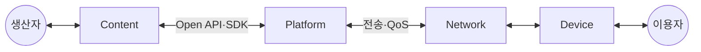

# CPND (Content, Platform, Network, Device)

---

## I. 수평적 ICT 가치사슬, CPND의 개요

### 가. 정의

- **콘텐츠(C)·플랫폼(P)·네트워크(N)·단말(D)** 이 수평적으로 연결되어 생산자와 이용자를 매개하는 ICT 생태계 [[가치사슬]] 모델

### 나. 등장 배경 및 특징

| 구분 | 내용 |
| --- | --- |
| 배경 | 스마트폰·앱스토어 등장으로 통신사 중심 폐쇄형(Walled Garden) 구조 해체 |
| 수평 분업 | 계층별로 다른 사업자가 개방형 인터페이스로 결합 |
| 공진화 | 한 요소의 발전이 다른 요소의 수요를 끌어올림 (예: 고화질 콘텐츠 ↔ 5G·고성능 단말) |
| 플랫폼 주도 | 양면 시장을 매개하는 플랫폼이 생태계 주도권 확보 |

---

## II. CPND의 구조 및 구성요소

### 가. 개념도

- 콘텐츠가 플랫폼을 통해 유통되고, 네트워크를 거쳐 다양한 단말(N-Screen)에서 소비되는 상호 의존 구조

### 나. 구성요소

| 구분 | 요소 | 설명 |
| --- | --- | --- |
| Content | VOD, 웹툰, 게임, [[메타버스]] 콘텐츠 | 가치의 원천인 디지털 재화 |
| Platform | OS, 앱스토어, OTT, 클라우드 | 공급자와 이용자를 연결하는 양면 시장, API로 참여자 확대 |
| Network | 5G·6G, [[SDN(Software Defined Network)\|SDN]]/[[NFV]], [[Wi-Fi 7]] | 콘텐츠를 단말로 전달하는 전송 인프라 |
| Device | 스마트폰, TV, IoT·XR 단말 | 이용자가 콘텐츠를 소비하는 접점 |

---

## III. 생태계 변화 비교 및 동향

### 가. 전통적 통신 생태계 vs CPND 생태계

| 구분 | 전통적 통신 생태계 | CPND 생태계 |
| --- | --- | --- |
| 구조 | 수직 통합 (통신사 일괄 제공) | 수평 분업·융합 |
| 개방성 | 폐쇄형 (Walled Garden) | 개방형 (Open API, 오픈소스) |
| 주도권 | 네트워크(N) 사업자 | 플랫폼(P)·단말(D) 사업자 |
| 수익 모델 | 통신 요금 | 플랫폼 수수료, 구독, 광고 |

### 나. 동향

- **CPND+S 확장**: 보안(Security)을 생태계 공통 기반 요소로 추가하는 관점
- **AI 결합**: 생성형 AI로 콘텐츠 제작, 온디바이스·[[EDGE|엣지]] AI로 단말·네트워크 지능화 ([[인공지능]])
- **계층 간 수직 재통합**: OTT의 오리지널 콘텐츠 제작, 빅테크의 자체 칩·단말 개발 등 영역 교차 진입 확대

---

### 🔗 연관 토픽

- **소속 도메인**: [[00_경영전략_MOC|📈 경영전략]]
- **세부 분류**: `1. 경영 환경 분석 & 전략 수립 프레임워크`
- **핵심 연관 토픽**:
  - [[가치사슬|가치사슬(Value Chain)]]
  - [[SDN(Software Defined Network)]]
  - [[NFV]]
  - [[Wi-Fi 7|WI-FI 7 (IEEE 802.11be)]]
  - [[XaaS|XaaS(Everything as a Service)]]
