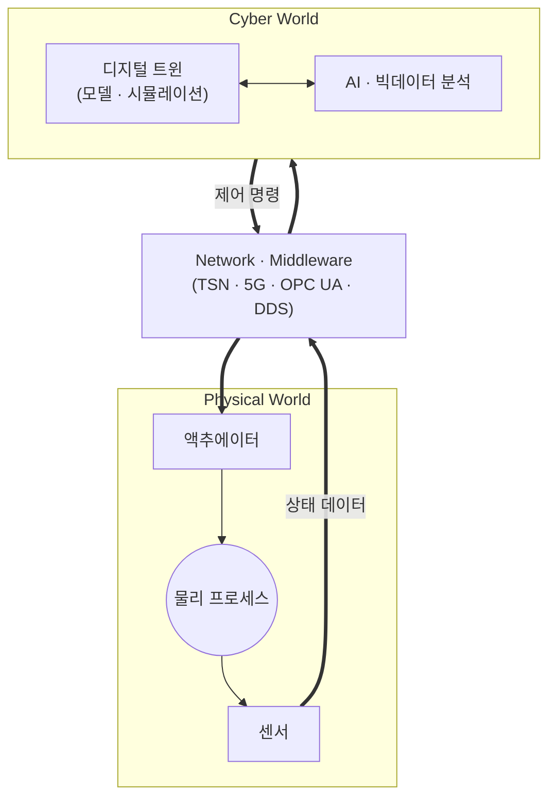

# CPS (Cyber-Physical System, 가상물리시스템)

---

## I. 사이버와 물리 세계의 실시간 융합, CPS의 개요

### 가. 정의

- 연산·통신(Cyber)을 물리 [[프로세스]](Physical)와 긴밀히 통합하여 **센서로 감지한 물리 상태를 분석하고 액추에이터로 실시간 제어하는 폐루프 시스템** (2006년 미국 NSF가 용어 정립)

### 나. 필요성 및 특징

| 구분 | 내용 |
| --- | --- |
| 필요성 | 스마트 팩토리·자율주행·스마트 그리드 등 실시간·고신뢰 제어 수요 |
| 폐루프 제어 | 센싱 → 분석 → 제어 → 다시 센싱의 지속 피드백 |
| 실시간성 · 신뢰성 | 시간 제약 준수, 장애 허용(Fault Tolerance), 기능안전 |
| 상호운용성 | 이기종 장치 간 표준 통신·[[데이터 표준화]] |
| 시스템의 시스템 | 개별 CPS가 결합해 대규모 SoS 구성 |

---

## II. 구조 및 기술요소

### 가. 구조

- 센서 데이터가 네트워크로 사이버 계층에 전달되고, 분석·최적화 결과가 액추에이터로 내려가 물리 세계를 제어

### 나. 기술요소

| 구분 | 요소 | 설명 |
| --- | --- | --- |
| 물리 계층 | 센서 / 액추에이터 | 온도·압력·위치 측정, 물리적 구동 |
| 통신 계층 | TSN | 표준 이더넷에서 전송 지연 상한을 보장하는 IEEE 802.1 표준군 |
| | OPC UA / DDS | 산업 장치 간 정보 모델·발행-구독 기반 실시간 데이터 공유 [[프로토콜]] |
| 컴퓨팅 | [[EDGE\|엣지 컴퓨팅]] | 현장 근처에서 저지연 제어 |
| 사이버 계층 | [[디지털 트윈]] | 물리 자산 상태를 가상에 동기화해 시뮬레이션 |
| | AI 분석 | 예지보전, 이상 탐지, 최적 제어 |
| 안전 · 보안 | OT 보안 · 기능안전 | 산업제어시스템(ICS) 보호(IEC 62443), [[IEC 61508]] 기반 안전 확보 |
| 참조 모델 | 5C 아키텍처 | Connection → Conversion → Cyber → Cognition → Configuration (Lee 외, 2015) |

---

## III. 비교 및 동향

### 가. IoT vs 디지털 트윈 vs CPS

| 비교 항목 | IoT | 디지털 트윈 | CPS |
| --- | --- | --- | --- |
| 핵심 목적 | 연결·데이터 수집 | 물리 대상의 가상 모델·시뮬레이션 | 사이버-물리 융합 자율 제어 |
| 데이터 흐름 | 주로 단방향 (센서 → 서버) | 양방향 동기화 | 양방향 폐루프 |
| 물리 제어 | 약함 (모니터링 중심) | 분석 결과로 간접 제어 | 액추에이터로 직접 실시간 제어 |
| 적용 | 스마트홈, 물류 추적 | 설계 검증, 운영 최적화 | 스마트 팩토리, [[Smart Car(자율주행)\|자율주행]], 로봇 |

- IoT는 연결 수단, 디지털 트윈은 사이버 측 모델, CPS는 이들을 포함한 제어 시스템 관점

### 나. 동향

- **SoS 확장**: 스마트 시티 교통·에너지망처럼 다수 CPS가 협력하는 대규모 시스템으로 확장
- **AI 기반 제어**: [[강화학습]]·[[Physical AI|물리적 AI]]로 규칙 기반 제어를 넘어 적응형 자율 제어 연구
- **보안 위협 증가**: IT/OT 융합으로 산업 제어망 공격면 확대, 제로 트러스트·OT 보안 투자 증가

---

### 🔗 연관 토픽

- **소속 도메인**: [[00_디지털서비스_MOC|🚀 디지털서비스]]
- **세부 분류**: `3. 사물인터넷 (IoT) & 스마트 플랫폼 · 메타버스`
- **핵심 연관 토픽**:
  - [[디지털 트윈|디지털 트윈 (Digital Twin)]]
  - [[Smart Factory|Smart Factory/스마트 팩토리(공장)]]
  - [[인더스트리 4.0 5.0|인더스트리 4.0 5.0 (Industry 4.0 5.0)]]
  - [[SCADA (Supervisory Control and Data Acquisition)|SCADA]]
  - [[Physical AI|물리적 AI]]
