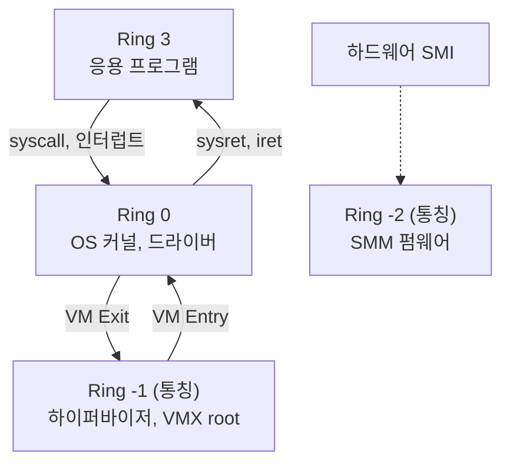

# CPU Ring Level

---

## I. 하드웨어 보호 계층, CPU Ring Level의 개요

### 가. 정의

- x86 [[CPU]]가 코드의 실행 권한을 **Ring 0(최고)~Ring 3(최저) 네 단계로 나누고, 낮은 권한 코드의 특권 명령·상위 영역 접근을 하드웨어로 차단**하는 보호 모델

### 나. 특징

| 구분 | 내용 |
| --- | --- |
| 권한 방향 | 숫자가 작을수록 높은 권한 |
| 실제 사용 | Windows·Linux는 Ring 0(커널)과 Ring 3(사용자)만 사용 |
| 통제된 진입 | 하위 → 상위 이동은 시스템 콜·인터럽트·게이트를 통해서만 |
| 확장 계층 | 하드웨어 가상화·펌웨어를 통칭 Ring -1, -2, -3으로 부름 (공식 링 번호는 아님) |

---

## II. 구조 및 구성요소

### 가. 링 구조와 전환

- 사용자 코드는 syscall로 Ring 0 진입, 게스트 커널의 민감 명령은 VM Exit로 하이퍼바이저가 처리, SMM은 하드웨어 SMI로만 진입

### 나. 구성요소

| 구분 | 요소 | 설명 |
| --- | --- | --- |
| 링 | Ring 0 | 커널, 모든 명령 실행 |
| | Ring 1·2 | 원래 드라이버·서비스용, 현대 OS는 미사용 |
| | Ring 3 | 사용자 응용, 특권 명령 실행 시 일반 보호 예외(#GP) |
| 확장 | Ring -1 | Intel VT-x·AMD-V의 [[Hypervisor (VMM)\|하이퍼바이저]] 모드 |
| | Ring -2 | SMM, 전원·펌웨어 처리 |
| | Ring -3 | Intel ME·AMD PSP 등 CPU 외부 관리 프로세서 |
| 권한 표시 | CPL | 현재 실행 권한, CS 레지스터 하위 2비트 |
| | DPL | 세그먼트·게이트 디스크립터에 지정된 요구 권한 |
| | RPL | 세그먼트 셀렉터의 요청 권한 |
| 검사 규칙 | max(CPL, RPL) ≤ DPL | 데이터 세그먼트 접근 허용 조건 |
| 페이지 보호 | U/S 비트 | 페이지 단위로 사용자·커널 접근 구분 (현대 OS의 실질 보호 수단) |

---

## III. 비교 및 동향

### 가. x86 Ring vs ARM Exception Level

| 비교 항목 | x86 | ARMv8-A |
| --- | --- | --- |
| 명칭 | Ring 0~3 | EL0~EL3 |
| 사용자 | Ring 3 | EL0 |
| 커널 | Ring 0 | EL1 |
| 하이퍼바이저 | VMX root (통칭 Ring -1) | EL2 |
| 보안 계층 | SMM, ME/PSP | EL3 Secure Monitor (TrustZone) |
| 권한 방향 | 숫자가 작을수록 높음 | 숫자가 클수록 높음 |

### 나. 동향

- **펌웨어 계층 위협**: SMM·ME 취약점과 UEFI 부트킷(BlackLotus 등) 등장으로 펌웨어 무결성 검증·Secure Boot 중요성 증가
- **커널 보호 강화**: SMEP·SMAP으로 Ring 0이 사용자 페이지 코드를 실행·접근하지 못하게 차단
- **[[기밀컴퓨팅|기밀 컴퓨팅]]**: Intel TDX·AMD SEV-SNP는 하이퍼바이저보다 높은 신뢰 계층에서 VM 메모리를 암호화·격리

---

### 🔗 연관 토픽

- **소속 도메인**: [[00_운영체제_MOC|⚙️ 운영체제]]
- **세부 분류**: `1. 프로세스 & 스레드 관리`
- **핵심 연관 토픽**:
  - [[운영체제 특권레벨|운영체제 특권레벨 (Privilege Levels)]]
  - [[커널|커널(Kernel)]]
  - [[Hypervisor (VMM)]]
  - [[가상화]]
  - [[인터럽트|인터럽트 (Interrupt)]]
