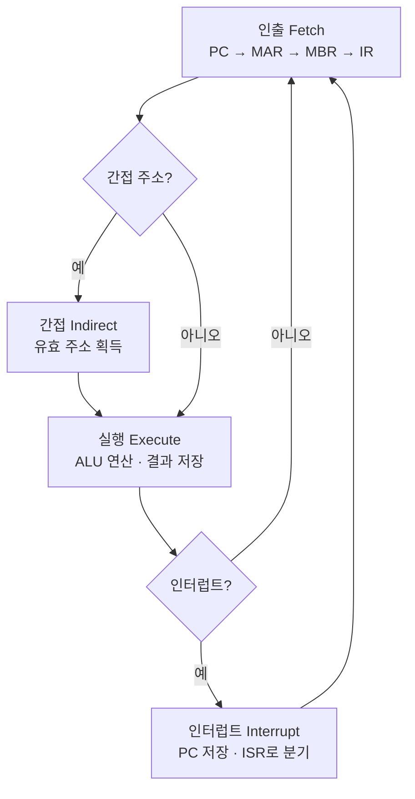

# CPU 처리과정 (Instruction Cycle)

---

## I. 인출에서 실행까지, CPU 처리과정의 개요

### 가. 정의

- [[CPU]]가 주기억장치의 명령어를 **인출·해독·실행하고 인터럽트를 확인하는 과정을 반복하는 명령어 사이클**

### 나. 특징

| 구분 | 내용 |
| --- | --- |
| 메이저 상태 | 인출(Fetch)·간접(Indirect)·실행(Execute)·인터럽트(Interrupt) 4단계 |
| 마이크로 연산 | 각 상태는 클록에 맞춰 수행되는 레지스터 전송 단위로 분해 |
| 상태 판단 | 간접 주소이면 간접 사이클, 실행 후 인터럽트가 있으면 인터럽트 사이클 |
| 성능 향상 | 파이프라이닝·슈퍼스칼라로 여러 명령의 사이클을 중첩 |

---

## II. 흐름 및 구성요소

### 가. 처리 흐름

- 하나의 명령 실행이 끝날 때마다 인터럽트 요청을 확인한 뒤 다음 명령 인출

### 나. 단계별 마이크로 연산

| 구분 | 요소 | 설명 |
| --- | --- | --- |
| 인출 | 주소 전달 | MAR ← PC |
| | 명령 읽기 | MBR ← M[MAR], PC ← PC + 1 |
| | 명령 적재 | IR ← MBR, 제어장치가 Opcode 해독 |
| 간접 | 유효 주소 | MAR ← IR(addr), MBR ← M[MAR], IR(addr) ← MBR |
| 실행 | 연산 | 예: ADD는 MAR ← IR(addr), MBR ← M[MAR], AC ← AC + MBR |
| | 플래그 | 결과에 따라 상태 레지스터(Zero·Sign·Carry·Overflow) 갱신 |
| [[인터럽트]] | 복귀 주소 저장 | MBR ← PC, MAR ← 저장 위치, M[MAR] ← MBR |
| | 분기 | PC ← ISR 시작 주소, 인터럽트 금지 플래그 설정 |

---

## III. 비교 및 동향

### 가. 처리 방식 비교

| 비교 항목 | 순차 처리 | 파이프라이닝 | 슈퍼스칼라 |
| --- | --- | --- | --- |
| 동작 | 한 명령 완료 후 다음 명령 | 단계를 나눠 여러 명령을 중첩 | 여러 파이프라인으로 동시 발행 |
| CPI | 단계 수만큼 (예: 4~5) | 이상적으로 1 | 이상적으로 1 미만 |
| 문제 | 자원 유휴 | [[Pipeline Hazard\|해저드]] (구조·데이터·제어) | 의존성 검사·하드웨어 복잡도 |
| 적용 | 초기·단순 제어기 | 대부분의 프로세서 | 고성능 CPU |

### 나. 동향

- **비순차 실행 (OoO)**: 의존성이 해결된 명령부터 실행하고 재정렬 버퍼(ROB)로 순서대로 완료
- **분기 예측 고도화**: TAGE·퍼셉트론 계열 동적 분기 예측기로 제어 해저드 손실 감소 (AMD Zen 등)

---

### 🔗 연관 토픽

- **소속 도메인**: [[00_컴퓨터구조_MOC|💻 컴퓨터구조]]
- **세부 분류**: `1. CPU 프로세서 & 마이크로아키텍처`
- **핵심 연관 토픽**:
  - [[CPU]]
  - [[명령문]]
  - [[Pipeline Hazard]]
  - [[인터럽트|인터럽트 (Interrupt)]]
  - [[DMA(Direct Memory Access)]]
