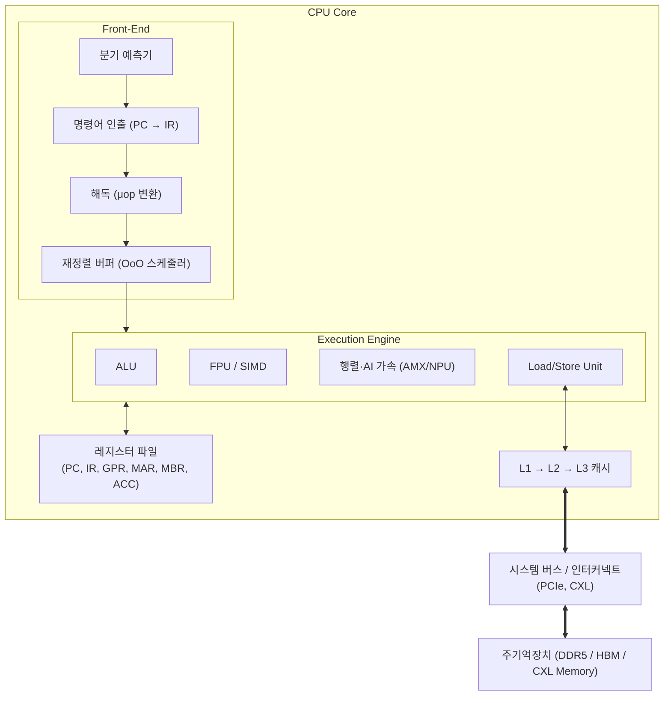

# CPU (Central Processing Unit, 중앙처리장치)

---

## I. 컴퓨터 시스템의 두뇌, CPU의 개요

### 가. CPU의 정의

- 주기억장치의 명령어를 **인출(Fetch)·해독(Decode)·실행(Execute)** 하여 데이터를 처리하고, 시스템 전체의 데이터 흐름을 제어하는 핵심 프로세서

### 나. 특징

| 구분 | 내용 |
| --- | --- |
| 저지연 직렬 처리 | 분기·문맥 교환 등 복잡한 제어 흐름과 단일 스레드 성능에 최적화 |
| 계층형 메모리 | L1/L2/L3 캐시로 프로세서–메모리 속도 차이 완화 ([[기억장치 계층 구조]]) |
| 범용성 | [[OS(운영체제)\|운영체제]]와 범용 애플리케이션 실행, CISC/RISC 명령어 집합 지원 ([[CISC vs RISC]]) |
| 구조 진화 | 무어의 법칙 둔화·전력 장벽 극복을 위해 칩렛, 이종 코어, 온칩 AI 가속으로 전환 |

---

## II. CPU 구조 및 핵심 기술

### 가. 내부 구조 및 명령어 처리 흐름

- **처리 흐름**: PC가 가리키는 명령어 인출 → IR 저장·해독 → ALU 등 실행 유닛에서 연산 → 레지스터·메모리에 결과 기록(Write-back) ([[CPU 처리과정]])

### 나. 핵심 구성요소 및 성능 향상 기술

| 구분 | 요소 | 설명 |
| --- | --- | --- |
| 핵심 장치 | ALU | 산술·논리 연산 수행 |
| | CU (제어장치) | 명령어 해독 후 각 장치에 제어 신호 발생 |
| | 레지스터 | 가장 빠른 내부 기억장치 (PC, IR, ACC, MAR, MBR, GPR) |
| 성능 향상 (ILP) | 파이프라이닝 | 명령어 단계를 분할·중첩 실행하여 처리율 향상 ([[Pipeline Hazard]]) |
| | 슈퍼스칼라 | 여러 실행 유닛으로 클럭당 다수 명령 처리 |
| | 분기 예측 | 분기 경로를 예측해 파이프라인 정지(Stall) 최소화 |
| | 비순차 실행 (OoO) | 준비된 명령부터 실행 후 재정렬 버퍼로 순서 보장 |
| 메모리 | [[캐시 메모리]], 3D V-Cache | [[지역성]] 활용 SRAM 캐시, 수직 적층으로 용량 확대 |
| 코어 구조 | 하이브리드 코어 | 고성능 P-Core + 고효율 E-Core, OS 연계 하드웨어 스케줄링 |
| AI 확장 | AMX, SME, 온칩 [[NPU]] | 행렬 연산 명령어 확장과 NPU 통합 |
| 패키징 | [[칩렛]] & UCIe | 기능별 다이를 분리 제작 후 2.5D/3D로 결합 |
| 인터커넥트 | [[CXL]], PCIe 5.0/6.0 | 가속기 간 [[캐시 일관성]]·메모리 풀링 지원 |

---

## III. CPU vs GPU 비교 및 발전 동향

### 가. CPU vs GPU

| 비교 항목 | CPU | [[GPU]] |
| --- | --- | --- |
| 설계 철학 | 지연 시간 최소화 (Low Latency) | [[처리량]] 극대화 (High Throughput) |
| 코어 구조 | 소수의 고성능 대형 코어 | 수천 개 이상의 단순 코어 |
| 칩 면적 배분 | 캐시와 제어 로직 비중 큼 | 연산 유닛(ALU) 비중 큼 |
| 실행 모델 | SISD/SIMD, 직렬 중심 | SIMT, 대규모 병렬 |
| 메모리 | DDR5, LPDDR5X (저지연) | HBM, GDDR7 (고대역폭) |
| 주요 용도 | OS, [[데이터베이스]], 비즈니스 로직 | 그래픽, [[딥러닝]] 학습·추론 |

### 나. 발전 동향

- **SoC / XPU 통합**: CPU·GPU·NPU를 단일 칩·패키지에 통합해 [[온디바이스 AI]] 지원
- **Post-Von Neumann**: DPU로 네트워크·스토리지 처리를 오프로드하고 [[PIM]]으로 메모리 내 연산 확대
- **후면 전력 공급(BSPDN)**: 신호선과 전력선을 웨이퍼 앞뒤로 분리해 전압 강하를 줄이고 클럭 향상 (인텔 PowerVia 등)

---

### 🔗 연관 토픽

- **소속 도메인**: [[00_컴퓨터구조_MOC|💻 컴퓨터구조]]
- **세부 분류**: `1. CPU 프로세서 & 마이크로아키텍처`
- **핵심 연관 토픽**:
  - [[GPU]]
  - [[NPU|NPU(Neural Processing Unit)]]
  - [[CPU 처리과정]]
  - [[캐시 메모리]]
  - [[CXL|CXL (Compute Express Link)]]
