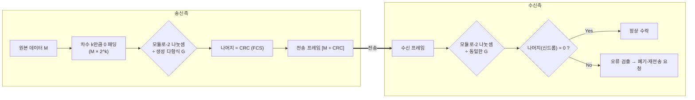

# CRC (Cyclic Redundancy Check, 순환중복검사)

---

## I. 전송 데이터의 무결성 검증, CRC의 개요

### 가. CRC의 정의

- 송신측이 **생성 다항식으로 모듈로-2 나눗셈한 나머지(FCS)를 데이터 뒤에 붙여** 보내고, 수신측이 같은 다항식으로 나누어 나머지가 0인지 확인하여 오류를 검출하는 기법

### 나. 특징

| 구분 | 내용 |
| --- | --- |
| 높은 검출력 | 모든 단일 비트 오류와 다항식 차수 이하 길이의 군집 오류(Burst Error) 검출 |
| 하드웨어 구현 용이 | 시프트 레지스터와 XOR 게이트만으로 고속 처리 (NIC에서 오프로딩) |
| 낮은 오버헤드 | 짧은 FCS(16·32bit)만 추가 |
| 범용성 | 이더넷 FCS, Wi-Fi, USB, SATA/NVMe 등에 표준 적용 |

---

## II. CRC 동작 원리 및 핵심 요소

### 가. 생성 및 검증 과정

### 나. 핵심 구성요소

| 구분 | 요소 | 설명 |
| --- | --- | --- |
| 연산 | 모듈로-2 연산 | 자리올림·빌림 없는 이진 연산, XOR로 구현 |
| 제수 | 생성 다항식 | 송수신측이 사전 합의 (CRC-16, CRC-32: IEEE 802.3) |
| 검증값 | FCS (Frame Check Sequence) | 프레임 트레일러에 붙는 CRC 값 |
| 판정 | 신드롬 (Syndrome) | 수신측 나눗셈 나머지, 0이면 정상 |
| 하드웨어 | 시프트 레지스터 (LFSR) | 플립플롭 + XOR로 클럭당 1비트씩 나눗셈 |
| 한계 | 비암호학적 검사 | 우발적 오류 검출용, 의도적 변조는 막지 못함 → [[HMAC]] 등 메시지 인증 코드 필요 |

---

## III. 오류 검출 기법 비교 및 활용

### 가. 패리티 vs 체크섬 vs CRC

| 비교 항목 | 패리티 검사 | 체크섬 | CRC |
| --- | --- | --- | --- |
| 원리 | 1의 개수를 홀·짝으로 맞춤 | 블록 단위 합의 1의 보수 | 다항식 모듈로-2 나눗셈 |
| 검출 능력 | 낮음 (짝수 개 오류 미검출) | 보통 (순서 바뀐 오류 등 한계) | 매우 높음 (버스트 오류 우수) |
| 구현 | 매우 단순 | 소프트웨어 용이 | 하드웨어 고속 처리 |
| 적용 | UART, 메모리 | [[TCP]]/UDP/IP 헤더 | 이더넷, Wi-Fi, USB, 스토리지 |

### 나. 활용 및 동향

- **하드웨어 오프로딩**: 10G 이상 이더넷에서 NIC가 CRC를 전담해 [[CPU]] 부하 감소, PCIe 6.0·800G 이더넷 등 초고속 인터페이스에 필수
- **보안과의 결합**: CRC는 무결성 검증만 담당하므로, 위변조 방지가 필요하면 해시·HMAC 기반 검증과 함께 사용
- 오류 검출 후 재전송은 BEC(ARQ)로 처리 ([[FEC(Forward Error Correction) BEC(Backward Error Correction)]])

---

### 🔗 연관 토픽

- **소속 도메인**: [[00_네트워크_MOC|🌐 네트워크]]
- **세부 분류**: `1. OSI 7계층 & 데이터링크 계층 (L1/L2)`
- **핵심 연관 토픽**:
  - [[FEC(Forward Error Correction) BEC(Backward Error Correction)]]
  - [[해밍코드]]
  - [[데이터 링크 계층|데이터 링크 계층 (Data Link Layer)]]
  - [[HMAC|HMAC (Hash-based Message Authentication Code)]]
  - [[TCP]]
