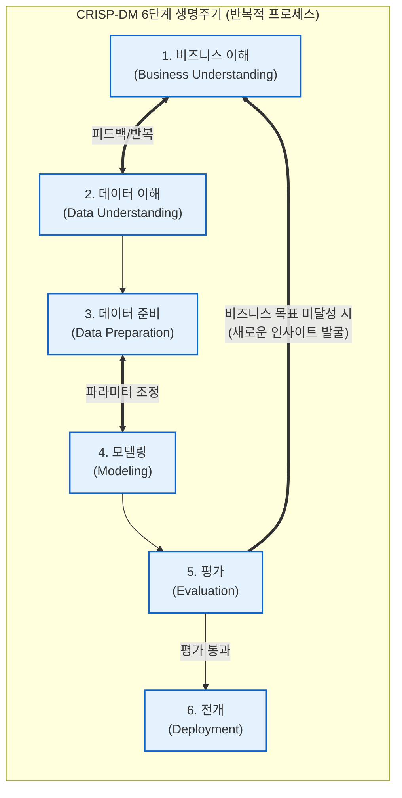

# CRISP-DM (Cross Industry Standard Process for Data Mining)

---

## I. 데이터 마이닝의 범용 표준 프로세스, CRISP-DM의 개요

### 가. 정의

- 비즈니스에 대한 깊은 이해를 바탕으로 데이터 마이닝 및 AI 프로젝트의 전체 라이프사이클을 6단계로 체계화한 계층적이고 반복적인 산업 교차 표준 프로세스 모델

### 나. 주요 특징

| 구분 | 주요 내용 |
| --- | --- |
| 비즈니스 중심성 | 단순 기술적 데이터 분석에 매몰되지 않고 최초 정의된 비즈니스 목표 달성 여부를 최종 성공 척도로 간주 |
| 양방향 피드백 루프 | 단계별 순차 진행에 머무르지 않고 데이터 이해-준비-모델링 간 상호 피드백을 통한 지속적 개선 수행 |
| 4레벨 계층적 구조 | 단계(Phases) $\to$ 일반 과제(Tasks) $\to$ 세부 과제(Specialized Tasks) $\to$ 프로세스 실행의 체계적 하향식 구조 |
| 산업 중립적 개방성 | 특정 분석 도구나 산업 도메인에 종속되지 않는 범용 표준으로 다양한 비즈니스 분석 환경에 적용 가능 |

## II. CRISP-DM의 개념도 및 핵심 구성 요소

### 가. CRISP-DM의 수행 프로세스 개념도

* 프로세스는 단방향으로 흐르지 않고, 특정 단계(예: 비즈니스 이해 ↔ 데이터 이해, 데이터 준비 ↔ 모델링)에서 필요에 따라 이전 단계로 돌아가는 강한 피드백 루프(Feedback Loop)를 가짐

### 나. CRISP-DM의 핵심 프로세스 및 구조 (6단계)

| 구분 (단계) | 요소기술(키워드) | 세부 설명 |
| --- | --- | --- |
| **1. 비즈니스 이해** | 프로젝트 목표 설정 | 현업의 요구사항을 파악하고, 비즈니스 관점의 목표를 데이터 마이닝 목표로 변환 |
| **1. 비즈니스 이해** | 프로젝트 계획 수립 | 초기 가설 설정, 필요한 자원 평가 및 단계별 수행 계획(Project Plan) 수립 |
| **2. 데이터 이해** | 데이터 탐색 ([[EDA]]) | 초기 데이터를 수집하고 속성을 파악하며, 데이터 품질 및 인사이트 사전 검증 |
| **3. 데이터 준비** | 데이터 정제 및 변환 | 분석 기법에 적합하도록 [[결측치]]/[[이상치]] 제거, 파생 변수 생성 및 포맷팅 (전체 프로젝트의 70~80% 시간 소요) |
| **4. 모델링** | [[알고리즘]] 선택/튜닝 | 머신러닝/통계 기반의 최적 모델링 기법 선택 및 하이퍼파라미터 조정을 통한 모델 학습 |
| **4. 모델링** | 모델 평가 (기술적) | 과적합(Overfitting) 방지 및 모델의 정확도, 재현율 등 데이터 마이닝 관점의 성능 평가 |
| **5. 평가** | 비즈니스 목표 부합성 | 모델링 결과가 최초 '비즈니스 이해' 단계에서 설정한 목적과 비즈니스 기대효과를 충족하는지 종합 검토 |
| **6. 전개** | 시스템 적용 및 모니터링 | 완성된 모델을 실제 운영(Production) 환경에 적용하고, 성능 저하 감시 및 [[유지보수]] 계획 수립 |

---

## III. CRISP-DM과 유사 데이터 마이닝 방법론 비교

### 가. 3대 데이터 분석 방법론(CRISP-DM, SEMMA, KDD) 비교

| 비교 항목 | CRISP-DM | SEMMA | KDD (Knowledge Discovery in DB) |
| --- | --- | --- | --- |
| **제창 기관** | 5개사 컨소시엄 (SPSS, NCR 등) | SAS Institute | Fayyad (학계 중심) |
| **접근 관점** | **비즈니스 목적 달성** 중심 | **통계적 모델링 및 분석** 중심 | **[[데이터베이스]] 프로파일링** 중심 |
| **프로세스 수** | 6단계 (계층적, 반복적) | 5단계 (순차적 중심) | 5단계 (순차적, 반복적) |
| **단계 구성** | 비즈니스 이해 → 데이터 이해 → 데이터 준비 → 모델링 → 평가 → 전개 | Sample(추출) → Explore(탐색) → Modify(수정) → Model(모델링) → Assess(평가) | Selection(선택) → Preprocessing(전처리) → Transformation(변환) → [[데이터 마이닝\|Data Mining]](마이닝) → Interpretation(해석/평가) |
| **주요 특징** | 산업 중립적, 피드백 루프 강조, 가장 널리 사용되는 범용적 표준 | SAS 솔루션(Enterprise Miner)에 최적화, 전개(Deployment) 단계 명시 안됨 | 학술적 데이터 마이닝 연구의 근간, 패턴 인식 및 해석에 집중 |

### 나. CRISP-DM의 현대적 진화 및 향후 전망

- **MLOps 파이프라인과의 통합 진화**: 전개(Deployment) 단계 이후의 모델 성능 저하 및 데이터 드리프트 감시를 위해 [[MLOps]]의 지속적 학습(CT)과 배포(CD) 파이프라인으로 체계적 연계 확장
- **애자일(Agile) 분석 방법론과의 융합**: 대규모 폭포수 방식의 긴 분석 주기를 극복하기 위해 2~4주 단위의 스프린트 반복과 프로토타입 빠른 출시를 지향하는 애자일 데이터 과학과 융합
- **생성형 AI 및 Data-Centric AI 체계로의 적응**: 비정형 텍스트 및 멀티모달 데이터를 수용하기 위해 데이터 준비 단계에서 청킹, 임베딩, 벡터화 등 [[AI Ready Data]] 구축 프로세스로 진화 발전

---

### 🔗 연관 토픽

- **소속 도메인**: [[00_인공지능_MOC|🤖 인공지능]]
- **세부 분류**: `2. 머신러닝 기초 & 핵심 알고리즘`
- **핵심 연관 토픽**:
  - [[결측치]]
  - [[이상치]]
  - [[데이터 마이닝|Data Mining (데이터 마이닝)]]
  - [[인공지능]]
  - [[MLOps]]
