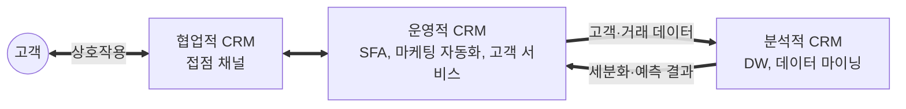

# CRM (Customer Relationship Management)

---

## I. 고객 생애 가치를 관리하는, CRM의 개요

### 가. 정의

- 고객과의 모든 접점 데이터를 통합·분석해 **고객 획득·유지·수익성(LTV)을 높이는** 경영 전략이자 이를 지원하는 정보시스템

### 나. 필요성 및 특징

| 구분 | 내용 |
| --- | --- |
| 필요성 | 신규 고객 획득 비용 증가 → 기존 고객 유지(Retention)의 가치 상승 |
| 고객 중심 | 제품·거래 중심에서 고객 관계·생애 가치 중심으로 전환 |
| 개인화 | 고객 세분화·예측 분석으로 맞춤 마케팅·서비스 |
| 옴니채널 | 매장·웹·앱·콜센터 등 접점 간 일관된 고객 경험 |

---

## II. CRM의 구조 및 구성요소

### 가. CRM 아키텍처

- 접점(협업적)에서 생긴 데이터가 업무 시스템(운영적)을 거쳐 분석(분석적)되고, 분석 결과가 다시 영업·마케팅 활동에 반영되는 순환 구조

### 나. 구성요소

| 구분 | 요소 | 설명 |
| --- | --- | --- |
| 운영적 CRM | SFA (Sales Force Automation) | 영업 기회 발굴 → 수주까지 파이프라인 관리 |
| | 마케팅 자동화 (EMA) | 캠페인 기획, 타깃 추출, 다채널 실행·성과 측정 |
| | 고객 서비스 (CSS) | 콜센터·헬프데스크, VOC·A/S 처리 |
| 분석적 CRM | RFM 분석 | 최근성·빈도·금액으로 고객 가치 평가 |
| | [[데이터 마이닝]]·ML | 이탈 예측, 교차·상향 판매 모델 |
| | DW·데이터 레이크 | 흩어진 고객 데이터의 통합 저장소 |
| 협업적 CRM | 옴니채널 | 채널 간 고객 이력 공유, 끊김 없는 응대 |
| 플랫폼 | SaaS CRM | 멀티테넌트 구독형 (예: Salesforce, Dynamics 365, HubSpot) |

---

## III. CRM 진화 비교 및 동향

### 가. 전통적 CRM vs 소셜 CRM vs AI CRM

| 구분 | 전통적 CRM | 소셜 CRM | AI CRM |
| --- | --- | --- | --- |
| 목적 | 내부 업무 자동화, 거래 분석 | 고객 소통·평판 관리 | 행동 예측, 개인화 자동화 |
| 데이터 | 정형 (구매 이력, 인적 사항) | 비정형 (SNS, 리뷰) | 멀티모달 (음성, 텍스트, 로그) |
| 소통 | 기업 → 고객 단방향 | 양방향 참여 | 실시간·상황 기반 선제 대응 |
| 핵심 기술 | RDBMS, RFM | 텍스트 마이닝, SNA | 생성형 AI, [[딥러닝]] 예측 |

### 나. 동향

- **AI 에이전트 내장**: Salesforce Agentforce, Microsoft Copilot 등 [[초거대 언어 모델|LLM]] 기반 에이전트가 상담 응대·메일 초안·영업 기회 요약 수행
- **CDP 연계**: 서드파티 쿠키 차단(Safari·Firefox)과 개인정보 규제 강화로 퍼스트파티 데이터를 통합하는 CDP와 CRM 결합
- **VRM 관점 등장**: 고객이 기업과의 관계를 직접 관리하는 [[의도 경제]] 모델이 CRM의 대응 개념으로 논의

---

### 🔗 연관 토픽

- **소속 도메인**: [[00_경영전략_MOC|📈 경영전략]]
- **세부 분류**: `1. 경영 환경 분석 & 전략 수립 프레임워크`
- **핵심 연관 토픽**:
  - [[고객여정지도]]
  - [[데이터 마이닝|Data Mining (데이터 마이닝)]]
  - [[의도 경제|의도 경제(Intention Economy)]]
  - [[SCM (Supply Chain Management)]]
  - [[초거대 언어 모델|초거대 언어 모델(Large Language Model)]]
