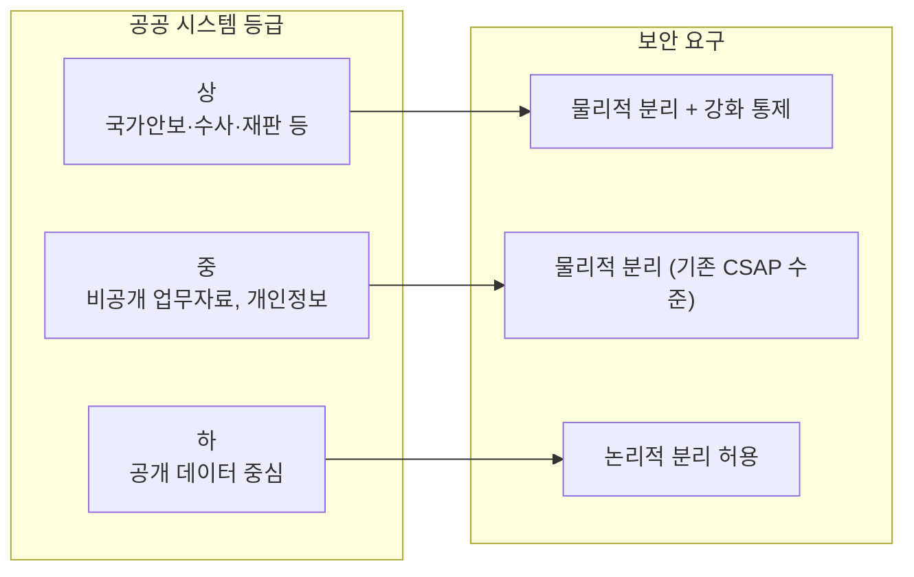

# CSAP (Cloud Security Assurance Program)

---

## I. 공공 클라우드 도입의 관문, CSAP의 개요

### 가. 정의

- 공공기관이 이용하는 **민간 클라우드 서비스가 정보보호 기준을 충족하는지 평가·인증**하는 제도로, 과기정통부 고시에 근거하여 KISA가 운영 (클라우드컴퓨팅법 근거)

### 나. 특징

| 구분 | 내용 |
| --- | --- |
| 목적 | 공공부문 민간 클라우드 이용 확대와 공공 데이터 보호 |
| 등급제 | 2023년 개정으로 상·중·하 등급 도입 |
| 망분리 차등 | 하 등급은 논리적 분리 허용, 상·중은 물리적 분리 |
| 서비스 유형 | IaaS, SaaS(표준·간편), DaaS |
| 평가 영역 | 관리적·물리적·기술적 보호조치와 공공기관용 추가 보호조치 |

---

## II. 등급 체계 및 평가 구성

### 가. 등급별 요구 구조

- 공공기관이 시스템 등급을 정하면 해당 등급 이상의 CSAP 인증을 받은 클라우드 서비스를 이용

### 나. 평가 구성

| 구분 | 요소 | 설명 |
| --- | --- | --- |
| 관리적 | 정책·조직, 인적 보안 | 정보보호 정책, 책임자 지정, 교육 |
| | 자산 관리·사고 대응 | 자산 식별, 침해사고 대응 체계 |
| 물리적 | 데이터센터 보안 | 출입 통제, 재해 대비, 국내 소재 |
| 기술적 | [[가상화]] 보안 | 하이퍼바이저·테넌트 격리 |
| | 접근 통제·[[암호화]] | 계정·권한 관리, 저장·전송 암호화 (검증필 암호모듈) |
| 공공기관 추가 | 망 분리·국정원 보안 요구 | 공공 이용자 영역 분리, 보안 관제 연계 |
| 유형 | IaaS | 서버·스토리지·네트워크 격리 |
| | SaaS 표준·간편 | 응용 수준 보안, 간편은 위험 낮은 서비스 대상 |
| | DaaS | 가상 데스크톱 단말·매체 통제 |

---

## III. 비교 및 동향

### 가. 등급별 비교

| 비교 항목 | 하 | 중 | 상 |
| --- | --- | --- | --- |
| 대상 정보 | 개인정보 미포함 공개 데이터 | 비공개 업무자료 | 국가안보·수사 등 민감 정보 |
| 망 분리 | 논리적 분리 허용 | 물리적 분리 | 물리적 분리 + 강화 |
| 데이터 위치 | 국내 | 국내 | 국내 |
| 보안 기준 | 완화 | 기존 CSAP 기준 | 추가 강화 통제 |

### 나. 동향

- **해외 사업자 진입 여지**: 하 등급 논리적 분리 허용으로 글로벌 [[CSP]]의 공공 시장 진입 경로 마련
- **SaaS 확산**: 공공 SaaS 전환 정책으로 SaaS 표준·간편 인증 수요 증가
- **국제 정합성**: [[ISO 27017]]·[[ISO 27018]] 등 국제 클라우드 보안 기준과의 정합성 요구

---

### 🔗 연관 토픽

- **소속 도메인**: [[00_보안_MOC|🛡️ 보안]]
- **세부 분류**: `1. 정보보안 원칙 & 거버넌스 · 인증`
- **핵심 연관 토픽**:
  - [[CSP|CSP (Cloud Service Provider)]]
  - [[ISO 27017]]
  - [[ISMS-P]]
  - [[클라우드 컴퓨팅 취약점 및 대응기술]]
  - [[국가 망 보안체계|국가 망 보안체계(N2SF)]]
