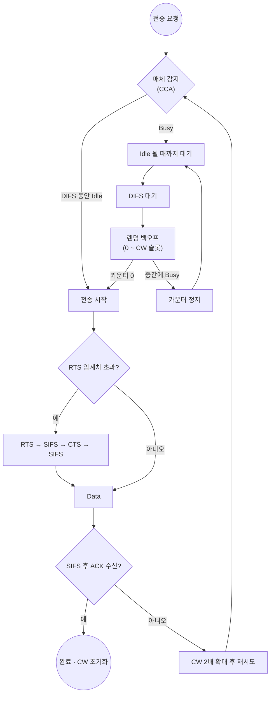

# CSMA/CA (Carrier Sense Multiple Access with Collision Avoidance)

---

## I. 감지할 수 없으니 피한다, CSMA/CA의 개요

### 가. 정의

- 충돌 감지가 어려운 무선 환경에서 **매체 감지, IFS 대기, 랜덤 백오프로 충돌을 미리 회피하고 ACK로 전송 성공을 확인**하는 IEEE 802.11 무선랜의 매체 접근 제어(MAC) 방식 (DCF)

### 나. 등장 배경 및 특징

| 구분 | 내용 |
| --- | --- |
| 충돌 감지 불가 | 송신 신호가 수신 신호보다 훨씬 강해 송신 중 충돌을 감지하기 어려움 |
| 은닉 단말 | 서로 신호가 닿지 않는 단말이 같은 AP에 동시 전송 |
| 충돌 회피 | IFS·랜덤 백오프로 동시 전송 확률 감소 |
| 가상 캐리어 센싱 | NAV로 다른 단말의 예약 시간 동안 대기 |
| 명시적 확인 | 모든 유니캐스트 데이터에 ACK, 미수신 시 충돌·오류로 간주 |

---

## II. 동작 구조 및 구성요소

### 가. DCF 동작 절차

- RTS/CTS는 프레임이 RTS 임계치보다 클 때 선택적으로 사용하며, CTS를 들은 주변 단말은 NAV를 설정해 은닉 단말 충돌을 줄임

### 나. 구성요소

| 구분 | 요소 | 설명 |
| --- | --- | --- |
| 감지 | CCA (물리 캐리어 센싱) | 신호 에너지·프리앰블 검출로 Idle/Busy 판단 |
| | NAV (가상 캐리어 센싱) | 프레임 Duration 필드로 매체 사용 예정 시간 설정 |
| 시간 | IFS | SIFS(ACK·CTS) < PIFS(PCF) < DIFS(일반 데이터) < EIFS, 짧을수록 우선 |
| 회피 | 랜덤 백오프 | 0~CW 사이 임의 슬롯 수만큼 대기, Busy면 정지 후 재개 |
| | CW (Contention Window) | 실패 시 CWmin → CWmax까지 2배씩 증가 |
| 예약 | RTS / CTS | 짧은 제어 프레임으로 채널 예약, 은닉 단말 완화 |
| 확인 | ACK | 수신 성공 통지, 없으면 재전송 |
| 우선순위 | EDCA (802.11e) | 접근 카테고리(음성·영상·일반·배경)별 AIFS·CW 차등 |

---

## III. 비교 및 동향

### 가. CSMA/CD vs CSMA/CA

| 비교 항목 | [[CSMA CD\|CSMA/CD]] | CSMA/CA |
| --- | --- | --- |
| 적용 | 반이중 유선 이더넷 (802.3) | 무선랜 (802.11) |
| 충돌 대응 | 발생 후 감지·중단 | 발생 전 회피 |
| 주요 기법 | Jam 신호, 이진 지수 백오프 | IFS, 랜덤 백오프, NAV, RTS/CTS, ACK |
| 성공 확인 | 충돌 미감지로 성공 간주 | ACK로 확인 |
| 오버헤드 | 낮음 | 높음 (IFS, ACK, 제어 프레임) |
| 고유 문제 | 케이블 길이·최소 프레임 크기 제약 | 은닉 단말, 노출 단말 |

### 나. 동향

- **스케줄 기반 접근 결합**: Wi-Fi 6(802.11ax)부터 AP가 OFDMA 자원 단위(RU)를 할당하는 Trigger 기반 상향 전송으로 경쟁 감소
- **공간 재사용**: BSS Coloring으로 인접 BSS 신호를 구분해 불필요한 대기 감소
- **[[Wi-Fi 8]]**: 다중 AP 협력과 우선순위 채널 접근으로 경쟁 기반 접근의 꼬리 지연 완화

---

### 🔗 연관 토픽

- **소속 도메인**: [[00_네트워크_MOC|🌐 네트워크]]
- **세부 분류**: `1. OSI 7계층 & 데이터링크 계층 (L1/L2)`
- **핵심 연관 토픽**:
  - [[CSMA CD|CSMA/CD]]
  - [[데이터 링크 계층|데이터 링크 계층 (Data Link Layer)]]
  - [[Wi-Fi 7|WI-FI 7 (IEEE 802.11be)]]
  - [[Wi-Fi 8]]
  - [[MIMO]]
