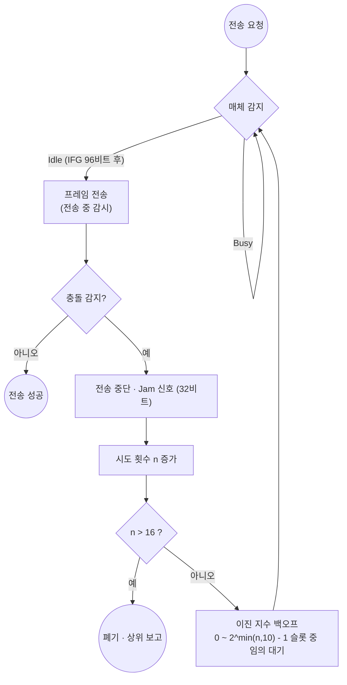

# CSMA/CD (Carrier Sense Multiple Access with Collision Detection)

---

## I. 듣고 말하고, 부딪히면 멈추는, CSMA/CD의 개요

### 가. 정의

- 공유 매체 이더넷(IEEE 802.3)에서 **매체가 비었는지 확인 후 전송하고, 전송 중 충돌을 감지하면 즉시 중단·Jam 신호 전송 후 이진 지수 백오프로 재전송**하는 매체 접근 제어(MAC) 방식

### 나. 특징

| 구분 | 내용 |
| --- | --- |
| LBT · LWT | 전송 전 감지(Listen Before Talk), 전송 중 감지(Listen While Talk) |
| 적용 환경 | 버스형·허브 기반 반이중(Half-Duplex) 이더넷 |
| 1-persistent | 매체가 Idle이 되면 바로 전송 시도 |
| 충돌 감지 | 송신 중 신호 레벨 변화로 충돌 인지 |
| 최소 프레임 | 충돌을 송신 중에 감지하기 위해 64바이트 이상 프레임 필요 |

---

## II. 동작 구조 및 구성요소

### 가. 동작 절차

- 충돌한 노드들이 서로 다른 임의 시간을 기다려 재충돌 확률을 낮추고, 충돌이 반복될수록 대기 범위를 2배씩 넓힘 (10회 이후 고정, 16회 실패 시 폐기)

### 나. 구성요소

| 구분 | 요소 | 설명 |
| --- | --- | --- |
| 감지 | Carrier Sense | 전송 전 매체의 신호 유무 확인 |
| 접근 | Multiple Access | 여러 노드가 같은 매체를 경쟁 사용 |
| 충돌 | Collision Detection | 송신 중 신호 레벨 비교로 충돌 인지 |
| | Jam 신호 | 충돌을 모든 노드가 확실히 인지하도록 보내는 32비트 신호 |
| 재전송 | BEB (이진 지수 백오프) | n번째 충돌 후 0~2^min(n,10)−1 슬롯 중 임의 대기 |
| 시간 | 슬롯 타임 | 최대 왕복 지연 기준 512비트 시간 → 최소 프레임 64바이트 |
| | IFG (Inter-Frame Gap) | 프레임 사이 최소 간격 96비트 시간 |

---

## III. 비교 및 동향

### 가. CSMA/CD vs CSMA/CA

| 비교 항목 | CSMA/CD | [[CSMA CA\|CSMA/CA]] |
| --- | --- | --- |
| 매체 | 유선 (802.3) | 무선 (802.11) |
| 충돌 대응 | 사후 감지·복구 | 사전 회피 |
| 성공 판단 | 충돌 미감지 | ACK 수신 |
| 제어 오버헤드 | 적음 (Jam 외 추가 프레임 없음) | 큼 (IFS, ACK, RTS/CTS) |

### 나. 동향

- **스위치드 이더넷**: 스위치가 포트마다 충돌 도메인을 분리해 충돌 자체가 발생하지 않음
- **전이중 전환**: 전이중 링크에서는 CSMA/CD를 사용하지 않음. 1000BASE-T까지는 반이중 규격이 있었으나 10GbE 이상은 전이중만 정의
- **흐름 제어 중심**: 현대 이더넷 MAC은 PAUSE·PFC 기반 흐름 제어에 집중

---

### 🔗 연관 토픽

- **소속 도메인**: [[00_네트워크_MOC|🌐 네트워크]]
- **세부 분류**: `1. OSI 7계층 & 데이터링크 계층 (L1/L2)`
- **핵심 연관 토픽**:
  - [[CSMA CA|CSMA/CA]]
  - [[데이터 링크 계층|데이터 링크 계층 (Data Link Layer)]]
  - [[스위치]]
  - [[OSI 7 Layer|OSI 7 Layer (ISO 7498)]]
  - [[다중화]]
