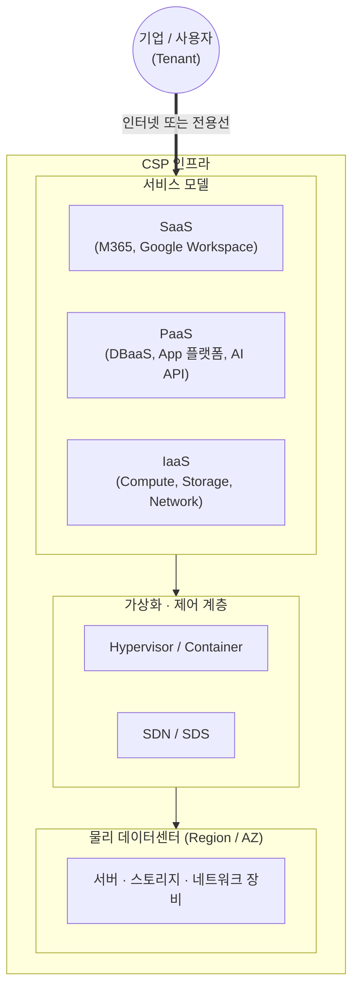

# CSP (Cloud Service Provider)

---

## I. 클라우드 자원을 빌려주는 사업자, CSP의 개요

### 가. 정의

- 데이터센터의 서버·스토리지·네트워크·소프트웨어 등 **[[클라우드 컴퓨팅]] 자원을 인터넷으로 제공하고 사용량에 따라 과금**하는 사업자 (AWS, Azure, Google Cloud, 네이버클라우드 등)

### 나. 특징

| 구분 | 내용 |
| --- | --- |
| 등장 배경 | 초기 IT 투자(CapEx) 부담 완화, 민첩성 요구, 온프레미스 [[유지보수]] 부담 감소 |
| 자원 풀링 | 대규모 물리 자원을 가상화하여 다수 테넌트에 논리적으로 분할 제공 |
| 탄력성 | 수요에 따른 자원 확장·축소 |
| 셀프서비스 | 콘솔·API로 즉시 [[프로비저닝]] |
| 공동 책임 모델 | 인프라 보안은 CSP, 데이터·계정·설정은 이용자 책임 |

---

## II. 서비스 구조 및 제공 기술

### 가. 서비스 구조

- 이용자는 IaaS·[[PaaS]]·SaaS 중 목적에 맞는 서비스를 선택하고, 하부 [[가상화]] 인프라와 데이터센터 운영은 CSP가 담당

### 나. 제공 기술

| 구분 | 요소 | 설명 |
| --- | --- | --- |
| 서비스 모델 | IaaS | [[CPU]]·메모리·스토리지 등 가상 인프라 제공 (예: AWS EC2) |
| | PaaS | [[OS(운영체제)\|OS]]·미들웨어·런타임 등 개발·실행 환경 제공 |
| | SaaS | 웹으로 구독하여 쓰는 완제품 소프트웨어 |
| 기반 기술 | 가상화 · [[컨테이너]] | [[Hypervisor (VMM)\|하이퍼바이저]]·[[도커\|Docker]] 기반 자원 분할·격리 |
| | [[SDN(Software Defined Network)\|SDN]] / [[NFV]] | 네트워크 제어의 소프트웨어화 |
| | 오케스트레이션 | [[쿠버네티스\|Kubernetes]] 등으로 배포·확장 자동화 |
| 보안 | [[IAM]] / CSPM | 접근 권한 제어, 클라우드 설정 오류·컴플라이언스 점검 |
| 확장 | [[XaaS]] | 서버리스(FaaS), DBaaS, AI 모델 API([[초거대 언어 모델\|LLM]]) 등 |

---

## III. 비교 및 동향

### 가. CSP vs MSP

| 비교 항목 | CSP | MSP (Managed Service Provider) |
| --- | --- | --- |
| 역할 | 클라우드 인프라·서비스 자체 제공 | 클라우드 도입 컨설팅·구축·마이그레이션·운영 대행 |
| 인프라 소유 | 데이터센터(Region/AZ) 직접 보유 | 보유하지 않고 고객의 CSP 자원 관리 |
| 비용 | 사용량 기반 요금 | 운영 수수료, 비용 최적화(FinOps) 서비스 |
| 대표 기업 | AWS, Azure, Google Cloud, 네이버클라우드, KT클라우드 | 메가존클라우드, 베스핀글로벌, 삼성SDS, LG CNS |

### 나. 동향

- **소버린 클라우드**: 데이터 주권 요구로 현지 법·규제를 따르는 격리 리전 확대, 국내 공공은 [[CSAP]] 인증 필요
- **AI 플랫폼 경쟁**: Amazon Bedrock, Google Vertex AI, Azure AI Foundry 등 생성형 AI 모델 API·학습 인프라 제공 경쟁
- **자체 칩**: AWS Graviton·Trainium, Google TPU 등 CSP 자체 설계 프로세서로 비용·성능 차별화

---

### 🔗 연관 토픽

- **소속 도메인**: [[00_디지털서비스_MOC|🚀 디지털서비스]]
- **세부 분류**: `1. 클라우드 컴퓨팅 & 가상화 인프라`
- **핵심 연관 토픽**:
  - [[클라우드 컴퓨팅|클라우드 컴퓨팅 (Cloud Computing)]]
  - [[XaaS|XaaS(Everything as a Service)]]
  - [[CSAP|CSAP, CSAP(Cloud Security Assurance Program)]]
  - [[멀티클라우드|멀티클라우드 (Multi-Cloud)]]
  - [[클라우드 컴퓨팅의 배치 모델 유형]]
