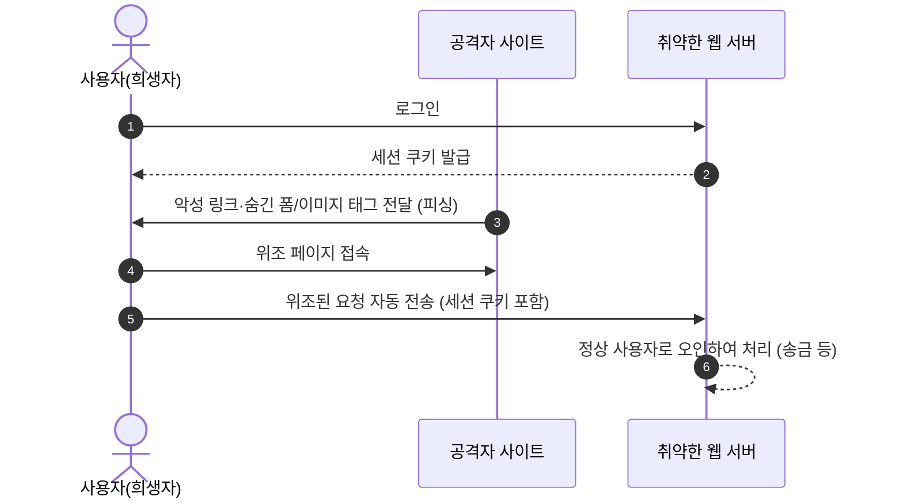

# CSRF (Cross-Site Request Forgery, 사이트 간 요청 위조)

---

## I. 인증된 사용자의 권한을 도용하는 공격, CSRF의 개요

### 가. CSRF의 정의

- 로그인된 사용자가 **자신의 의지와 무관하게 공격자가 의도한 요청(송금, 비밀번호 변경, 탈퇴 등)을 취약한 웹 서버에 보내도록** 만드는 웹 공격 기법

### 나. 발생 원인 및 특징

| 구분 | 내용 |
| --- | --- |
| [[쿠키]] 자동 전송 악용 | 브라우저는 요청 시 해당 도메인의 [[세션]] 쿠키를 자동으로 첨부 |
| 서버의 신뢰 악용 | 서버는 쿠키만으로 정상 요청과 위조 요청을 구분하지 못함 |
| 상태 변경 목적 | 정보 탈취보다 서버 데이터를 변경하는 [[트랜잭션]]이 목표 |
| 예측 가능한 요청 | 요청 URL·파라미터 구조를 공격자가 쉽게 알 수 있을 때 성립 |

---

## II. 공격 메커니즘 및 방어 기술

### 가. 공격 흐름

### 나. 방어 기술

| 구분 | 기술 | 설명 |
| --- | --- | --- |
| 토큰 검증 | Anti-CSRF Token (Synchronizer Token) | 폼마다 예측 불가능한 일회성 토큰을 넣고 서버 세션 값과 비교 |
| | Double Submit Cookie | 토큰을 쿠키와 요청 파라미터에 함께 실어 일치 여부를 비교 (서버 상태 불필요) |
| 쿠키 제어 | SameSite 속성 | Strict(동일 사이트만), Lax(안전한 최상위 GET만)로 크로스 사이트 요청 시 쿠키 전송 차단 |
| 헤더 검증 | Referer / Origin 검증 | 요청 출처가 허용 도메인인지 확인 |
| | Fetch Metadata (Sec-Fetch-Site) | 브라우저가 제공하는 출처 정보로 cross-site 요청 차단 |
| | Custom Header | [[AJAX]]·API 요청에 커스텀 헤더 강제 (외부 도메인은 CORS로 제한) |
| 인증 강화 | 재인증, CAPTCHA, 2FA | 송금·계정 변경 등 중요 작업 시 사용자 확인 |
| 연계 방어 | XSS 차단 + CSP(Content Security Policy) | XSS가 있으면 토큰이 탈취되어 CSRF 방어가 무력화됨 |

---

## III. XSS와의 비교 및 동향

### 가. CSRF vs XSS

| 비교 항목 | CSRF | [[XSS]] |
| --- | --- | --- |
| 공격 대상 | 웹 서버 (상태 변경) | 사용자 브라우저 |
| 악용하는 신뢰 | 서버가 브라우저를 신뢰 | 사용자가 웹사이트를 신뢰 |
| 목적 | 권한 도용, 무단 송금·변경 | 쿠키 탈취, 악성 스크립트 실행 |
| 원인 | 쿠키 자동 전송 | 입력값 검증·출력 인코딩 미흡 |
| 대응 | CSRF 토큰, SameSite, Origin 검증 | 입력 필터링, 출력 인코딩, CSP |

### 나. 동향

- **SameSite=Lax 기본 적용**: 주요 브라우저가 기본값을 Lax로 바꾸면서 전통적 CSRF 위험이 크게 감소
- **토큰 기반 인증 확산**: 쿠키 대신 Authorization 헤더(JWT, Bearer)를 쓰는 SPA·API 구조에서는 CSRF 표적이 줄어듦
- **심층 방어**: 서브도메인 탈취 등 우회 가능성이 있으므로 [[프레임워크]] 내장 CSRF 토큰, 엄격한 CORS, XSS 방어를 함께 적용 (서버 측 위조는 [[SSRF(Server-Side Request Forgery)\|SSRF]] 참고)

---

### 🔗 연관 토픽

- **소속 도메인**: [[00_보안_MOC|🛡️ 보안]]
- **세부 분류**: `2. 현대 암호학 & 키 관리 · 전자서명`
- **핵심 연관 토픽**:
  - [[XSS]]
  - [[쿠키]]
  - [[세션]]
  - [[SSRF(Server-Side Request Forgery)]]
  - [[OWASP Top 10 2025]]
