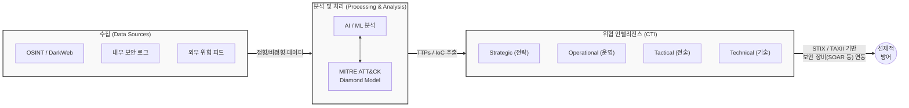

# CTI (Cyber Threat Intelligence)

---

## I. 지능형 사이버 위협에 대한 선제적 방어 체계, CTI의 개요

### 가. CTI(Cyber Threat Intelligence)의 정의
사이버 공격과 관련된 다양한 데이터와 정보를 수집·분석하여 공격자의 의도, 목적, TTPs(전술·기술·절차)를 식별하고 능동적인 선제 방어를 지원하는 지능형 위협 정보다.

### 나. CTI의 필요성 및 주요 특징
| 구분 | 내용 |
| --- | --- |
| **필요성** | 사후 침해 대응(Reactive)의 한계를 극복하고, 고도화된 APT 공격 및 제로데이 위협에 대한 사전 예방(Proactive) 체계 구축 필요 |
| **증거 기반 분석** | 실제 침해 지표(IoC) 및 공격 행위 패턴(TTPs) 중심의 객관적 증거 수집·분석 |
| **전략·전술 연계** | C-Level 의사결정부터 SOC 보안 장비 자동 룰 적용까지 다계층 인텔리전스 제공 |
| **표준화된 공유** | STIX/TAXII 국제 표준 규격을 통한 조직 간 신속한 위협 정보 교환 및 자동화 연동 |

## II. CTI의 개념도 및 핵심 기술 요소

### 가. CTI의 정보 처리 아키텍처 및 라이프사이클 개념도

* 다양한 출처에서 원시 데이터를 수집하여 분석 프레임워크를 통해 컨텍스트를 부여하고, 이를 계층별 보안 관계자(C-Level, SOC 분석가 등)에게 맞춤형 인텔리전스로 배포하여 방어 체계에 즉각 적용함

### 나. CTI의 핵심 기술 및 구성 요소

| 구분 | 요소기술(키워드) | 세부 설명 |
| --- | --- | --- |
| **분석 [[프레임워크]]** | [[MITRE ATT&CK (Adversarial Tactics, Techniques & Common Knowledge)\|MITRE ATT&CK]] | 해커의 공격 과정을 전술(Tactics), 기술(Techniques), 절차(Procedures)로 분류한 글로벌 지식 기반 프레임워크 |
| **분석 프레임워크** | Diamond Model | 사이버 공격을 공격자(Adversary), 인프라(Infra), 피해자(Victim), 역량(Capability)의 4대 요소로 모델링하는 기법 |
| **위협 지표** | IoC (Indicator of Compromise) | 침해사고의 징후를 나타내는 기술적 식별 지표 (예: 악성 IP, 악성코드 해시값, C&C 서버 도메인 등) |
| **위협 지표** | TTPs | 공격자의 전략, 기술, 절차를 의미하며, 단순 IoC 차단을 넘어선 공격자의 근본적인 행위 기반 패턴 지표 |
| **공유 표준** | STIX | 사이버 위협 정보를 구조화된 언어로 표현하기 위한 [[XML]]/[[JSON]] 기반의 국제 표준 규격 (OASIS 표준) |
| **공유 표준** | TAXII | STIX로 작성된 위협 인텔리전스 정보를 시스템 간에 실시간으로 안전하게 교환하기 위한 전송 [[프로토콜]] |
| **CTI 레벨(유형)** | 전략적/운영적 CTI | C-Level의 비즈니스 리스크 의사결정 지원(전략적), 보안 매니저의 위협 캠페인 분석 및 헌팅 수행(운영적) |
| **CTI 레벨(유형)** | 전술적/기술적 CTI | SOC 분석가의 TTPs 중심 방어(전술적), 실무 보안 장비(FW, IPS)에 적용되는 단기적 IoC 정보 차단(기술적) |

---

## III. 전통적 보안 체계와의 비교 및 CTI의 향후 전망

### 가. 전통적 보안 대응과 CTI 기반 보안 대응 비교

| 비교 항목 | 전통적 보안 체계 | CTI 기반 보안 체계 |
| --- | --- | --- |
| **대응 방식** | 사후 대응적 (Reactive) 및 이벤트 중심 | 사전 예방적 (Proactive) 및 컨텍스트 중심 |
| **주요 방어 대상** | 알려진 위협 (Signature 기반 탐지) | 알려지지 않은 위협, 제로데이, APT 공격 방어 |
| **핵심 식별 지표** | IP 주소, 파일 해시 (수명이 짧은 지표) | TTPs, 공격자 인프라/도구 (수명이 길고 우회하기 어려운 지표) |
| **정보의 고도화** | 단편적인 보안 로그 및 알림(Alert) 위주 | 데이터 상관관계 분석을 통한 실행 가능한(Actionable) 지식 |

### 나. 주요 동향 및 발전 전망
* **생성형 AI 융합 (AI-Driven CTI)**: 거대언어모델([[초거대 언어 모델|LLM]]) 기반으로 다크웹 및 비정형 위협 보고서를 실시간 요약·분석하여 TTPs 자동 추출 및 [[위협 헌팅|위협 헌팅(Threat Hunting)]] 시간 단축
* **SOAR 기반 능동형 자동 대응**: 수집된 CTI를 [[SIEM]] 및 [[SOAR (Security Orchestration, Automation and Response)|SOAR]] 플레이북과 연계하여 탐지 즉시 방화벽 차단 및 엔드포인트 격리까지 무인 자동화 수행
* **CTEM(지속적 위협 노출 관리) 프레임워크 연계**: 단순 외부 위협 인텔리전스 수집에 그치지 않고, 조직 내부 공격 표면 관리(ASM)와 결합하여 실제 침해 위험성이 높은 자산을 선별 방어

---

### 🔗 연관 토픽

- **소속 도메인**: [[00_보안_MOC|🛡️ 보안]]
- **세부 분류**: `3. 네트워크 & 엔드포인트 · 인프라 보안`
- **핵심 연관 토픽**:
  - [[위협 헌팅|위협 헌팅(Threat Hunting)]]
  - [[SIEM]]
  - [[SOAR (Security Orchestration, Automation and Response)]]
  - [[CVE]]
  - [[샌드박스|샌드박스 (Sandbox)]]
