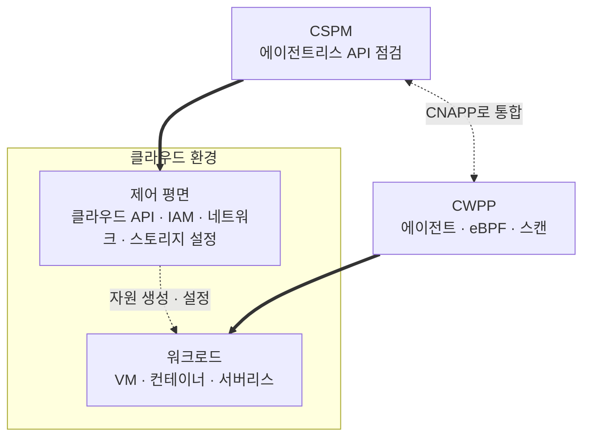

# CWPP와 CSPM

---

## I. 설정과 실행을 함께 지키는, CWPP·CSPM의 개요

### 가. 정의

- **CSPM**: 클라우드 계정·서비스의 **설정 오류와 규정 위반을 API로 지속 점검하고 교정**하는 보안 형상 관리 솔루션
- **CWPP**: VM·[[컨테이너]]·서버리스 등 **실행 중인 워크로드의 취약점과 런타임 위협을 탐지·차단**하는 워크로드 보호 솔루션

### 나. 필요성

| 구분 | 내용 |
| --- | --- |
| 설정 오류 | 공개 스토리지, 과도한 권한 등 사람의 실수가 클라우드 사고의 주요 원인 |
| 공동 책임 모델 | 설정·워크로드 보안은 고객 책임 영역 |
| 동적 자원 | 수시로 생성·삭제되는 워크로드에 기존 보안 도구 적용 한계 |
| 멀티 클라우드 | 여러 CSP의 상이한 설정을 통합 관리할 필요 |

---

## II. 적용 구조 및 구성요소

### 가. 보호 영역

- CSPM은 클라우드 API로 설정을 밖에서 점검하고, CWPP는 워크로드 내부에서 실행 행위를 감시

### 나. 구성요소

| 구분 | 요소 | 설명 |
| --- | --- | --- |
| CSPM | 설정 오류 탐지 | 공개 버킷, 열린 포트, 과도 권한 탐지·자동 교정 |
| | 컴플라이언스 점검 | CIS 벤치마크, ISMS-P, PCI DSS 기준 지속 평가 |
| | 자산 인벤토리 | 멀티 클라우드 자원 자동 식별 |
| CWPP | 런타임 보호 | 비정상 프로세스·네트워크 행위 탐지·차단 |
| | 취약점 관리 | OS·라이브러리·컨테이너 이미지 스캔 |
| | 마이크로 [[세그멘테이션]] | 워크로드 간 통신 최소화 |
| | 무결성 모니터링 (FIM) | 핵심 파일 무단 변경 탐지 |

---

## III. 비교 및 동향

### 가. CSPM vs CWPP

| 비교 항목 | CSPM | CWPP |
| --- | --- | --- |
| 질문 | 어떻게 설정되었는가 | 무엇이 실행되고 있는가 |
| 보호 영역 | 제어 평면, 클라우드 설정 | 워크로드 내부 |
| 방식 | 에이전트리스, 정적 점검 | 에이전트 기반 런타임 감시 (일부 에이전트리스 스캔) |
| 성격 | 예방 | 탐지·대응 |
| 주요 위협 | 설정 오류, 규정 위반 | 악성코드, 취약점 악용, 횡적 이동 |

### 나. 동향

- **CNAPP 통합**: CSPM·CWPP·CIEM·IaC 스캔을 하나로 통합한 플랫폼 (Gartner 제시)
- **시프트 레프트**: IaC(Terraform 등)·이미지 스캔을 CI/CD에 넣어 배포 전 차단 ([[DevSecOps]])
- **위험 우선순위화**: 설정·취약점·권한·노출 경로를 그래프로 연결해 실제 공격 가능 경로 중심으로 조치

---

### 🔗 연관 토픽

- **소속 도메인**: [[00_보안_MOC|🛡️ 보안]]
- **세부 분류**: `1. 정보보안 원칙 & 거버넌스 · 인증`
- **핵심 연관 토픽**:
  - [[클라우드 컴퓨팅 취약점 및 대응기술]]
  - [[CSAP|CSAP, CSAP(Cloud Security Assurance Program)]]
  - [[DevSecOps]]
  - [[SecaaS (Security as a Service)]]
  - [[컨테이너|컨테이너 (Container)]]
