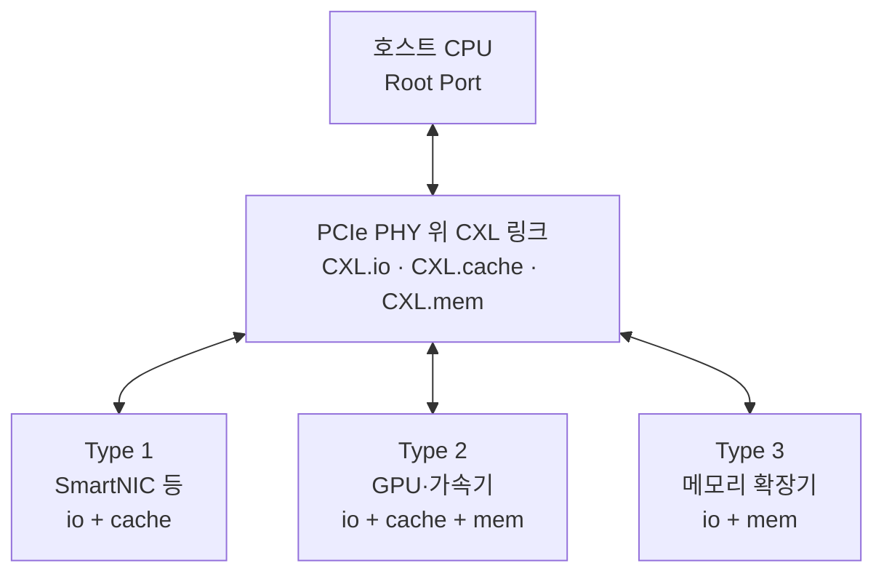

# CXL (Compute Express Link)

---

## I. PCIe 위의 캐시 일관성 인터커넥트, CXL의 개요

### 가. 정의

- PCIe 물리 계층 위에서 [[CPU]]와 가속기·메모리 장치 간 **[[캐시 일관성]]을 유지하며 메모리를 공유·확장하는 개방형 인터커넥트 표준** (2019년 1.0)

### 나. 필요성 및 특징

| 구분 | 내용 |
| --- | --- |
| 필요성 | AI·인메모리 워크로드의 메모리 용량·대역폭 부족, 서버별 메모리 고립(Stranded Memory) |
| 캐시 일관성 | 가속기가 호스트 메모리를 일관성 있게 캐싱, 데이터 복사 감소 |
| PCIe 재사용 | PCIe PHY·커넥터 사용, 링크 협상으로 PCIe/CXL 모드 선택 |
| 자원 유연화 | 메모리 확장·풀링·공유로 TCO 절감 |

---

## II. 구조 및 구성요소

### 가. 구조

- 장치 종류에 따라 세 하위 [[프로토콜]]을 조합해 사용

### 나. 구성요소

| 구분 | 요소 | 설명 |
| --- | --- | --- |
| 프로토콜 | CXL.io | PCIe와 같은 트랜잭션, 장치 탐색·설정·DMA (필수) |
| | CXL.cache | 장치가 호스트 메모리를 일관성 있게 캐싱 |
| | CXL.mem | 호스트가 장치 메모리를 Load/Store로 직접 접근 |
| 물리 계층 | PCIe PHY | CXL 1.1·2.0은 PCIe 5.0(32GT/s), 3.x는 PCIe 6.0(64GT/s) |
| 자원 공유 | 메모리 풀링 (2.0~) | 스위치를 통해 여러 호스트가 메모리 풀을 나눠 할당 |
| | 메모리 공유 (3.0~) | 여러 호스트가 같은 메모리 영역을 일관성 있게 공유 |
| 네트워크 | CXL 스위치·패브릭 | 2.0 단일 계층 스위치, 3.0 다단 스위치·패브릭·P2P |
| 보안 | IDE (Integrity and Data Encryption) | 링크 구간 데이터의 기밀성·무결성 보호 (2.0~) |

---

## III. 비교 및 동향

### 가. 장치 유형 비교

| 비교 항목 | Type 1 | Type 2 | Type 3 |
| --- | --- | --- | --- |
| 프로토콜 | io + cache | io + cache + mem | io + mem |
| 장치 메모리 | 없음 (캐시만) | 있음 (HDM) | 메모리가 주 기능 |
| 동작 | 호스트 메모리를 캐싱 | 호스트·장치 메모리 양방향 일관성 | 호스트가 확장 메모리로 사용 |
| 사례 | SmartNIC | GPU, FPGA, AI 가속기 | CMM(CXL Memory Module), 메모리 풀 |

### 나. 동향

- **세대 진화**: 2.0(2020, 스위칭·풀링) → 3.0(2022, PCIe 6.0·패브릭·공유) → 3.1·3.2 → 4.0(2025, PCIe 7.0 기반 128GT/s)
- **메모리 확장 상용화**: 삼성·SK hynix·Micron의 CXL 메모리 모듈과 Intel Xeon·AMD EPYC의 CXL 지원으로 [[HBM]]·DDR 외 용량 계층 확보
- **분리형 인프라**: CPU·메모리·가속기를 분리해 필요에 따라 조합하는 컴포저블 데이터센터로 확장

---

### 🔗 연관 토픽

- **소속 도메인**: [[00_컴퓨터구조_MOC|💻 컴퓨터구조]]
- **세부 분류**: `1. CPU 프로세서 & 마이크로아키텍처`
- **핵심 연관 토픽**:
  - [[캐시 일관성|캐시 일관성(Cache Coherence)]]
  - [[PCI Express (Peripheral Component Interconnect Express)]]
  - [[HBM|HBM (High Bandwidth Memory)]]
  - [[메모리 인터리빙]]
  - [[CPU|중앙처리장치 (CPU Central Processing Unit)]]
