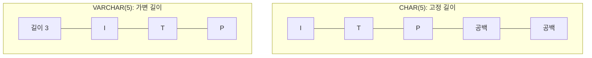

# Char Type (문자형)

---

## I. 문자 하나 또는 고정 길이 문자열, Char Type의 개요

### 가. 정의

- 프로그래밍 언어에서는 **문자 하나를 저장하는 기본 자료형**(C의 1바이트 char, Java의 2바이트 UTF-16 char), DBMS에서는 **선언한 길이만큼 공간을 고정 할당하는 문자열 타입 CHAR(n)**

### 나. 특징

| 구분 | 내용 |
| --- | --- |
| 문자 = 정수 코드 | 문자를 문자 집합의 코드값(ASCII, Unicode)으로 저장, 정수 연산 가능 |
| 크기 | C 1바이트(signed/unsigned 여부는 구현 정의), Java 2바이트, Rust 4바이트(Unicode 스칼라) |
| DB 고정 길이 | CHAR(n)은 짧은 값도 n 길이로 저장, 남는 자리를 공백으로 채움 |
| 용도 | 길이가 일정한 코드값(Y/N, 국가 코드, 고정 길이 해시 문자열) |

---

## II. 저장 구조 및 구성요소

### 가. CHAR(5)와 VARCHAR(5)에 'ITP' 저장

- CHAR는 선언 길이만큼 확보하고 우측을 공백으로 채우며, VARCHAR는 실제 길이와 길이 정보만 저장

### 나. 구성요소

| 구분 | 요소 | 설명 |
| --- | --- | --- |
| 프로그래밍 char | 코드값 저장 | 'A'는 65(0x41)로 저장, 'A' + 1 = 'B' |
| | 문자 집합 | ASCII(7비트), Unicode(UTF-8·UTF-16·UTF-32 인코딩) |
| | 부호 | C에서 char의 부호 여부는 컴파일러마다 다름, signed/unsigned char로 명시 |
| DB CHAR | 고정 길이 할당 | 데이터 길이와 무관하게 n 길이 확보 |
| | Right Padding | 남는 자리를 공백으로 채움 |
| | 공백 무시 비교 | 비교 시 뒤쪽 공백을 무시 (Blank-Padded Comparison, DBMS별 상이) |
| | 길이 단위 | 바이트 기준 또는 문자 기준 (예: Oracle BYTE/CHAR 의미 지정) |
| | 제자리 갱신 | 길이가 변하지 않아 행 이주(Row Migration) 위험 낮음 |

---

## III. 비교 및 동향

### 가. CHAR vs VARCHAR

| 비교 항목 | CHAR | VARCHAR |
| --- | --- | --- |
| 저장 | 선언 길이만큼 고정 | 실제 길이 + 길이 정보(1~2바이트) |
| 공백 채움 | 있음 | 없음 |
| 갱신 | 길이 불변, 행 크기 고정 | 길어지면 행 이주·체이닝 가능 |
| 공간 효율 | 길이가 일정하면 우수, 가변이면 낭비 | 가변 길이에 유리 |
| 적합 데이터 | 코드, 플래그, 고정 길이 식별자 | 이름, 주소, 제목 등 가변 텍스트 |

### 나. 동향

- **Unicode 기본화**: UTF-8이 사실상 표준 인코딩이 되며 "1문자 = 1바이트" 가정이 깨짐, 문자 기준 길이 지정과 [[String Type]] 처리 중요
- **압축 저장**: 컬럼형 DW·RDBMS의 블록 압축으로 CHAR 공백 낭비가 줄어, 저장 효율보다 데이터 성격(고정·가변)에 맞는 타입 선언이 중요

---

### 🔗 연관 토픽

- **소속 도메인**: [[00_컴퓨터구조_MOC|💻 컴퓨터구조]]
- **세부 분류**: `2. 캐시 & 메모리 계층 구조 · 스토리지`
- **핵심 연관 토픽**:
  - [[String Type]]
  - [[Data Type]]
  - [[Int Type]]
  - [[변수]]
  - [[데이터베이스]]
