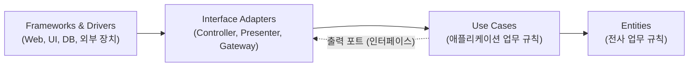

# Clean Architecture

---

## I. 의존성은 안쪽으로만, Clean Architecture의 개요

### 가. 정의

- 시스템을 동심원 계층으로 나누고 **소스 코드 의존성이 바깥(세부 사항)에서 안쪽(업무 규칙)으로만 향하게 하여** 업무 규칙을 프레임워크·UI·DB로부터 독립시키는 아키텍처 (Robert C. Martin, 2012)

### 나. 특징

| 구분 | 내용 |
| --- | --- |
| 등장 배경 | 프레임워크·DB에 강결합된 시스템의 변경·테스트 곤란 |
| 독립성 | [[프레임워크]]·UI·DB·외부 에이전시와 무관하게 업무 규칙 유지 |
| 테스트 용이 | 외부 요소 없이 엔티티·유스케이스 단독 테스트 |
| 교체 용이 | 업무 규칙 변경 없이 UI·DB 교체 |

---

## II. 계층 구조 및 구성요소

### 가. 계층 구조와 의존성 규칙

- 실선은 소스 코드 의존 방향으로 항상 안쪽을 향하며, 유스케이스가 바깥(DB·Presenter)을 호출해야 할 때는 안쪽에 정의한 포트 인터페이스를 바깥이 구현(DIP)

### 나. 구성요소

| 구분 | 요소 | 설명 |
| --- | --- | --- |
| 계층 | 엔티티 | 전사 핵심 업무 규칙, 변화에 가장 둔감한 안쪽 계층 |
| | 유스케이스 | 애플리케이션 고유 업무 규칙, 엔티티로의 데이터 흐름 조율 |
| | 인터페이스 어댑터 | 유스케이스와 외부 간 데이터 형식 변환 (Controller, Presenter, Gateway) |
| | 프레임워크 · 드라이버 | DB·웹 프레임워크·UI 등 세부 사항 |
| 원칙 | 의존성 규칙 | 안쪽 계층은 바깥 계층의 이름조차 알지 못함 |
| | 의존성 역전 (DIP) | 바깥으로 향하는 호출은 안쪽에 정의한 인터페이스로 역전 |
| 경계 | 입력 · 출력 포트 | 유스케이스 경계를 정의하는 인터페이스 (Boundary) |
| | 경계 데이터 | 경계를 넘을 때 DB 행 객체 대신 단순 DTO 사용 |

---

## III. 비교 및 동향

### 가. 도메인 중심 아키텍처 비교

| 비교 항목 | Clean Architecture | Hexagonal (Ports & Adapters) | Onion Architecture |
| --- | --- | --- | --- |
| 제안자 | Robert C. Martin (2012) | Alistair Cockburn (2005) | Jeffrey Palermo (2008) |
| 메타포 | 동심원 4계층 | 육각형 내부와 포트·어댑터 | 양파 계층 |
| 경계 표현 | 입력·출력 포트(Boundary) | 주도(Driving)·피주도(Driven) 포트 | 도메인 서비스 인터페이스 |
| 공통점 | 도메인을 중심에 두고 인프라를 바깥으로 밀어내 DIP로 격리 | | |

### 나. 동향

- [[MSA (Micro Service Architecture)|MSA]]·[[DDD (Domain Driven Design)|DDD]]와 결합해 서비스 내부 도메인을 보호하는 기본 구조로 활용
- Android·iOS에서 [[MVVM (Model, View, View Model)|MVVM]]과 결합한 계층 분리 구조로 확산
- 소규모 시스템에서는 계층·매핑 코드가 과도해지므로 적용 범위 판단 필요

---

### 🔗 연관 토픽

- **소속 도메인**: [[00_소프트웨어공학_MOC|🏗️ 소프트웨어공학]]
- **세부 분류**: `2. 애자일(Agile) & 지속적 통합/배포(CI/CD)`
- **핵심 연관 토픽**:
  - [[객체지향 설계 원리]]
  - [[DDD (Domain Driven Design)]]
  - [[소프트웨어 아키텍처 스타일]]
  - [[데메테르의 법칙|데메테르의 법칙 (Law of Demeter)]]
  - [[MSA (Micro Service Architecture)]]
