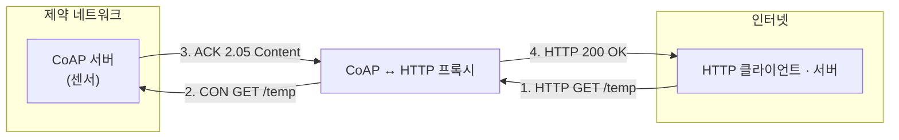

# CoAP (Constrained Application Protocol)

---

## I. 작은 기기를 위한 가벼운 웹, CoAP의 개요

### 가. 정의

- 메모리·전력이 제한된 IoT 기기와 저전력 손실망(LLN)을 위해 **UDP 위에서 REST 방식(GET·POST·PUT·DELETE, URI)을 제공하는 경량 웹 전송 [[프로토콜]]** (IETF RFC 7252)

### 나. 특징

| 구분 | 내용 |
| --- | --- |
| 등장 배경 | HTTP의 텍스트 헤더와 [[TCP]] 연결 오버헤드가 소형 센서에 부담 |
| UDP · 경량 헤더 | 4바이트 고정 바이너리 헤더, 연결 설정 없음 |
| REST 호환 | HTTP와 같은 메서드·URI·응답 코드 체계, 프록시로 HTTP와 변환 |
| 자체 [[신뢰성]] | CON 메시지 + ACK, 지수 백오프 재전송 |
| 멀티캐스트 | UDP 기반이라 그룹 요청·리소스 탐색 가능 |

---

## II. 구조 및 구성요소

### 가. CoAP–HTTP 연동 구조

- 프록시가 HTTP 요청을 CoAP로 바꿔 센서에 전달하고, 센서는 ACK에 응답을 실어(Piggyback) 회신

### 나. 구성요소

| 구분 | 요소 | 설명 |
| --- | --- | --- |
| 메시지 타입 | CON (Confirmable) | ACK가 필요한 신뢰 전송, 미수신 시 재전송 |
| | NON (Non-confirmable) | ACK 없는 전송, 주기적 센서 값 |
| | ACK · RST | CON 수신 확인, 처리 불가 시 리셋 |
| 계층 | 메시지 계층 / 요청·응답 계층 | UDP 신뢰성·중복 제거 / REST 의미 처리 |
| 보안 | DTLS · OSCORE | UDP용 TLS, 메시지 단위 [[암호화]] (프록시 경유 E2E 보호) |
| 확장 | Observe (RFC 7641) | 리소스를 구독하면 변경 시 서버가 통지 |
| | Block-wise (RFC 7959) | 큰 페이로드를 블록으로 나눠 전송 |
| 탐색 | Resource Discovery | `/.well-known/core`로 제공 리소스 조회 (CoRE Link Format) |

---

## III. 비교 및 동향

### 가. CoAP vs MQTT

| 비교 항목 | CoAP | [[MQTT (Message Queuing Telemetry Transport)\|MQTT]] |
| --- | --- | --- |
| 통신 모델 | 클라이언트-서버 (REST) | Publish-Subscribe (브로커) |
| 전송 계층 | UDP | TCP |
| 신뢰성 | CON / NON | [[QoS]] 0·1·2 |
| 보안 | DTLS, OSCORE | TLS |
| 최소 헤더 | 4바이트 | 2바이트 |
| 적합 분야 | 기기 제어·관리 (LwM2M), 원격 검침 | 텔레메트리 수집, 다대다 메시징 |

### 나. 동향

- **LwM2M 기반 기기 관리**: OMA LwM2M의 전송 프로토콜로 NB-IoT·LTE-M 원격 검침·스마트시티에 활용
- **Thread·Matter 생태계**: Thread 메시망의 관리 메시지에 CoAP 사용 ([[매터]])

---

### 🔗 연관 토픽

- **소속 도메인**: [[00_네트워크_MOC|🌐 네트워크]]
- **세부 분류**: `1. OSI 7계층 & 데이터링크 계층 (L1/L2)`
- **핵심 연관 토픽**:
  - [[MQTT (Message Queuing Telemetry Transport)]]
  - [[XMPP]]
  - [[매터]]
  - [[TCP 와 UDP 비교]]
  - [[네트워크 프로토콜|네트워크 프로토콜 (Network Protocol)]]
