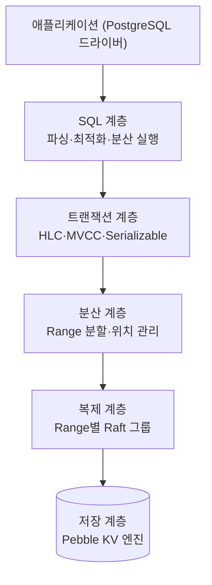

# CockroachDB (코크로치DB)

---

## I. 죽지 않는 분산 SQL, CockroachDB의 개요

### 가. 정의

- Raft 합의 기반 복제와 Serializable 트랜잭션을 제공하며 **노드·지역 장애에도 서비스를 유지하도록 설계된 분산 SQL([[New SQL|NewSQL]]) 데이터베이스** (Cockroach Labs, PostgreSQL 호환)

### 나. 특징

| 구분 | 내용 |
| --- | --- |
| 수평 확장 | 노드 추가만으로 데이터·부하 자동 재분배 |
| 강한 일관성 | 기본 격리 수준 Serializable, 분산 ACID [[트랜잭션]] |
| 생존성 | Range별 3중 이상 복제, 노드·AZ·리전 장애 허용 |
| 호환성 | PostgreSQL 와이어 프로토콜·SQL 문법 호환 |

---

## II. 아키텍처 및 구성요소

### 가. 계층 구조

- SQL을 Key-Value 연산으로 바꾸고, 키 범위(Range) 단위로 Raft 그룹을 구성해 과반 합의로 복제

### 나. 구성요소

| 구분 | 요소 | 설명 |
| --- | --- | --- |
| 데이터 분할 | Range | 키 공간을 연속 범위로 분할 (기본 최대 512MiB), 자동 분할·재배치 |
| 복제·합의 | Raft | Range별 리더 선출, 과반 복제 후 커밋 ([[합의 알고리즘]]) |
| | Leaseholder | 읽기·쓰기 조정 담당 복제본 |
| 시간 | HLC | 물리 시계 + 논리 카운터, 시계 오차 상한 내 인과 순서 보장 |
| 동시성 | MVCC | 타임스탬프 버전으로 읽기–쓰기 간섭 감소 |
| 격리 | Serializable (기본) | 쓰기 스큐까지 방지, Read Committed도 선택 가능 |
| 저장 | Pebble | Go로 작성한 LSM 기반 KV 엔진 (RocksDB 대체) |
| 배치 | 멀티 리전 | 테이블·행 단위 지역 지정으로 지연 감소·데이터 주권 대응 |

---

## III. 비교 및 동향

### 가. CockroachDB vs Google Spanner

| 비교 항목 | CockroachDB | Google Spanner |
| --- | --- | --- |
| 배포 | 자체 설치·멀티 클라우드·관리형 서비스 | Google Cloud 관리형 서비스 |
| 시간 동기화 | HLC (소프트웨어) | TrueTime (GPS·원자시계) |
| 일관성 | Serializable | 외부 일관성 (Strict Serializability) |
| SQL 호환 | PostgreSQL | GoogleSQL, PostgreSQL 인터페이스 |
| 라이선스 | 2024년부터 독자 라이선스(CockroachDB Software License) | 상용 서비스 |

### 나. 동향

- **금융·글로벌 서비스 도입**: 멀티 리전 무중단이 필요한 결제·원장 시스템에 적용
- **관리형 서비스 개편**: Serverless 요금제를 Basic·Standard 플랜으로 재편, 사용량 기반 과금
- **분산 SQL 경쟁**: YugabyteDB, TiDB 등과 PostgreSQL·MySQL 호환 분산 DB 시장 형성

---

### 🔗 연관 토픽

- **소속 도메인**: [[00_데이터베이스_MOC|🗄️ 데이터베이스]]
- **세부 분류**: `2. 트랜잭션 & 동시성 제어 (Concurrency)`
- **핵심 연관 토픽**:
  - [[New SQL]]
  - [[분산 데이터베이스]]
  - [[합의 알고리즘]]
  - [[PACELC]]
  - [[MVCC(다중 버전 동시성 제어) 2가지 유형]]
