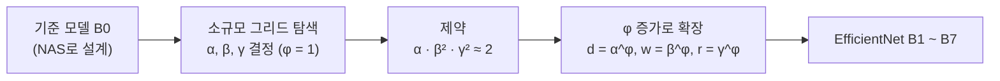

# Compound Scaling

---

## I. 깊이·너비·해상도를 함께 키우는, Compound Scaling의 개요

### 가. 정의

- CNN의 **깊이(Depth)·너비(Width)·입력 해상도(Resolution)를 하나의 복합 계수 $\phi$로 정해진 비율에 따라 동시에 확장**하는 모델 스케일링 기법 (EfficientNet, Google, 2019)

### 나. 등장 배경 및 특징

| 구분 | 내용 |
| --- | --- |
| 단일 차원 확장의 한계 | 깊이·너비·해상도 중 하나만 키우면 정확도 향상이 빠르게 포화 |
| 차원 간 상호 의존 | 해상도가 커지면 더 넓은 수용 영역(깊이)과 더 많은 채널(너비)이 필요 |
| 예측 가능한 비용 | $\phi$가 1 증가할 때 FLOPs가 약 2배가 되도록 설계 |
| 효율 | 같은 연산량에서 더 높은 정확도 (EfficientNet-B7이 당시 ImageNet 최고 수준을 훨씬 적은 파라미터로 달성) |

---

## II. 동작 원리 및 구성요소

### 가. 개념도

- 기준 모델에서 비율 상수를 한 번 찾은 뒤, 자원에 맞춰 $\phi$만 키워 모델군을 생성

### 나. 구성요소

| 구분 | 요소 | 설명 |
| --- | --- | --- |
| 확장 차원 | 깊이 (Depth) | 층 수 증가, 더 복잡한 특징 |
| | 너비 (Width) | 채널 수 증가, 세밀한 특징 |
| | 해상도 (Resolution) | 입력 이미지 크기 증가, 미세 패턴 |
| 계수 | 복합 계수 $\phi$ | 가용 자원에 따라 사용자가 정하는 전역 계수 |
| | 비율 상수 $\alpha, \beta, \gamma$ | 그리드 탐색으로 도출, EfficientNet은 $\alpha=1.2, \beta=1.1, \gamma=1.15$ |
| 제약 | $\alpha \cdot \beta^2 \cdot \gamma^2 \approx 2$ | FLOPs는 깊이에 비례, 너비·해상도에는 제곱 비례하므로 총 연산량 $\approx 2^\phi$ |
| 기준 모델 | EfficientNet-B0 | MBConv 블록 기반, 신경망 구조 탐색(NAS)으로 설계 |

---

## III. 비교 및 동향

### 가. 단일 스케일링 vs Compound Scaling

| 비교 항목 | 단일 차원 스케일링 | Compound Scaling |
| --- | --- | --- |
| 확장 대상 | 깊이·너비·해상도 중 하나 | 세 차원 동시 |
| 자원 배분 | 경험적, 불균형 | 고정 비율 상수로 균형 배분 |
| 성능 | 일정 수준 이후 포화 | 같은 FLOPs에서 더 높은 정확도 |
| 대표 | ResNet(깊이), Wide ResNet(너비) | EfficientNet B0~B7 |

### 나. 동향

- **EfficientNetV2**: 학습 속도까지 고려한 Fused-MBConv와 점진적 해상도 학습(Progressive Learning)으로 개선
- **LLM 스케일링 법칙과의 비교**: LLM은 파라미터 수·데이터 양·연산량의 최적 배분을 다루는 Compute-Optimal 스케일링 법칙(Chinchilla, 2022)으로 발전, 균형 배분이라는 발상은 유사 ([[초거대 언어 모델]])

---

### 🔗 연관 토픽

- **소속 도메인**: [[00_인공지능_MOC|🤖 인공지능]]
- **세부 분류**: `1. 수학 · 통계학 & 데이터 전처리`
- **핵심 연관 토픽**:
  - [[CNN|CNN (Convolutional Neural Network)]]
  - [[이미지넷]]
  - [[AutoML (Automated Machine Learning)]]
  - [[테스트 타임 스케일링|테스트 타임 스케일링(Test-Time Scaling, TTS)]]
  - [[초거대 언어 모델|초거대 언어 모델(Large Language Model)]]
