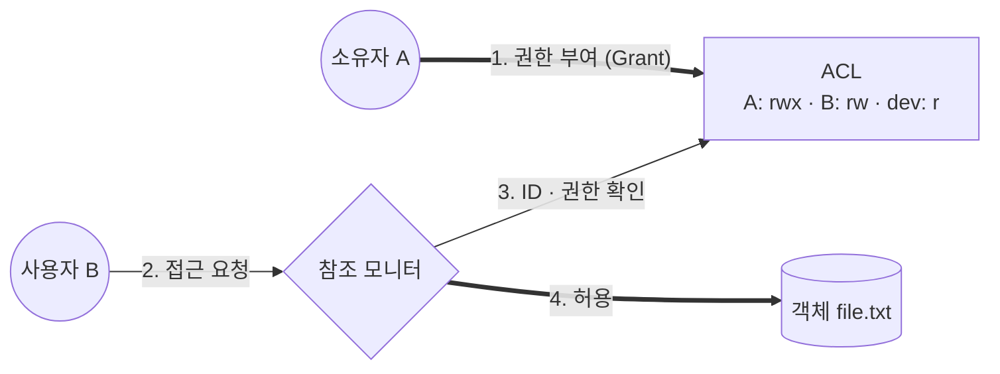

# DAC (Discretionary Access Control)

---

## I. 소유자가 정하는 권한, DAC의 개요

### 가. 정의

- 객체의 **소유자가 사용자·그룹의 신분(ID)을 기준으로 재량에 따라 접근 권한을 부여·회수**하는 임의적 접근통제 모델

### 나. 특징

| 구분 | 내용 |
| --- | --- |
| 신분 기반 | 주체의 ID·그룹으로 권한 판단 |
| 재량적 위임 | 소유자가 다른 사용자에게 권한 부여(Grant)·회수(Revoke) |
| 유연성 | 중앙 관리자 없이 신속한 자원 공유 |
| 취약점 | 사용자 권한으로 실행된 트로이 목마가 정보를 복사·유출해도 막지 못함 |
| 권한 전파 | 위임이 반복되면 권한 추적 어려움 |

---

## II. 동작 구조 및 구현 요소

### 가. ACL 기반 동작

- 소유자가 ACL을 직접 수정해 권한을 주고, 참조 모니터는 요청마다 주체 ID와 ACL을 대조

### 나. 구현 요소

| 구분 | 요소 | 설명 |
| --- | --- | --- |
| 통제 기준 | 신분 | 사용자·[[프로세스]] ID와 그룹 |
| 권한 주체 | 소유자 | 객체 생성자가 권한 관리 |
| 권한 관리 | Grant / Revoke | [[SQL(Structured Query Language)\|SQL]] `GRANT`·`REVOKE`, `WITH GRANT OPTION`으로 위임 |
| 자료 구조 | 접근 통제 행렬 | 행=주체, 열=객체, 원소=권한 |
| 구현 | ACL | 객체별 주체·권한 목록 (행렬의 열) |
| | Capability List | 주체별 객체·권한 목록 (행렬의 행) |
| 적용 예 | UNIX 권한 비트 | owner·group·other별 rwx, `chmod`·`chown` |
| | Windows NTFS ACL | 파일·폴더별 사용자 권한 설정 |

---

## III. 비교 및 동향

### 가. DAC vs MAC vs RBAC

| 비교 항목 | DAC | [[MAC]] | [[RBAC]] |
| --- | --- | --- | --- |
| 권한 결정자 | 객체 소유자 | 시스템 (보안 정책) | 보안 관리자 |
| 결정 기준 | 주체 신분 | 주체 인가 등급·객체 보안 레이블 | 역할 |
| 보안성 / 유연성 | 낮음 / 높음 | 높음 / 낮음 | 중간 / 높음 |
| 약점 | 트로이 목마, 권한 확산 | 경직성, 관리 부담 | 역할 폭증 |
| 적용 | 일반 OS 파일 시스템, 상용 [[DBMS]] | 군·정보기관, SELinux | 기업 ERP, 대규모 조직 |

### 나. 동향

- **ABAC 확산**: 사용자·자원·환경(시간·위치) 속성을 조합한 동적 접근 제어
- **[[제로 트러스트 보안모델|제로 트러스트]] 결합**: 신분 확인 1회로 끝나지 않고 기기 상태·행위를 지속 검증
- **클라우드 공유 통제**: 사용자 재량으로 생기는 외부 공유 링크를 DLP·CASB로 감시

---

### 🔗 연관 토픽

- **소속 도메인**: [[00_보안_MOC|🛡️ 보안]]
- **세부 분류**: `1. 정보보안 원칙 & 거버넌스 · 인증`
- **핵심 연관 토픽**:
  - [[접근 제어 접근 통제|접근 제어/접근 통제(Access Control)]]
  - [[MAC]]
  - [[RBAC]]
  - [[서버 접근 통제]]
  - [[IAM]]
