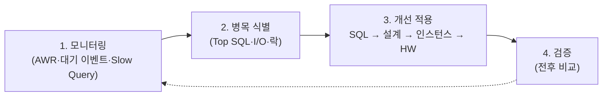

# DB 성능 개선 방안 (Database Tuning)

---

## I. 응답 시간 단축과 처리량 향상, DB 튜닝의 개요

### 가. 정의

- 주어진 자원에서 **응답 시간을 줄이고 처리량(TPS)을 높이기 위해 SQL, 데이터 설계, DBMS 인스턴스, OS·하드웨어를 단계적으로 최적화하는 활동**

### 나. 특징

| 구분 | 내용 |
| --- | --- |
| 계층적 접근 | SQL·애플리케이션 → 설계 → 인스턴스 → HW·OS |
| 효과 순서 | 일반적으로 SQL 튜닝이 비용 대비 효과가 가장 큼 |
| 트레이드오프 | 인덱스 추가는 조회 향상, 쓰기 성능 저하 |
| 지속성 | 데이터량·분포 변화에 따라 통계 갱신·모니터링 반복 |

---

## II. 튜닝 절차 및 계층별 기법

### 가. 튜닝 절차

- 측정 근거로 병목을 찾고, 효과가 크고 비용이 작은 상위 계층(SQL)부터 개선

### 나. 계층별 기법

| 구분 | 요소 | 설명 |
| --- | --- | --- |
| SQL | 실행 계획 분석 | 불필요한 Full Scan·정렬 제거, 적절한 접근 경로 유도 ([[OPTIMIZER]]) |
| | 조인 방식·순서 | NL·Hash·Sort Merge 선택, 선행 테이블 결정 ([[조인]]) |
| | 바인드 변수·힌트 | 하드 파싱 감소, 필요 시 실행 계획 고정 |
| 설계 | 인덱스 | 결합 인덱스 컬럼 순서, 커버링 인덱스 ([[RDBMS 인덱스(index)\|인덱스]]) |
| | 반정규화 | 조인 감소를 위한 중복 허용 ([[데이터베이스 반정규화]]) |
| | [[파티셔닝]] | Range·Hash·List 분할로 I/O 축소, 파티션 프루닝 |
| 인스턴스 | 메모리 | 버퍼 캐시, 공유 풀, 정렬·해시 영역(PGA·work_mem) 크기 조정 |
| | 동시성 | 락 경합·커넥션 풀 크기 조정 |
| HW·OS | I/O 분산 | 데이터·로그·임시 파일을 다른 디스크에 배치, SSD·[[RAID]] |
| 아키텍처 | 확장 | 읽기 복제본([[쿼리오프로딩]]), [[샤딩]], 캐시(Redis) |

---

## III. 비교 및 동향

### 가. RBO vs CBO

| 비교 항목 | RBO (Rule-Based) | CBO (Cost-Based) |
| --- | --- | --- |
| 원리 | 사전 정의된 우선순위 규칙 | 통계 기반 비용 계산 |
| 판단 기준 | 인덱스 유무·연산자 종류 | 행 수, 블록 수, 선택도, 분포 |
| 장점 | 예측 가능 | 데이터 상태 반영 |
| 단점 | 데이터 변화 무시 | 통계가 부정확하면 잘못된 계획 |
| 현황 | Oracle 10g부터 지원 중단 | 현대 RDBMS 표준 |

### 나. 동향

- **자율 튜닝**: Oracle Autonomous Database의 자동 인덱스, SQL Server 자동 계획 수정 등 ML 기반 자동화
- **클라우드 확장 중심**: 단일 서버 튜닝보다 읽기 복제본·샤딩·스토리지 분리 구조로 병목 회피
- **관측성 도구**: 쿼리 단위 성능 이력(Query Store, pg_stat_statements)으로 회귀 탐지

---

### 🔗 연관 토픽

- **소속 도메인**: [[00_데이터베이스_MOC|🗄️ 데이터베이스]]
- **세부 분류**: `2. 트랜잭션 & 동시성 제어 (Concurrency)`
- **핵심 연관 토픽**:
  - [[OPTIMIZER]]
  - [[RDBMS 인덱스(index)]]
  - [[조인|조인(Join)]]
  - [[파티셔닝]]
  - [[쿼리오프로딩]]
