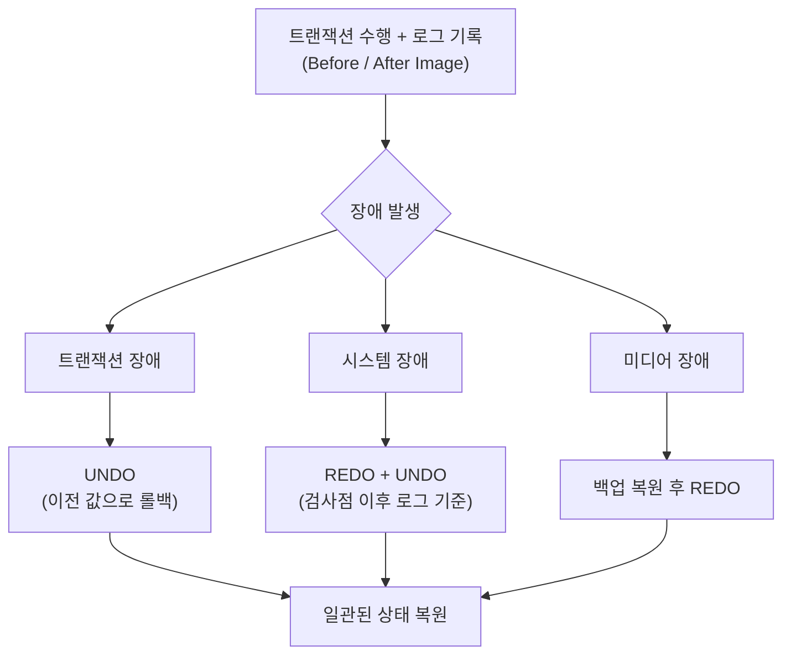
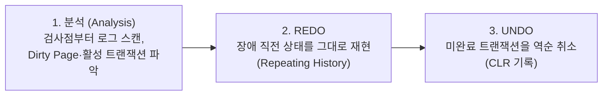

# DB 회복기법 (Database Recovery)

---

## I. 장애 시 일관된 상태로의 복원, DB 회복기법의 개요

### 가. 정의

- [[트랜잭션]] 수행 중 시스템·미디어 장애가 발생했을 때 **로그(Log)와 백업(Dump)을 이용해 장애 이전의 일관된 상태로 복원**하는 [[DBMS]]의 핵심 기능

### 나. 필요성 및 특징

| 구분 | 내용 |
| --- | --- |
| 목적 | ACID 중 원자성(Atomicity)과 영속성(Durability) 보장 |
| WAL 원칙 | 데이터 페이지를 디스크에 쓰기 전에 반드시 로그를 먼저 기록 (Write-Ahead Logging) |
| 2대 연산 | REDO(완료된 작업 재실행), UNDO(미완료 작업 취소) |
| 성능 균형 | 검사점(Checkpoint) 주기로 복구 시간과 운영 오버헤드 조절 |

---

## II. 회복 절차 및 핵심 기술

### 가. 장애 유형별 회복

### 나. ARIES 알고리즘 (현대 RDBMS 표준)

### 다. 핵심 기술 요소

| 구분 | 기술 | 설명 |
| --- | --- | --- |
| 원칙 | WAL | 로그를 먼저 안정 저장소에 기록 |
| 연산 | REDO (Roll-forward) | After Image로 Commit된 변경을 다시 반영 |
| | UNDO (Roll-back) | Before Image로 미완료 변경을 되돌림 |
| 로그 기반 | 즉시 갱신 (Immediate) | 수행 중 바로 디스크 반영 → REDO·UNDO 모두 필요 |
| | 지연 갱신 (Deferred) | Commit 후 디스크 반영 → REDO만 필요 |
| 최적화 | 검사점 (Checkpoint) | 주기적으로 Dirty Page를 디스크에 반영해 복구 범위 축소 |
| 대안 | [[그림자페이지 기법]] | 로그 없이 현재·그림자 페이지 테이블로 복구 (단편화·GC 부담) |
| 표준 | [[ARIES]] | LSN 기반 분석·REDO·UNDO 3단계, Fine-grained Locking 지원 |
| 미디어 회복 | 백업 + 아카이브 로그 | 디스크 손상 시 덤프에서 복원 후 로그 재적용 |

---

## III. 비교 및 동향

### 가. 즉시 갱신 vs 지연 갱신

| 비교 항목 | 즉시 갱신 | 지연 갱신 |
| --- | --- | --- |
| 디스크 반영 | 수행 중 수시로 | Commit 시점 |
| 필요 연산 | REDO + UNDO | REDO만 |
| 로그 내용 | Before·After Image | After Image 중심 |
| 장점 | 버퍼가 작아도 운영 가능 | 복구 로직 단순 |
| 단점 | 복구 복잡 | 큰 메모리 버퍼 필요 |
| 활용 | 대부분의 상용 RDBMS | 일부 특수 DB |

### 나. 동향

- **스토리지 오프로딩**: Aurora 등 [[클라우드 네이티브]] DB는 REDO 처리를 스토리지 계층에 맡겨 장애 복구 시간을 초 단위로 단축
- **분산 DB**: 스냅샷 기반 병렬 복구, 복제본 자동 Failover로 [[HA(High Availability)\|가용성]] 확보 ([[분산 데이터베이스]], [[New SQL\|NewSQL]])
- **비휘발성 메모리**: NVM 활용으로 WAL의 디스크 I/O 병목을 줄이는 Instant Recovery 연구

---

### 🔗 연관 토픽

- **소속 도메인**: [[00_데이터베이스_MOC|🗄️ 데이터베이스]]
- **세부 분류**: `3. 장애 회복 기법 & 데이터 무결성`
- **핵심 연관 토픽**:
  - [[ARIES|ARIES (Algorithms for Recovery and Isolation Exploiting Semantics)]]
  - [[그림자페이지 기법]]
  - [[트랜잭션]]
  - [[DRP(RTO, RPO 등)]]
  - [[DBMS]]
