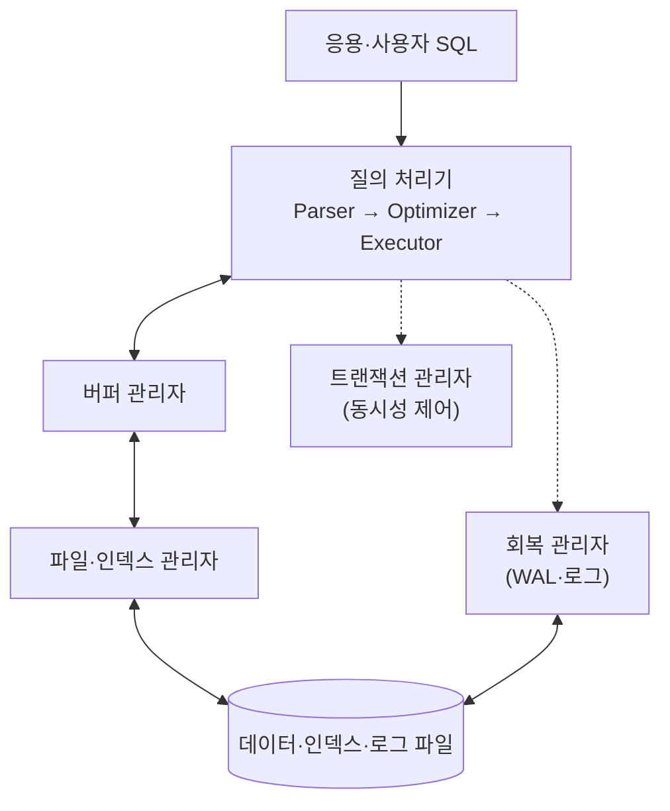

# DBMS (Database Management System)

---

## I. 데이터 공유와 통제의 중심, DBMS의 개요

### 가. 정의

- 응용 프로그램과 데이터 사이에서 **데이터의 정의·조작·제어를 담당하여 여러 사용자가 [[데이터베이스]]를 안전하게 공유하도록 하는 시스템 소프트웨어**

### 나. 필요성 및 특징

| 구분 | 내용 |
| --- | --- |
| 등장 배경 | 파일 시스템의 중복·종속성·불일치·보안 문제 해결 |
| 데이터 독립성 | 응용과 저장 구조 분리 (논리적·물리적 독립성) |
| 무결성·보안 | 제약조건, 권한 관리로 오류·무단 접근 차단 |
| 동시성·회복 | 다중 사용자 [[트랜잭션]]의 ACID 보장, 장애 시 복구 |
| 3대 기능 | 정의(DDL), 조작(DML), 제어(DCL) |

---

## II. 내부 구조 및 구성요소

### 가. DBMS 아키텍처

- 질의 처리기가 실행 계획을 만들고, 저장 엔진이 버퍼를 통해 데이터를 읽고 쓰며, 트랜잭션·회복 관리자가 ACID를 보장

### 나. 구성요소

| 구분 | 요소 | 설명 |
| --- | --- | --- |
| 질의 처리 | Parser | 구문·의미·권한 검사, 파스 트리 생성 |
| | [[OPTIMIZER\|Optimizer]] | 통계 기반 비용 계산으로 실행 계획 선택 |
| | Executor | 실행 계획에 따라 연산 수행 |
| 저장 엔진 | Buffer Manager | 자주 쓰는 블록을 메모리에 캐시 (LRU 등) |
| | File·Index Manager | 데이터 파일, B+Tree 인덱스 관리 (예: InnoDB) |
| 제어 | Transaction Manager | [[Locking]], [[MVCC(다중 버전 동시성 제어) 2가지 유형\|MVCC]]로 동시성 제어 ([[병행 제어]]) |
| | Recovery Manager | WAL 기반 REDO·UNDO 회복 ([[DB 회복기법]]) |
| 메타데이터 | [[시스템 카탈로그]] | 객체·제약·권한·통계 정보 저장 |

---

## III. 비교 및 동향

### 가. RDBMS vs NoSQL vs NewSQL

| 비교 항목 | RDBMS | [[NoSQL (CAP 이론 BASE 속성)\|NoSQL]] | [[New SQL\|NewSQL]] |
| --- | --- | --- | --- |
| 데이터 모델 | 테이블 | Key-Value, Document, Column-Family, Graph | 테이블 (분산 SQL) |
| 확장 | 주로 Scale-Up | Scale-Out | Scale-Out |
| 일관성 | ACID | BASE 중심 (제품별 조정 가능) | 분산 ACID |
| 활용 | 금융·ERP | 대규모 로그·캐시·비정형 데이터 | 글로벌 대규모 트랜잭션 |
| 예 | Oracle, PostgreSQL, MySQL | MongoDB, Redis, Cassandra | Google Spanner, [[CockroachDB]], TiDB |

### 나. 동향

- **스토리지–컴퓨팅 분리**: AWS Aurora, AlloyDB 등 공유 스토리지 기반 [[클라우드 네이티브]] RDBMS
- **자율 운영 DB**: Oracle Autonomous Database 등 인덱스·튜닝·패치 자동화
- **멀티 모델**: 하나의 DBMS에서 관계형·JSON·벡터·그래프 데이터를 함께 지원

---

### 🔗 연관 토픽

- **소속 도메인**: [[00_데이터베이스_MOC|🗄️ 데이터베이스]]
- **세부 분류**: `1. 데이터 모델링 & 관계형 DB 설계`
- **핵심 연관 토픽**:
  - [[데이터베이스]]
  - [[트랜잭션]]
  - [[OPTIMIZER]]
  - [[시스템 카탈로그|시스템 카탈로그 (System Catalog)]]
  - [[ANSI SPARC 모델(3-단계 데이터베이스 구조) 데이터 독립성]]
