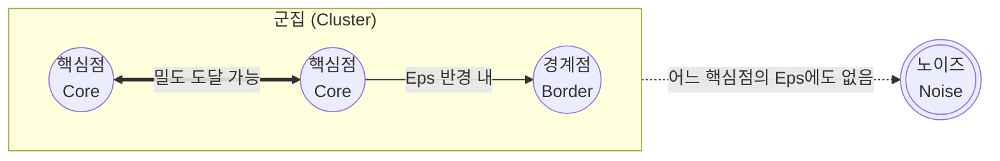

# DBSCAN (Density-Based Spatial Clustering of Applications with Noise)

---

## I. 임의 형태 군집과 노이즈 분리, DBSCAN의 개요

### 가. 정의

- 데이터가 **밀집된 정도(Density)** 를 기준으로 촘촘한 영역을 군집으로 묶고, 어느 군집에도 속하지 않는 저밀도 데이터를 노이즈([[이상치]])로 분리하는 [[비지도 학습]] 기반 군집화 [[알고리즘]]

### 나. 필요성 및 특징

| 구분 | 내용 |
| --- | --- |
| 필요성 | [[K-평균 알고리즘\|K-Means]]의 한계(원형 군집만 가능, 군집 수 k 사전 지정) 극복 |
| 임의 형태 군집 | 고리·초승달 등 비선형 분포도 분리 |
| 군집 수 자동 결정 | 반경(Eps)과 최소 개수(MinPts)만 정하면 군집 수는 자동 결정 |
| 노이즈 강건성 | 저밀도 데이터를 노이즈로 배제하여 군집 품질 향상 |

---

## II. DBSCAN 동작 원리 및 핵심 요소

### 가. 포인트 분류 및 군집 확장

- 임의의 점에서 시작해 반경 $\epsilon$ 안에 MinPts 이상의 이웃이 있으면 핵심점으로 정하고, 밀도 도달 가능한 점들을 연쇄적으로 묶어 군집을 확장

### 나. 핵심 구성요소

| 구분 | 요소 | 설명 |
| --- | --- | --- |
| 파라미터 | Eps ($\epsilon$) | 이웃을 정의하는 탐색 반경 |
| | MinPts | 핵심점이 되기 위해 반경 내에 필요한 최소 데이터 수 (자신 포함) |
| 포인트 분류 | 핵심점 (Core) | 반경 내 이웃 수 ≥ MinPts |
| | 경계점 (Border) | 자신은 MinPts 미만이지만 핵심점의 반경 안에 있음 |
| | 노이즈 (Noise) | 핵심점도 경계점도 아닌 고립된 점 |
| 연결성 | 직접 밀도 도달 | 점 p가 핵심점 q의 반경 안에 있음 |
| | 밀도 도달 | 핵심점 체인을 거쳐 간접적으로 도달 가능 |
| | 밀도 연결 | 두 점 p, q가 공통 핵심점 o로부터 모두 밀도 도달 가능 → 같은 군집 |

---

## III. K-Means와의 비교 및 동향

### 가. K-Means vs DBSCAN

| 비교 항목 | K-Means | DBSCAN |
| --- | --- | --- |
| 군집 기준 | 중심점(Centroid)과의 거리 | 데이터 밀도 |
| 군집 형태 | 구형·원형 | 임의 형태 |
| 사전 설정 | 군집 수 k | Eps, MinPts |
| 노이즈 처리 | 모든 점을 군집에 강제 할당 | 노이즈로 자동 분리 |
| 계산 복잡도 | 빠름 | $O(n^2)$, 공간 인덱스 사용 시 $O(n \log n)$ |
| 한계 | 초기 중심점·이상치에 민감 | 밀도가 서로 다른 군집이 섞이면 성능 저하, 고차원에 취약 |

### 나. 동향

- **HDBSCAN**: 계층적 군집을 결합해 서로 다른 밀도의 군집을 자동 추출
- **이상 탐지 활용**: 금융 사기 탐지, 네트워크 침입 탐지, 로그 이상 행위 분석 등 [[이상 감지]] 분야 핵심 알고리즘
- **확장**: R-Tree·K-D Tree 공간 인덱싱, Spark 기반 분산 DBSCAN, [[차원 축소]](PCA·UMAP)와 결합한 고차원 데이터 군집화

---

### 🔗 연관 토픽

- **소속 도메인**: [[00_인공지능_MOC|🤖 인공지능]]
- **세부 분류**: `1. 수학 · 통계학 & 데이터 전처리`
- **핵심 연관 토픽**:
  - [[K-평균 알고리즘]]
  - [[비지도 학습]]
  - [[이상치]]
  - [[이상 감지]]
  - [[차원 축소|차원 축소(Dimensionality Reduction)]]
