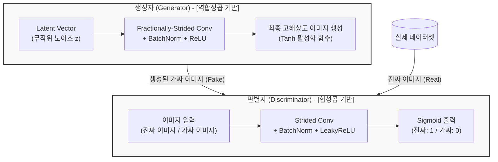

# DCGAN (Deep Convolutional Generative Adversarial Network)

---

## I. 합성곱 신경망을 결합한 안정적 이미지 생성 모델, DCGAN의 개요

### 가. 정의

- 기존 GAN([[GAN (Generative Adversarial Network)|Generative Adversarial Network]])의 학습 불안정성과 모드 붕괴 문제를 해결하기 위해, 생성자와 판별자 네트워크에 **합성곱 신경망([[CNN]])** 구조와 배치 정규화를 체계적으로 결합한 심층 생성 모델

### 나. 주요 특징

| 구분 | 주요 내용 |
| --- | --- |
| 공간 특징 보존 | 다층 퍼셉트론(MLP) 대신 CNN을 채택하여 이미지의 2D 공간 상관관계를 온전히 학습 |
| 풀링 계층 완전 배제 | 정보 손실을 방지하기 위해 판별자에는 스트라이드 합성곱, 생성자에는 역합성곱(Fractionally-strided Conv) 사용 |
| 완전 연결층(FC) 제거 | 네트워크 파라미터 수를 줄이고 수렴 속도를 높이기 위해 최상단 글로벌 풀링 및 컨볼루션 직접 연결 |
| 잠재 공간 산술 연산 | 학습된 잠재 벡터 간의 덧셈/뺄셈 연산(예: '안경 쓴 남자' - '남자' + '여자' = '안경 쓴 여자')을 통한 의미론적 제어 가능 |

## II. DCGAN의 아키텍처 및 핵심 기술 요소

### 가. DCGAN의 생성자-판별자 구조 및 동작 개념도

* 생성자는 무작위 노이즈 벡터를 받아 역합성곱(Deconvolution) 연산으로 이미지를 키워 나가고, 판별자는 일반 합성곱 연산을 통해 입력된 이미지가 실제 데이터인지 생성된 가짜인지 판별함

### 나. DCGAN의 핵심 기술 및 구성 요소

| 구분 | 요소기술(키워드) | 세부 설명 |
| --- | --- | --- |
| **아키텍처 규칙** | 풀링(Pooling) 대체 | 정보 손실을 방지하기 위해 판별자에는 **스트라이드 합성곱(Strided Convolution)**, 생성자에는 **역합성곱(Fractionally-strided Conv)** 적용 |
| **정규화 기법** | 배치 정규화 (Batch Norm) | 학습 불안정을 막기 위해 생성자의 출력층과 판별자의 입력층을 제외한 모든 계층에 배치 정규화 적용 |
| **아키텍처 규칙** | 완전 연결 계층 제거 | 네트워크의 깊이를 깊게 유지하면서도 파라미터 수를 줄이기 위해 최상위 합성곱 이후의 Fully Connected Layer 제거 |
| **활성화 함수** | LeakyReLU (판별자) | 판별자 전 계층에 기울기 소실(Gradient Vanishing)을 방지하기 위해 음수 영역에서 약간의 기울기를 갖는 LeakyReLU 사용 |
| **활성화 함수** | ReLU / Tanh (생성자) | 생성자의 은닉층에는 수렴 속도가 빠른 ReLU를 사용하고, 출력층에는 화소 범위(-1 ~ 1) 조절을 위해 Tanh 사용 |
| **학습 제어** | 모드 붕괴(Mode Collapse) 방지 | 다양한 형태의 이미지를 생성하지 못하고 특정 이미지만 반복 생성하는 현상을 구조적 제약을 통해 완화 |

---

## III. 전통적 GAN과 DCGAN 비교 및 최신 생성 AI 동향

### 가. 기본 GAN과 DCGAN의 기술적 특성 비교

| 비교 항목 | 기본 GAN (Standard GAN) | DCGAN (Deep Convolutional GAN) |
| --- | --- | --- |
| **신경망 구조** | 다층 퍼셉트론 (MLP - Fully Connected) | **합성곱 신경망 (CNN)** 기반 아키텍처 |
| **이미지 품질** | 저해상도 및 픽셀이 깨지는 현상 빈번 | 공간 특징 유지를 통해 **선명하고 고품질의 이미지 생성** |
| **학습 안정성** | 매우 불안정 (쉽게 발산하거나 모드 붕괴 발생) | 배치 정규화 및 CNN 제약을 통해 **안정적인 학습 수렴** |
| **잠재 공간(Latent)** | 의미론적 조작(Vector Arithmetic)이 어려움 | 잠재 벡터의 연산(예: 안경 쓴 얼굴 - 안경 없는 얼굴)을 통한 특징 조작 가능 |

### 나. 향후 전망 및 기술 동향

- **StyleGAN으로의 구조적 진화**: DCGAN의 컨볼루션 생성 메커니즘을 발전시켜 잠재 공간을 분리(Mapping Network)하고 스타일 혼합(Style Mixing)을 가능하게 한 StyleGAN 시리즈로 진화
- **디퓨전 모델(Diffusion Models)로의 생성 패러다임 전환**: GAN 특유의 적대적 학습 불안정성을 극복하기 위해 확률적 노이즈 점진적 제거 기반의 확산 모델(Stable Diffusion, DALL-E)이 고해상도 생성 AI 시장의 표준으로 자리매김
- **실시간 온디바이스 생성 가속화 연구**: 고화질 디퓨전 모델의 높은 연산 비용을 보완하기 위해, 가볍고 빠른 단일 추론이 가능한 적대적 학습 기법(Adversarial Diffusion Distillation 등)과 결합한 실시간 생성 모델 연구 지속

---

### 🔗 연관 토픽

- **소속 도메인**: [[00_인공지능_MOC|🤖 인공지능]]
- **세부 분류**: `3. 딥러닝 핵심 아키텍처 & 신경망`
- **핵심 연관 토픽**:
  - [[GAN (Generative Adversarial Network)]]
  - [[인공지능]]
  - [[CNN|CNN (Convolutional Neural Network)]]
  - [[배치 정규화]]
  - [[딥러닝]]
