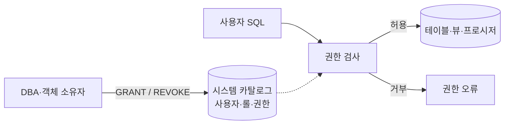

# DCL (Data Control Language)

---

## I. 누가 무엇을 할 수 있는가, DCL의 개요

### 가. 정의

- 사용자·롤에게 **데이터베이스 객체와 시스템 작업에 대한 권한을 부여(GRANT)하거나 회수(REVOKE)하는 SQL 명령어 집합** (교재에 따라 COMMIT·ROLLBACK 등 트랜잭션 제어어를 포함하기도 함)

### 나. 특징

| 구분 | 내용 |
| --- | --- |
| 목적 | 무단 접근 방지, 최소 권한 원칙 실현 |
| 저장 위치 | 권한 정보는 [[시스템 카탈로그]]에 기록 |
| 즉시 반영 | 실행 즉시 적용 (Oracle은 암묵적 커밋 발생) |
| 권한 전파 | WITH GRANT OPTION·WITH ADMIN OPTION으로 재부여 허용 |

---

## II. 처리 구조 및 명령어

### 가. 권한 검사 흐름

- 모든 SQL은 파싱 단계에서 카탈로그의 권한 정보와 대조되어 허용 여부가 결정

### 나. 명령어와 관련 요소

| 구분 | 요소 | 설명 |
| --- | --- | --- |
| 부여 | GRANT | `GRANT SELECT, INSERT ON 주문 TO 영업롤` |
| | WITH GRANT OPTION | 받은 객체 권한을 다른 사용자에게 재부여 가능 |
| 회수 | REVOKE | 부여한 권한 회수 |
| | CASCADE | 재부여된 권한까지 연쇄 회수 (객체 권한, DBMS별 차이) |
| 권한 종류 | 시스템 권한 | CREATE TABLE, CREATE USER, DROP ANY TABLE 등 |
| | 객체 권한 | 특정 테이블·뷰에 대한 SELECT, INSERT, UPDATE, DELETE, EXECUTE |
| 그룹화 | ROLE | 권한 묶음을 사용자에게 일괄 부여 ([[RBAC]]) |
| 세밀 제어 | 뷰·행 수준 보안 | 뷰, Row-Level Security(VPD)로 행·열 단위 제한 |

---

## III. 비교 및 동향

### 가. SQL 명령어 분류

| 비교 항목 | [[DDL]] | [[DML]] | DCL | TCL |
| --- | --- | --- | --- | --- |
| 대상 | 스키마·객체 | 데이터 | 권한 | 트랜잭션 |
| 명령어 | CREATE, ALTER, DROP, TRUNCATE | SELECT, INSERT, UPDATE, DELETE | GRANT, REVOKE | COMMIT, ROLLBACK, SAVEPOINT |
| 주 사용자 | DBA·설계자 | 개발자·사용자 | DBA | 개발자 |

### 나. 동향

- **ABAC·행 수준 보안**: 사용자 속성·시간·위치에 따라 동적으로 접근을 제한하는 세밀한 통제
- **IAM 연동**: 클라우드 DB가 IAM·SSO(SAML, OIDC)와 연계해 계정·권한을 중앙 관리하고 감사 로그 수집 ([[IAM]])
- **데이터 카탈로그 기반 정책**: 태그(민감정보 등급) 기반으로 마스킹·접근 정책을 일괄 적용

---

### 🔗 연관 토픽

- **소속 도메인**: [[00_데이터베이스_MOC|🗄️ 데이터베이스]]
- **세부 분류**: `4. 물리 저장 구조 & 인덱스 최적화`
- **핵심 연관 토픽**:
  - [[DDL]]
  - [[DML]]
  - [[RBAC]]
  - [[시스템 카탈로그]]
  - [[SQL(Structured Query Language)]]
