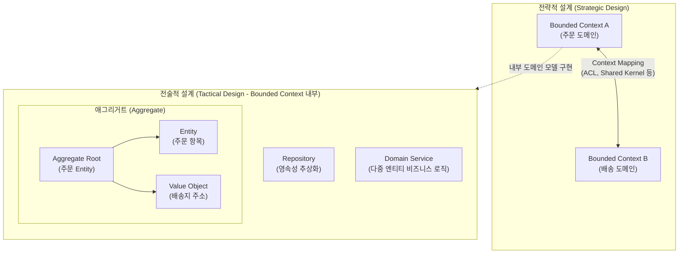

# DDD (Domain-Driven Design)

---

## I. 복잡한 비즈니스 도메인 중심의 소프트웨어 설계 방법론, DDD의 개요

소프트웨어의 복잡성을 통제하기 위해 비즈니스 도메인(업무 영역)을 핵심 중심에 두고, 개발자와 도메인 전문가가 공통 언어(Ubiquitous Language)를 기반으로 비즈니스 모델을 코드 구조에 직접 반영하는 객체 지향 분석·설계 방법론이다.

| 구분 | 주요 내용 |
| --- | --- |
| **개념** | 거대한 도메인을 경계(Bounded Context)로 분할하는 전략적 설계와, 객체 지향 모델(Aggregate, Entity, VO)로 구현하는 전술적 설계를 융합한 방법론 |
| **등장 배경** | 데이터베이스 스키마와 CRUD 중심 설계의 한계(비즈니스 로직 분산 및 코드 스파게티화) 극복, 비즈니스 변경에 유연한 응집도 높은 아키텍처 요구 |
| **핵심 특징** | 유비쿼터스 언어(Ubiquitous Language) 활용, 전략적·전술적 설계 이원화, 마이크로서비스 아키텍처([[MSA (Micro Service Architecture)|MSA]]) 서비스 분할의 핵심 기준 제공 |

---

## II. DDD의 아키텍처 개념도 및 핵심 구성 요소

### 가. DDD의 전략적 및 전술적 설계 아키텍처

전체 비즈니스는 바운디드 컨텍스트(Bounded Context) 단위로 분리되어 컨텍스트 매핑으로 상호 작용하며(전략적 설계), 각 컨텍스트 내부는 애그리거트(Aggregate)와 도메인 객체 패턴으로 불변식과 일관성을 보장한다(전술적 설계).

### 나. DDD의 핵심 기술 및 구성 요소

| 분류 | 요소기술 (키워드) | 세부 설명 |
| --- | --- | --- |
| **소통 체계** | 유비쿼터스 언어 | 도메인 전문가, 기획자, 개발자가 기획서부터 소스코드까지 동일한 의미로 사용하는 단일 공통 용어 체계 |
| **전략적 설계** | Bounded Context | 특정 도메인 모델과 용어의 의미가 일관되게 유지되는 논리적·물리적 경계 영역 (MSA 서비스 분할 단위) |
| **전략적 설계** | Context Mapping | 서로 다른 Bounded Context 간의 관계와 연동 방식 정의 (고객/공급자, Shared Kernel, 방청 계층(ACL) 등) |
| **전술적 설계** | 애그리거트 (Aggregate) | 관련 객체들의 집합으로 데이터 변경의 라이프사이클 단위이며, 외부 접근은 반드시 **루트(Root Entity)**를 통해서만 허용 |
| **전술적 설계** | Entity vs Value Object | 고유한 식별자(ID)를 가져 상태가 변해도 추적 가능한 객체(Entity)와, 속성 값 자체가 고유성을 정의하는 불변 객체(VO) |
| **전술적 설계** | 도메인 이벤트 (Domain Event) | 비즈니스적으로 발생한 과거의 중요한 상태 변화(예: `OrderPlaced`)를 비동기로 발행하여 시스템 간 결합도 완화 |
| **전술적 설계** | Repository / Domain Service | 애그리거트 단위의 데이터 영속성을 추상화하는 저장소(Repository) 및 특정 엔티티에 속하지 않는 도메인 행위(Service) |

---

## III. 전통적 CRUD 설계와의 비교 및 최신 동향

### 가. 전통적 데이터 중심 설계(CRUD) vs 도메인 주도 설계(DDD) 비교

| 비교 항목 | 전통적 데이터 중심 설계 (Data-Centric) | 도메인 주도 설계 (DDD) |
| --- | --- | --- |
| **설계 중심** | 데이터베이스 테이블 구조 및 ERD 관계 | **비즈니스 도메인의 규칙과 행위(Behavior)** |
| **로직 위치** | 주로 서비스 스크립트 계층이나 DB [[프로시저]] | **도메인 모델(Entity, VO) 내부로 [[캡슐화]]** |
| **유지보수성** | 변경 발생 시 DB 전반에 영향도 전파 (높은 결합도) | Bounded Context 내에 격리되어 **변경 영향도 최소화** |
| **소통 체계** | 현업의 요구사항과 개발자 코드 간 용어 괴리 심함 | **유비쿼터스 언어**를 통해 비즈니스와 코드가 일체화 |

### 나. 최신 기술 동향 및 발전 방향

* **마이크로서비스(MSA) 아키텍처의 필수 설계 기준**: 무분별한 서비스 쪼개기로 인한 분산 트랜잭션 지옥을 방지하기 위해, DDD의 Bounded Context와 이벤트 스토밍(Event Storming) 워크숍이 MSA 설계의 표준 실천법으로 정착됨.
* **이벤트 기반 아키텍처([[EDA]]) 및 CQRS와의 결합**: 도메인 이벤트(Domain Event)를 Kafka/RabbitMQ를 통해 비동기로 전파하고, 명령(Command)과 조회(Query)의 데이터 모델을 분리하는 CQRS 패턴과 융합하여 대규모 트래픽 분산 환경을 구현함.

---

### 🔗 연관 토픽

- **소속 도메인**: [[00_소프트웨어공학_MOC|🏗️ 소프트웨어공학]]
- **세부 분류**: `4. 아키텍처 스타일 & 객체지향 설계 원리`
- **핵심 연관 토픽**:
  - [[MSA (Micro Service Architecture)]]
  - [[EDA]]
  - [[결합도]]
  - [[응집도]]
  - [[캡슐화]]
