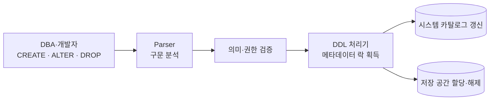

# DDL (Data Definition Language)

---

## I. 데이터베이스 구조 정의, DDL의 개요

### 가. 정의

- 테이블·뷰·인덱스·스키마 등 **데이터베이스 객체를 생성·변경·삭제하는 [[SQL(Structured Query Language)|SQL]] 명령어 집합** (CREATE, ALTER, DROP, TRUNCATE, RENAME)

### 나. 특징

| 구분 | 내용 |
| --- | --- |
| 카탈로그 반영 | 실행 결과가 메타데이터로 [[시스템 카탈로그]]에 기록 |
| 자동 커밋 | Oracle·MySQL은 DDL 전후 암묵적 커밋 → 롤백 불가 |
| 트랜잭션 DDL | PostgreSQL·SQL Server는 트랜잭션 안에서 DDL 롤백 가능 |
| 잠금 | 구조 변경 중 메타데이터 락(배타)으로 다른 접근 제어 |

---

## II. 처리 구조 및 명령어

### 가. DDL 처리 흐름

- 검증을 통과한 DDL은 카탈로그의 메타데이터를 갱신하고, 필요하면 저장 공간을 할당·해제

### 나. 명령어

| 구분 | 요소 | 설명 |
| --- | --- | --- |
| 생성 | CREATE | 테이블, 뷰, 인덱스, 시퀀스, [[프로시저]] 등 생성 |
| 변경 | ALTER | 컬럼 추가·변경·삭제, 제약조건 추가 |
| 삭제 | DROP | 객체 구조와 데이터 삭제 (Oracle은 휴지통·FLASHBACK으로 복원 가능) |
| 초기화 | TRUNCATE | 구조는 두고 모든 행을 빠르게 제거, 저장 공간 회수 |
| 이름 변경 | RENAME | 객체 이름 변경 |
| 제약조건 | PRIMARY KEY, FOREIGN KEY, UNIQUE, CHECK, NOT NULL | [[데이터베이스 무결성]] 규칙 정의 |

---

## III. 비교 및 동향

### 가. DDL vs DML vs DCL

| 비교 항목 | DDL | [[DML]] | [[DCL]] |
| --- | --- | --- | --- |
| 대상 | 구조(스키마) | 데이터(행) | 권한·트랜잭션 |
| 명령어 | CREATE, ALTER, DROP, TRUNCATE | SELECT, INSERT, UPDATE, DELETE, MERGE | GRANT, REVOKE (+ COMMIT, ROLLBACK) |
| 롤백 | DBMS에 따라 불가 | 가능 | 권한 변경은 즉시 반영 |
| 주 사용자 | DBA, 설계자 | 개발자, 사용자 | DBA |

### 나. 동향

- **스키마 마이그레이션 도구**: Flyway·Liquibase로 DDL 변경 이력을 코드로 관리하고 CI/CD로 배포
- **온라인 스키마 변경**: MySQL Online DDL, gh-ost·pt-online-schema-change로 서비스 중단 없이 ALTER 수행

---

### 🔗 연관 토픽

- **소속 도메인**: [[00_데이터베이스_MOC|🗄️ 데이터베이스]]
- **세부 분류**: `1. 데이터 모델링 & 관계형 DB 설계`
- **핵심 연관 토픽**:
  - [[DML]]
  - [[DCL]]
  - [[스키마]]
  - [[시스템 카탈로그|시스템 카탈로그 (System Catalog)]]
  - [[SQL(Structured Query Language)]]
