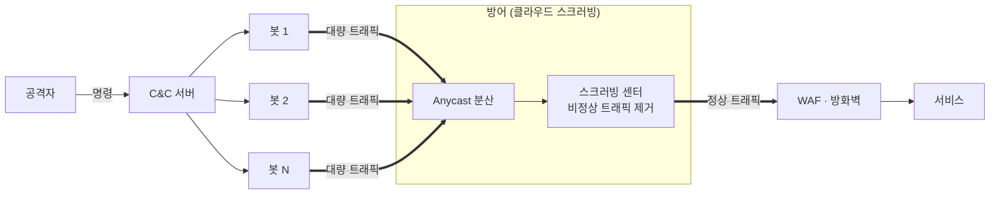

# DDoS (Distributed Denial of Service)

---

## I. 봇넷으로 가용성을 무너뜨리는, DDoS의 개요

### 가. 정의

- 악성코드에 감염된 **다수의 분산 시스템(봇넷)을 원격 조종하여 표적에 트래픽·요청을 동시에 집중**시켜 정상 서비스를 불가능하게 만드는 분산 서비스 거부 공격

### 나. 특징

| 구분 | 내용 |
| --- | --- |
| 분산성 | 수만~수백만 대 봇(PC·IoT 기기)이 동시 공격 |
| 추적 곤란 | 실제 공격자는 C&C 뒤에 숨고, 출발지가 넓게 분산 |
| 자원 고갈 | 회선 대역폭, 서버 CPU·메모리, 세션 테이블 소진 |
| 다계층 | L3/L4 볼륨 공격부터 L7 애플리케이션 공격까지 |
| [[가용성]] 침해 | CIA 중 가용성을 직접 공격 |

---

## II. 공격 구조 및 유형

### 가. 공격·방어 구조

- 공격자는 C&C로 봇넷에 명령하고, 방어 측은 Anycast로 트래픽을 분산해 스크러빙 센터에서 정화한 뒤 정상 트래픽만 전달

### 나. 공격 유형

| 구분 | 요소 | 설명 |
| --- | --- | --- |
| 볼륨 공격 | UDP·ICMP Flood | 대량 패킷으로 회선 대역폭 포화 |
| | 반사·증폭 | DNS·NTP·Memcached 응답을 표적으로 반사 ([[DRDOS\|DRDoS]]) |
| 프로토콜 공격 | SYN Flood | SYN만 대량 전송해 반개방 연결 백로그 고갈 |
| | ACK·Fragment Flood | 상태 추적 장비(방화벽·LB) 자원 고갈 |
| 애플리케이션 공격 | HTTP GET/POST Flood | 정상 요청으로 위장해 고부하 페이지 반복 호출 |
| | Slowloris·RUDY | 헤더·본문을 느리게 보내 연결을 장시간 점유 |
| 공격 인프라 | 봇넷·[[C2]] | 감염 기기 집합과 원격 명령 서버 (예: Mirai IoT 봇넷) |
| 방어 | 스크러빙 센터 | 트래픽을 우회시켜 정화 후 원 서버로 전달 |
| | SYN Cookie | 연결 상태 저장 없이 SYN 처리 |

---

## III. 비교 및 동향

### 가. L3/L4 공격 vs L7 공격

| 비교 항목 | L3/L4 공격 | L7 공격 |
| --- | --- | --- |
| 대상 | 회선, 네트워크 장비, TCP 스택 | 웹 서버, WAS, DB |
| 방식 | 대량 패킷 (Gbps·Mpps) | 정상과 유사한 요청 (RPS) |
| 탐지 | 트래픽 급증으로 비교적 쉬움 | 정상 요청과 구분 어려움 |
| 예 | SYN·UDP·ICMP Flood, 증폭 공격 | HTTP Flood, Slowloris, RUDY |
| 대응 | ISP 연동, 스크러빙, Anti-DDoS 장비 | WAF, 봇 관리, 챌린지, 요청 제한 |

### 나. 동향

- **초대형화**: IoT 봇넷과 HTTP/2 Rapid Reset(CVE-2023-44487) 등으로 Tbps·수억 RPS 규모 공격 등장
- **클라우드 방어**: 클라우드 Anti-DDoS·[[CDN]]·[[WAAP]]를 상시 경유하는 구조가 표준화 ([[SecaaS (Security as a Service)|SecaaS]])
- **랜섬 DDoS**: 공격 후 금전을 요구하는 RDoS 증가

---

### 🔗 연관 토픽

- **소속 도메인**: [[00_보안_MOC|🛡️ 보안]]
- **세부 분류**: `1. 정보보안 원칙 & 거버넌스 · 인증`
- **핵심 연관 토픽**:
  - [[DoS (Denial of Service)]]
  - [[DRDOS]]
  - [[C2]]
  - [[WAAP|WAAP(Web Application and API Protection)]]
  - [[가용성]]
