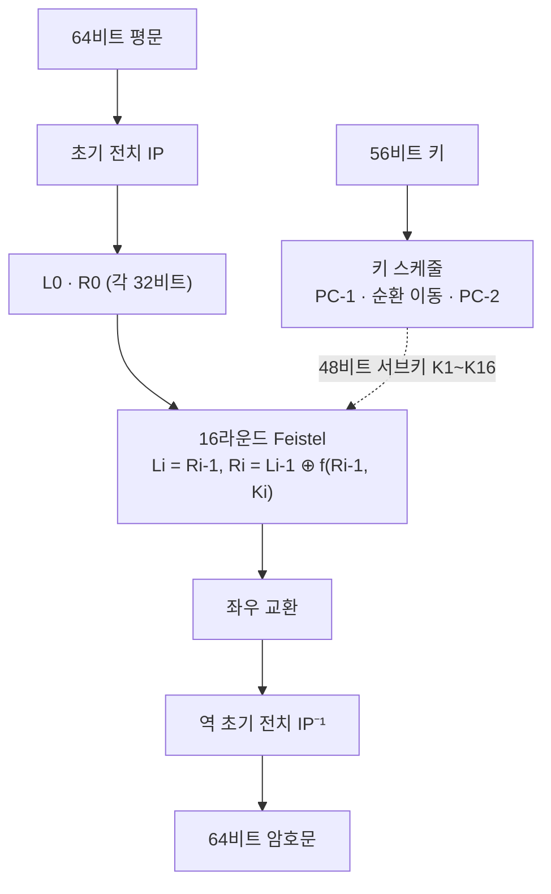

# DES (Data Encryption Standard)

---

## I. 현대 블록 암호의 출발점, DES의 개요

### 가. 정의

- IBM의 Lucifer를 바탕으로 미국 NBS(현 NIST)가 1977년 표준(FIPS 46)으로 제정한 **64비트 블록·56비트 키·16라운드 Feistel 구조**의 [[대칭키 암호화|대칭키]] 블록 암호

### 나. 특징

| 구분 | 내용 |
| --- | --- |
| Feistel 구조 | 암·복호화 구조가 같고 서브키 순서만 역순 |
| 키 길이 | 64비트 중 8비트는 패리티, 실효 56비트 |
| 안전성 한계 | 1998년 EFF Deep Crack이 약 56시간에 전수조사로 해독 |
| 역사적 의의 | 차분·선형 분석 등 현대 암호 분석 연구의 기반 |
| 현황 | 표준 철회(2005), 3DES도 2023년 이후 사용 금지 |

---

## II. 구조 및 구성요소

### 가. 암호화 구조

- 오른쪽 32비트를 확장(E)·서브키 XOR·S-Box·P-Box로 처리한 f 함수 결과를 왼쪽과 XOR하는 과정을 16회 반복

### 나. 구성요소

| 구분 | 요소 | 설명 |
| --- | --- | --- |
| 규격 | 블록 | 64비트 |
| | 키 | 56비트 (+8비트 패리티) |
| 라운드 함수 f | 확장 전치 (E) | 32비트 → 48비트 확장 |
| | S-Box | 6비트 입력 → 4비트 출력, 8개, 유일한 비선형 요소 (혼돈) |
| | P-Box | 32비트 전치 (확산) |
| 키 스케줄 | PC-1·PC-2·순환 이동 | 16개의 48비트 서브키 생성 |
| 초기·최종 전치 | IP, IP⁻¹ | 안전성에는 기여하지 않는 비트 재배치 |

---

## III. 비교 및 동향

### 가. DES vs 3DES vs AES

| 비교 항목 | DES | 3DES | [[AES]] |
| --- | --- | --- | --- |
| 키 길이 | 56비트 | 112·168비트 (실효 강도 80·112비트) | 128·192·256비트 |
| 블록 | 64비트 | 64비트 | 128비트 |
| 구조 | Feistel 16라운드 | DES를 EDE로 3회 적용 | SPN 10·12·14라운드 |
| 안전성 | 전수조사로 해독 가능 | 중간 일치 공격으로 강도 저하, 64비트 블록 충돌(Sweet32) | 실용적 공격 없음 |
| 상태 | 폐기 | NIST 2023년 이후 사용 금지 | 현행 표준 (FIPS 197, 2001) |

### 나. 동향

- **레거시 제거**: 금융 IC카드·결제망 등에 남은 3DES를 AES로 전환
- **양자 대비**: 대칭키는 PQC로 대체할 대상이 아니라 AES-256처럼 키 길이를 늘려 대응
- **국내 표준**: SEED·ARIA·LEA 등 국내 블록 암호가 공공 분야 검증필 암호모듈에 사용

---

### 🔗 연관 토픽

- **소속 도메인**: [[00_보안_MOC|🛡️ 보안]]
- **세부 분류**: `1. 정보보안 원칙 & 거버넌스 · 인증`
- **핵심 연관 토픽**:
  - [[AES]]
  - [[블록 암호화|블록 암호화 (Block Cipher)]]
  - [[대칭키 암호화]]
  - [[Shannon의 암호 설계 원칙]]
  - [[암호 분석 공격 기법|암호 분석 공격(Cryptanalysis Attacks) 기법]]
