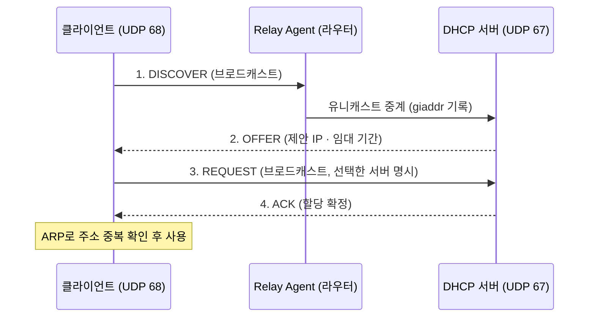

# DHCP (Dynamic Host Configuration Protocol)

---

## I. 꽂으면 바로 통신, DHCP의 개요

### 가. 정의

- 호스트에 **IP 주소, 서브넷 마스크, 기본 [[게이트웨이]], [[DNS(Domain Name System)|DNS]] 서버 등 네트워크 설정을 임대(Lease) 방식으로 자동 할당**하는 응용 계층 [[프로토콜]] (RFC 2131, UDP 67/68)

### 나. 특징 및 필요성

| 구분 | 내용 |
| --- | --- |
| 자동 설정 | 단말마다 수동 입력하는 부담과 입력 실수 제거 |
| 임대 기반 | 일정 기간만 대여, 미사용 주소 회수·재사용 |
| 갱신 | 임대 50%(T1)에 할당 서버로 갱신, 87.5%(T2)에 다른 서버 포함 재요청 |
| 브로드캐스트 기반 | 주소가 없는 단말이 서버를 찾기 위해 브로드캐스트 사용 |
| 중앙 관리 | 주소 풀·예약(MAC 고정 할당)·옵션을 서버에서 일괄 관리 |

---

## II. 동작 구조 및 구성요소

### 가. DORA 절차

- 여러 서버가 OFFER를 보내도 클라이언트는 REQUEST를 브로드캐스트해 선택한 서버를 알리고, 나머지 서버는 제안을 회수

### 나. 구성요소

| 구분 | 요소 | 설명 |
| --- | --- | --- |
| 메시지 | DISCOVER · OFFER · REQUEST · ACK | 서버 탐색, 주소 제안, 사용 요청, 확정 (DORA) |
| | NAK · RELEASE · DECLINE · INFORM | 거절, 반납, 주소 중복 통보, 주소 외 설정만 요청 |
| 자원 | 주소 풀 · 예약 | 할당 범위, 특정 MAC에 고정 주소 |
| | 임대 기간 · T1 / T2 | 유효 기간과 갱신 시점 |
| 중계 | Relay Agent | 다른 서브넷의 브로드캐스트를 서버로 유니캐스트 중계 ([[라우터]]의 ip helper) |
| 옵션 | DHCP Options | 게이트웨이(3), DNS(6), 도메인명(15), PXE 부팅 서버 등 |
| 보안 | DHCP 스누핑 | 신뢰 포트만 서버 응답 허용, 위장 서버 차단, IP-MAC 바인딩 생성 |
| 위협 | 고갈 공격 · 위장 서버 | 가짜 MAC으로 풀 소진, 악성 게이트웨이·DNS 배포 |

---

## III. 비교 및 동향

### 가. 정적 설정 vs DHCPv4 vs IPv6 자동 설정

| 비교 항목 | 정적 설정 | DHCPv4 | IPv6 (SLAAC / DHCPv6) |
| --- | --- | --- | --- |
| 설정 주체 | 관리자 수동 | 서버 할당 | SLAAC는 라우터 광고(RA)로 단말이 직접 생성, DHCPv6는 서버 할당 |
| 상태 관리 | 문서 의존 | 서버가 임대 상태 유지 | SLAAC 무상태, DHCPv6 상태형·무상태형 |
| 주소 효율 | 고정 점유 | 회수·재사용 | 주소 공간이 충분해 효율 문제 적음 |
| 적용 대상 | 서버, 네트워크 장비, 프린터 | 사용자 PC, 모바일 | [[IPv6]] 단말 |

### 나. 동향

- **IPAM 연동**: DHCP·DNS·IP 할당 이력을 통합 관리하는 DDI(DNS·DHCP·IPAM) 솔루션 확산
- **클라우드·컨테이너**: 퍼블릭 클라우드 VPC는 플랫폼이 DHCP를 대행하고, [[쿠버네티스]]는 CNI 플러그인이 Pod에 IP를 할당
- **보안 기본 적용**: 액세스 스위치에서 DHCP 스누핑·DAI·IP Source Guard 조합

---

### 🔗 연관 토픽

- **소속 도메인**: [[00_네트워크_MOC|🌐 네트워크]]
- **세부 분류**: `1. OSI 7계층 & 데이터링크 계층 (L1/L2)`
- **핵심 연관 토픽**:
  - [[ARP]]
  - [[RARP]]
  - [[IPv4]]
  - [[DNS(Domain Name System)]]
  - [[게이트웨이]]
