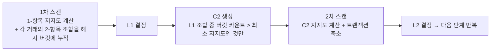

# DHP (Direct Hashing & Pruning)

---

## I. 해시로 후보를 줄이는 Apriori 개선, DHP의 개요

### 가. 정의

- Apriori에서 **k-항목 지지도를 셀 때 (k+1)-항목 조합을 해시 버킷에 미리 세어 두고, 버킷 수가 최소 지지도 미만인 조합을 다음 후보에서 제거하는 연관 규칙 알고리즘** (Park·Chen·Yu, 1995)

### 나. 특징

| 구분 | 내용 |
| --- | --- |
| 해시 가지치기 | 버킷 카운트가 최소 지지도 미만이면 그 버킷의 모든 조합은 비빈발 |
| 효과 구간 | 후보가 가장 폭증하는 2-항목 후보 축소에 특히 효과적 |
| 트랜잭션 축소 | 후보를 포함하지 않는 항목·트랜잭션을 다음 스캔에서 제외 |
| 한계 | 여전히 단계마다 DB 스캔 필요 |

---

## II. 동작 원리 및 구성요소

### 가. 동작 절차

- 해시 충돌로 버킷 카운트는 실제 지지도 이상이므로, 버킷 카운트가 기준 미만이면 안전하게 제거 가능 (기준 이상이어도 최종 확인은 스캔으로)

### 나. 구성요소

| 구분 | 요소 | 설명 |
| --- | --- | --- |
| 자료구조 | 해시 테이블 | (k+1)-항목 조합을 버킷으로 매핑 |
| | 버킷 카운터 | 버킷에 매핑된 조합들의 출현 횟수 합 |
| 기법 | Direct Hashing | h({x, y}) 등 해시 함수로 조합을 버킷에 매핑 |
| | Hash Pruning | 버킷 카운트 < 최소 지지도인 후보 제거 |
| | Transaction Trimming | 빈발 가능성이 없는 항목·거래를 다음 스캔에서 제외 |
| 기준 | 최소 [[지지도]] | 빈발 판단 기준 |
| 원리 | Apriori 성질 | 비빈발 부분집합을 가진 후보 제거와 병행 |

---

## III. 비교 및 동향

### 가. Apriori vs DHP vs FP-Growth

| 비교 항목 | [[Apriori 알고리즘\|Apriori]] | DHP | [[FP(Frequent Pattern) - Growth 알고리즘\|FP-Growth]] |
| --- | --- | --- | --- |
| 핵심 기법 | 후보 생성·검증 | 해시 기반 후보 축소 | FP-Tree, 후보 생성 없음 |
| 후보 수 | 많음 (특히 C2) | 크게 감소 | 없음 |
| DB 스캔 | 단계마다 | 단계마다 (데이터 크기 축소) | 2회 |
| 추가 메모리 | 후보 집합 | 해시 테이블 | FP-Tree |
| 적합 | 소규모 | 2-항목 후보가 많은 경우 | 대규모 |

### 나. 동향

- **스캔 횟수 개선 기법과 결합**: Partition 알고리즘(2회 스캔), DIC(동적 항목 집합 계수) 등과 비교·결합 연구
- **분산 환경**: 실무 대용량 분석은 Spark MLlib의 병렬 FP-Growth 등 후보 생성 없는 방식이 주류 ([[연관성 분석]])

---

### 🔗 연관 토픽

- **소속 도메인**: [[00_데이터베이스_MOC|🗄️ 데이터베이스]]
- **세부 분류**: `4. 물리 저장 구조 & 인덱스 최적화`
- **핵심 연관 토픽**:
  - [[Apriori 알고리즘]]
  - [[FP(Frequent Pattern) - Growth 알고리즘]]
  - [[연관성 분석]]
  - [[지지도]]
  - [[해시 테이블]]
