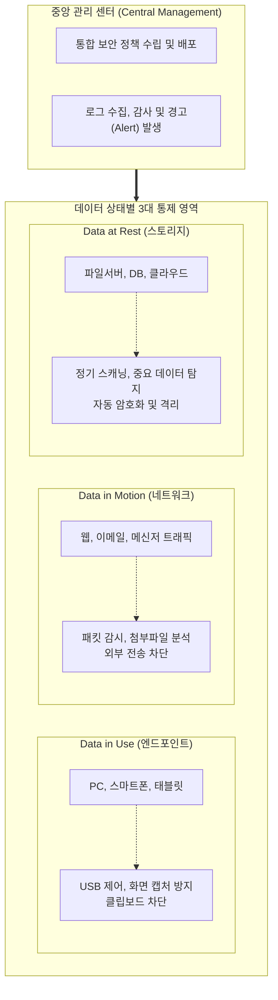

# DLP (Data Loss Prevention)

---

## I. 내부자 위협 대응 및 중요 정보 유출 원천 차단, DLP의 개요

### 가. DLP(Data Loss Prevention)의 정의
조직의 중요 데이터(개인정보, 기밀문서 등)를 식별·분류하고 엔드포인트, 네트워크, 스토리지 전 구간에서 데이터 흐름을 감시하여 무단 유출을 사전 탐지 및 차단하는 통합 데이터 보안 솔루션이다.

### 나. DLP의 등장 배경 및 주요 특징
| 구분 | 내용 |
| --- | --- |
| **등장 배경** | 악의적 내부자 또는 관리자 부주의로 인한 핵심 영업비밀 및 개인정보 유출 사고 급증, [[개인정보보호법]] 및 GDPR 컴플라이언스 준수 의무화 |
| **내용 인지 탐지** | 단순 파일명이 아닌 본문 텍스트, 패턴, 문서 지문(Fingerprint) 등을 분석하는 내용 기반(Content-Aware) 검사 |
| **3대 상태 통제** | 사용 중(Data in Use), 전송 중(Data in Motion), 저장 중(Data at Rest) 전 라이프사이클 통제 |
| **중앙 집중 정책** | 단일 관리 콘솔을 통한 전사 보안 정책 배포, 감사 로그 수집, 실시간 경고 및 대응 자동화 |

---

## II. DLP의 아키텍처 및 핵심 구성요소

### 가. DLP의 아키텍처 및 동작 원리

* 관리 서버에서 수립된 보안 정책을 각 구간(엔드포인트, 네트워크, 스토리지)에 배포하여 데이터 흐름을 실시간으로 감시함
* 중요 정보로 분류된 데이터가 인가되지 않은 채널(USB, 외부 메일 등)로 이동하려는 시도를 식별 시, 즉시 전송을 차단하고 로그를 기록함

### 나. DLP의 핵심 기술 요소

| 구분 | 요소기술(키워드) | 세부 설명 |
| --- | --- | --- |
| **데이터 탐지 (정형)** | [[EDM]] (Exact Data Matching) | DB 등에 저장된 실제 데이터(주민번호, 계좌번호 등)와 정확히 일치하는 구조화된 데이터를 매칭하여 유출 차단 |
| **데이터 탐지 (비정형)** | IDM (Indexed Document Matching) | 기밀문서, 설계도면 원본에서 추출한 해시 및 문서 지문(Fingerprinting)을 비교하여 변형된 비정형 데이터 탐지 |
| **데이터 탐지 (분석)** | OCR (광학 문자 인식) | 이미지 파일(JPG, PDF 등) 내에 포함된 텍스트를 추출하여 중요 정보 포함 여부 분석 |
| **문맥 인지** | Context-Awareness | 단순 키워드가 아닌 데이터가 사용되는 문맥, 사용자 위치, 접근 시간 등을 종합 분석하여 오탐율 최소화 |
| **엔드포인트 통제** | 매체 제어 (Device Control) | USB, 외장하드, 블루투스 등 이동형 저장매체의 접근 권한 제어 및 쓰기 금지 처리 |
| **네트워크 통제** | 컨텐츠 필터링 (Content Filtering) | 메일 본문 및 첨부파일, 웹 업로드 패킷을 심층 패킷 분석(DPI)하여 정책 위반 데이터 전송 차단 |
| **스토리지 통제** | 데이터 디스커버리 (Discovery) | 사내 분산된 시스템에 방치된 중요 데이터를 주기적으로 스캐닝하여 분류하고, 안전한 저장소로 격리 |
| **연동/대응** | [[DRM(Digital Right Management)\|DRM]] / ZTNA 연동 | 문서 외부 반출 필요 시 DRM으로 암호화하여 승인 처리하거나, 제로 트러스트 아키텍처와 연계하여 접근 제어 |

---

## III. DLP와 DRM의 비교 및 향후 동향

### 가. 데이터 보안 핵심 솔루션 비교 (DLP vs DRM)

| 비교 항목 | DLP (Data Loss Prevention) | DRM (Digital Rights Management) |
| --- | --- | --- |
| **핵심 목적** | 정보 유출 **경로(채널) 차단** 및 흐름 통제 | 데이터(문서) **자체의 [[암호화]]** 및 권한 제어 |
| **보호 대상** | 사내망을 이동하거나 저장된 모든 데이터 | 사전에 정의되거나 생성된 특정 문서/파일 |
| **제어 방식** | 컨텐츠 내용(패턴, 지문) 분석 기반 접근/전송 차단 | 사용자 인증 및 암호화 키 기반의 열람/편집/출력 통제 |
| **유출 시 보호 능력** | 파일이 이미 외부로 유출되면 보호 불가능 | 외부로 유출되더라도 암호화되어 있어 권한 없이는 열람 불가 |
| **도입 및 운영** | 전사적 네트워크 및 시스템 통합 인프라 구축 필요 | 애플리케이션 및 파일 시스템 중심의 플러그인/에이전트 설치 |
| **상호 보완성** | 전송 채널 통제(무단 반출 원천 차단) | 반출 승인 파일 보호(암호화 유지 및 열람 통제) |

### 나. 주요 동향 및 발전 전망
* **Cloud DLP 및 CASB/SASE 통합**: 클라우드 업무 환경(M365, SaaS) 확산에 대응하여 CASB 및 SSE/SASE 프레임워크와 결합된 클라우드 네이티브 DLP 구축
* **AI/ML 기반 사용자 및 엔티티 행위 분석(UEBA) 융합**: 대량 다운로드, 비정상적 시간대 접근 등 사용자 행위 컨텍스트를 머신러닝으로 분석하여 내부자 이상 징후 탐지 정확도 극대화
* **제로 트러스트 데이터 보안(ZTNA) 연계**: 사용자 신원 및 단말 신뢰도 평가 결과에 따라 DLP 정책을 동적으로 변경하는 조건부 접근 제어 체계 도입

---

### 🔗 연관 토픽

- **소속 도메인**: [[00_보안_MOC|🛡️ 보안]]
- **세부 분류**: `3. 네트워크 & 엔드포인트 · 인프라 보안`
- **핵심 연관 토픽**:
  - [[EDM]]
  - [[클라우드 컴퓨팅 취약점 및 대응기술]]
  - [[SecaaS (Security as a Service)]]
  - [[개인정보보호법]]
  - [[DRM(Digital Right Management)]]
