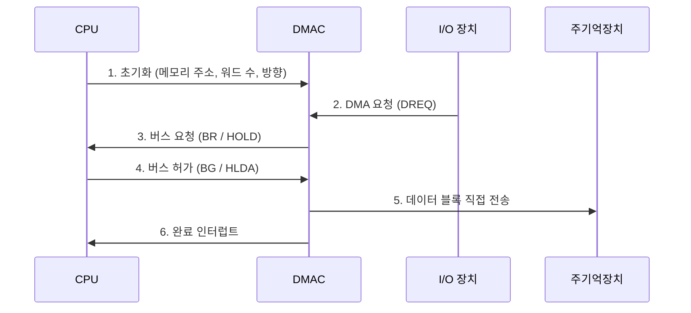

# DMA (Direct Memory Access)

---

## I. CPU를 거치지 않는 입출력 전송, DMA의 개요

### 가. 정의

- 입출력 장치와 주기억장치 사이의 데이터를 **[[CPU]] 대신 DMA 제어기(DMAC)가 버스를 직접 제어해 블록 단위로 전송**하는 입출력 방식

### 나. 필요성 및 특징

| 구분 | 내용 |
| --- | --- |
| 필요성 | 프로그램 I/O·인터럽트 I/O는 워드마다 CPU가 개입해 대용량 전송 시 부담 큼 |
| CPU 부하 감소 | CPU는 전송 시작 설정과 완료 인터럽트 처리만 담당 |
| 병렬성 | CPU 연산과 I/O 전송을 동시에 진행해 [[처리량]] 향상 |
| 버스 공유 | DMAC가 버스 마스터가 되므로 CPU와 버스 사용 경쟁 발생 |

---

## II. 동작 및 구성요소

### 가. 동작 절차

- 워드 카운터가 0이 되면 DMAC가 버스를 반납하고 인터럽트로 완료를 알림

### 나. 구성요소

| 구분 | 요소 | 설명 |
| --- | --- | --- |
| 제어기 | DMAC 레지스터 | 주소 레지스터, 워드 카운트 레지스터, 제어·상태 레지스터 |
| 제어 신호 | DREQ / DACK | 장치의 DMA 요청 / DMAC의 응답 |
| | BR / BG | DMAC의 버스 요청 / CPU의 버스 허가 |
| 전송 모드 | 버스트 (Burst) | 버스를 점유한 채 블록 전체 전송, 빠르지만 CPU 대기 |
| | 사이클 스틸링 (Cycle Stealing) | 한 워드마다 CPU로부터 버스 사이클을 하나씩 빼앗아 전송 |
| | 투명 (Transparent) | CPU가 버스를 쓰지 않는 사이클에만 전송, CPU 지연 없음 |
| 확장 | 채널 / IOP | 자체 명령으로 여러 장치를 제어하는 입출력 전용 프로세서 |
| 중재 | 버스 중재 | 여러 버스 마스터의 동시 요청 시 우선순위 결정 |
| 보호 | IOMMU | 장치의 DMA 주소를 변환·검사해 잘못된 메모리 접근 차단 |

---

## III. 비교 및 동향

### 가. 입출력 방식 비교

| 비교 항목 | 프로그램 I/O | 인터럽트 I/O | DMA |
| --- | --- | --- | --- |
| 전송 주체 | CPU | CPU | DMAC |
| 동작 | CPU가 상태를 계속 확인 (Polling) | 장치 준비 시 인터럽트 | 초기화 후 DMAC가 전송 |
| CPU 부담 | 매우 큼 | 중간 (워드마다 개입) | 작음 (시작·종료만) |
| 전송 단위 | 워드 | 워드 | 블록 |
| 적합 장치 | 단순 장치 | 키보드 등 저속 장치 | 디스크, NIC, [[GPU]] |

### 나. 동향

- **RDMA**: 원격 서버 메모리에 [[커널]]·[[TCP]]/IP 스택을 거치지 않고 직접 접근 (InfiniBand, RoCE, iWARP), AI 학습 클러스터·NVMe-oF에 활용
- **GPUDirect**: NIC·스토리지가 CPU 메모리를 거치지 않고 GPU 메모리와 직접 DMA

---

### 🔗 연관 토픽

- **소속 도메인**: [[00_컴퓨터구조_MOC|💻 컴퓨터구조]]
- **세부 분류**: `1. CPU 프로세서 & 마이크로아키텍처`
- **핵심 연관 토픽**:
  - [[인터럽트|인터럽트 (Interrupt)]]
  - [[MMU(Memory Management Unit)]]
  - [[CPU 처리과정]]
  - [[PCI Express (Peripheral Component Interconnect Express)]]
  - [[CPU]]
