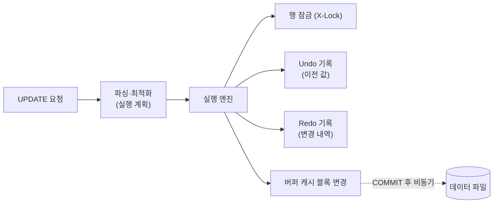

# DML (Data Manipulation Language)

---

## I. 데이터를 다루는 언어, DML의 개요

### 가. 정의

- 테이블에 저장된 **데이터를 조회·삽입·수정·삭제하는 SQL 명령어 집합** (SELECT, INSERT, UPDATE, DELETE, MERGE)

### 나. 특징

| 구분 | 내용 |
| --- | --- |
| 트랜잭션 단위 | COMMIT 전까지 ROLLBACK 가능 (클라이언트 자동 커밋 설정에 따라 다름) |
| 선언형 | 원하는 결과만 기술, 처리 방법은 [[OPTIMIZER\|옵티마이저]]가 결정 |
| 무결성 검사 | 실행 시 PK·FK·CHECK 등 제약조건 검증 ([[데이터베이스 무결성]]) |
| 로그 발생 | 변경 시 Undo·Redo 로그 생성 |

---

## II. 처리 구조 및 명령어

### 가. UPDATE 처리 흐름

- 변경은 먼저 버퍼 캐시에서 일어나고, Undo는 롤백·읽기 일관성에, Redo는 장애 복구에 사용

### 나. 명령어 및 관련 요소

| 구분 | 요소 | 설명 |
| --- | --- | --- |
| 조회 | SELECT | 조건에 맞는 행 조회 (DQL로 따로 분류하기도 함) |
| 삽입 | INSERT | 단일 행 또는 서브쿼리로 다중 행 추가 |
| 수정 | UPDATE | WHERE 조건의 행 값 변경 |
| 삭제 | DELETE | 조건 행 삭제, 구조 유지, 롤백 가능 |
| 병합 | MERGE | 존재하면 UPDATE, 없으면 INSERT (Upsert) |
| 동시성 | 행 잠금 | 변경 행에 배타 잠금, 읽기는 MVCC로 대기 없이 처리 ([[Locking]]) |
| 접근 경로 | 실행 계획 | Full Scan, [[RDBMS 인덱스(index)\|Index]] Range Scan 등 |

---

## III. 비교 및 동향

### 가. DML vs DDL vs DCL

| 비교 항목 | DML | [[DDL]] | [[DCL]] |
| --- | --- | --- | --- |
| 대상 | 행(데이터) | 스키마·객체 | 사용자·권한 |
| 명령어 | SELECT, INSERT, UPDATE, DELETE, MERGE | CREATE, ALTER, DROP, TRUNCATE | GRANT, REVOKE |
| 커밋 | 명시적 COMMIT·ROLLBACK | Oracle·MySQL은 자동 커밋 | 즉시 반영 |
| 로그량 | 행 단위로 많음 | 메타데이터 위주로 적음 | 적음 |

### 나. 대용량 DML 최적화

- **인덱스 최소화**: 쓰기 시 모든 인덱스가 갱신되므로 꼭 필요한 인덱스만 유지
- **배치 처리**: Array Binding·Bulk Insert로 왕복·파싱 비용 감소
- **파티션 활용**: 이력 대량 삭제는 DELETE 대신 파티션 DROP·TRUNCATE로 Undo 생성 회피 ([[파티셔닝]])

---

### 🔗 연관 토픽

- **소속 도메인**: [[00_데이터베이스_MOC|🗄️ 데이터베이스]]
- **세부 분류**: `2. 트랜잭션 & 동시성 제어 (Concurrency)`
- **핵심 연관 토픽**:
  - [[DDL]]
  - [[DCL]]
  - [[트랜잭션]]
  - [[SQL 문법]]
  - [[RDBMS 인덱스(index)]]
