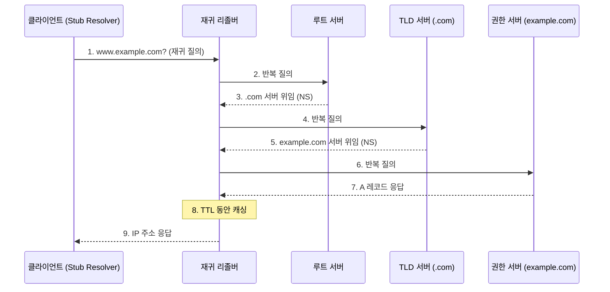

# DNS (Domain Name System)

---

## I. 이름을 주소로 바꾸는 분산 전화번호부, DNS의 개요

### 가. 정의

- 사람이 읽는 **도메인 이름을 IP 주소 등 자원 레코드로 변환(Resolution)하는 계층형 분산 데이터베이스와 그 질의 [[프로토콜]]** (RFC 1034, 1035)

### 나. 특징

| 구분 | 내용 |
| --- | --- |
| 편의성 | 숫자 주소([[IPv4]], [[IPv6]]) 대신 의미 있는 이름 사용 |
| 계층·분산 | 루트 → TLD → 2단계 도메인으로 관리 권한을 위임 |
| 캐싱 | 응답을 TTL 동안 저장해 질의량·지연 감소 |
| 간접화 | 서버 주소가 바뀌어도 이름 유지, 부하 분산(GSLB)에 활용 |
| 평문 기본 | 기본 DNS는 암호화·인증이 없어 위변조·감청에 취약 |

---

## II. 동작 구조 및 구성요소

### 가. 이름 해석 절차

- 클라이언트는 리졸버에 재귀 질의를 하고, 리졸버는 캐시에 없으면 루트부터 권한 서버까지 반복 질의로 찾음

### 나. 구성요소

| 구분 | 요소 | 설명 |
| --- | --- | --- |
| 서버 계층 | 루트 서버 | 13개 논리 이름(A~M), 애니캐스트로 전 세계 수백 개 인스턴스 운영 |
| | TLD 서버 | gTLD(.com), ccTLD(.kr) 관리 |
| | 권한 서버 (Authoritative) | 해당 영역(Zone)의 원본 레코드 보유 |
| 질의 | 재귀 리졸버 | 사용자를 대신해 탐색·캐싱 (통신사·공용 DNS) |
| | 재귀 / 반복 질의 | 최종 답을 요구 / 다음 서버 위치(위임)를 응답 |
| 레코드 | A · AAAA | IPv4 · IPv6 주소 |
| | CNAME · NS · MX | 별칭, 위임 네임서버, 메일 서버 |
| | TXT · PTR · SOA | 검증·정책(SPF), 역방향 조회, 영역 기본 정보 |
| 전송 | UDP/[[TCP]] 53 | 일반 질의는 UDP, 응답이 크거나 잘린 경우·영역 전송(AXFR)은 TCP |

---

## III. 비교 및 동향

### 가. DNS 보안·프라이버시 기술

| 구분 | 기술 | 설명 |
| --- | --- | --- |
| [[무결성]] | [[DNSSEC(Domain Name System Security Extension)\|DNSSEC]] | 레코드 전자서명으로 위변조·캐시 포이즈닝 방지 (기밀성은 제공 안 함) |
| 전송 [[암호화]] | DoT (DNS over TLS) | TCP 853, TLS로 클라이언트–리졸버 구간 암호화 |
| | DoH (DNS over HTTPS) | HTTPS(443)로 질의, 일반 웹 트래픽과 구분 어려움 |
| | DoQ (DNS over QUIC) | QUIC 기반, 연결 지연 감소 (RFC 9250) |
| 가용성 | 애니캐스트 | 같은 IP를 여러 지점에서 광고, 가까운 서버 응답·[[DDOS\|DDoS]] 분산 |
| 부하 분산 | GSLB | 위치·서버 상태 기반으로 응답 IP 선택 |

### 나. 동향

- **암호화 DNS 확산**: 주요 OS·브라우저가 DoH·DoT를 지원하며 기업은 보안 정책상 내부 리졸버로 통제
- **DNSSEC 검증**: 공용 리졸버 중심으로 검증 확대, 도메인 서명 비율은 아직 낮음
- **보안 활용**: 보호 DNS(악성 도메인 차단)와 DNS 로그 기반 위협 탐지

---

### 🔗 연관 토픽

- **소속 도메인**: [[00_네트워크_MOC|🌐 네트워크]]
- **세부 분류**: `1. OSI 7계층 & 데이터링크 계층 (L1/L2)`
- **핵심 연관 토픽**:
  - [[DNSSEC(Domain Name System Security Extension)]]
  - [[DHCP|DHCP(Dynamic Host Configuration Protocol)]]
  - [[CDN|CDN(Contents Delivery Network)]]
  - [[IPv4]]
  - [[IPv6]]
