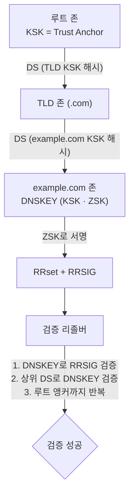

# DNSSEC (Domain Name System Security Extensions)

---

## I. DNS 응답에 서명을, DNSSEC의 개요

### 가. 정의

- [[DNS(Domain Name System)|DNS]] 레코드에 **공개키 전자서명을 추가하여 응답 데이터의 출처 인증과 [[무결성]]을 검증**할 수 있게 한 DNS 보안 확장 (IETF RFC 4033~4035)

### 나. 특징

| 구분 | 내용 |
| --- | --- |
| 등장 배경 | UDP 기반 DNS의 위조 응답·캐시 포이즈닝 (2008 Kaminsky 공격) |
| 무결성·출처 인증 | 서명 검증으로 위조 레코드 탐지 |
| 부재 증명 | 존재하지 않는 이름도 서명된 응답으로 증명 (NSEC·NSEC3) |
| 신뢰 체인 | 루트부터 TLD·도메인까지 계층적 검증 |
| 기밀성 미제공 | 질의·응답을 암호화하지 않음 |

---

## II. 동작 구조 및 구성요소

### 가. 신뢰 체인 검증

- 각 존은 레코드를 ZSK로 서명하고, 상위 존은 하위 존 KSK의 해시(DS)를 서명해 보관하여 루트까지 이어지는 신뢰 체인 구성

### 나. 구성요소

| 구분 | 요소 | 설명 |
| --- | --- | --- |
| 레코드 | RRSIG | RRset에 대한 전자서명 |
| | DNSKEY | 존의 공개키 (ZSK, KSK) |
| | DS | 하위 존 KSK의 해시, 상위 존에 등록 |
| | NSEC / NSEC3 | 부재 증명, NSEC3는 해시로 존 열람(zone walking) 완화 |
| 키 | ZSK | 존 데이터 서명, 자주 교체 |
| | KSK | DNSKEY 집합 서명, 상위 DS와 연결 |
| 검증 | 트러스트 앵커 | 루트 KSK 공개키 (2018년 최초 교체) |
| | 검증 리졸버 | 서명 검증 후 결과 반환 (AD 플래그) |

---

## III. 비교 및 동향

### 가. DNSSEC vs DoT vs DoH

| 비교 항목 | DNSSEC | DoT | DoH |
| --- | --- | --- | --- |
| 목적 | 무결성·출처 인증 | 전송 구간 기밀성 | 전송 구간 기밀성 |
| 보호 대상 | DNS 데이터 자체 | 클라이언트-리졸버 구간 | 클라이언트-리졸버 구간 |
| 포트 | UDP/TCP 53 | TCP 853 | TCP 443 (HTTPS) |
| 방어 위협 | 위조 응답, 캐시 포이즈닝 | 도청, 경로상 변조 | 도청, 경로상 변조, 차단 회피 |
| 적용 주체 | 도메인·DNS 운영자 | OS, 리졸버 | 브라우저, 앱 |

### 나. 동향

- **상호 보완**: DNSSEC(데이터 진위) + DoT/DoH(전송 암호화)를 함께 적용
- **키 관리 자동화**: CDS/CDNSKEY 레코드로 DS 갱신 자동화, 잘못된 롤오버로 인한 도메인 장애 방지
- **알고리즘 전환**: RSA에서 ECDSA P-256·Ed25519로 전환해 응답 크기 축소, PQC 서명 적용 연구

---

### 🔗 연관 토픽

- **소속 도메인**: [[00_보안_MOC|🛡️ 보안]]
- **세부 분류**: `1. 정보보안 원칙 & 거버넌스 · 인증`
- **핵심 연관 토픽**:
  - [[DNS(Domain Name System)]]
  - [[스니핑, 스푸핑|스니핑(Sniffing) & 스푸핑(Spoofing)]]
  - [[DNS 싱크홀(Sinkhole)]]
  - [[DRDOS]]
  - [[무결성]]
