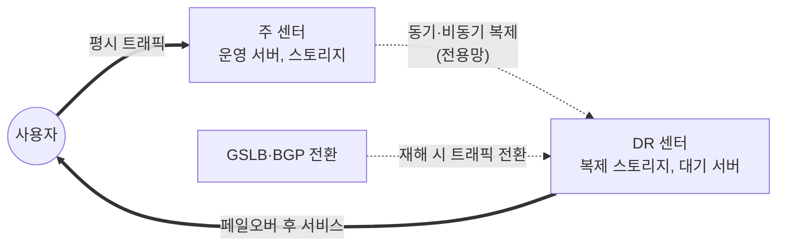

# DRS (Disaster Recovery System)

---

## I. 원격지에서 핵심 시스템을 되살리는, DRS의 개요

### 가. 정의

- 재해·장애로 주 전산센터가 마비될 때 **원격지에 복제해 둔 데이터와 대기 시스템으로 핵심 업무를 재개**하는 재해복구 시스템 (DR 센터)

### 나. 필요성 및 특징

| 구분 | 내용 |
| --- | --- |
| 필요성 | 다운타임에 따른 재무 손실·신뢰 하락 방지 |
| 규제 | 금융권은 전자금융감독규정에 따라 재해복구센터 구축과 연 1회 이상 재해복구 훈련 필요 |
| 지리적 분산 | 주 센터와 동시 피해를 받지 않는 원격지 배치 |
| 목표 기반 설계 | 업무별 RTO·RPO에 맞춰 복제 방식·사이트 유형 결정 |

---

## II. DRS의 구조 및 구성요소

### 가. 구조

- 평시 주 센터 데이터를 전용망으로 DR 센터에 복제하고, 재해 시 GSLB나 [[BGP]] 경로 변경으로 트래픽을 DR 센터로 전환

### 나. 구성요소

| 구분 | 요소 | 설명 |
| --- | --- | --- |
| 목표 | RTO / RPO | [[BIA (Business Impact Analysis)\|BIA]]로 정한 복구 시간·시점 |
| 복제 | 동기식 복제 | 양쪽 쓰기 완료 후 응답, RPO = 0, 거리·지연 제약 |
| | 비동기식 복제 | 주 센터 쓰기 후 지연 복제, 원거리 가능, RPO > 0 |
| | 스토리지 미러링 | 스토리지 컨트롤러 수준 블록 복제 |
| | CDP | 변경 이력 연속 기록으로 임의 시점 복구 |
| 전환 | GSLB | [[DNS(Domain Name System)\|DNS]] 기반 헬스체크·접속 전환 |
| | 복구 자동화 | 런북 기반 VM 기동, IP 변경, DB 오픈 |
| 운영 | 모의 훈련 | 정기 전환 훈련으로 절차·데이터 정합성 검증 |

---

## III. 구축 유형 비교 및 동향

### 가. DR 사이트 유형

| 구분 | Mirror Site | Hot Site | Warm Site | Cold Site |
| --- | --- | --- | --- | --- |
| 운영 방식 | 주 센터와 동시 운영 (Active-Active) | 동일 시스템 대기 (Active-Standby) | 주요 장비만 보유 | 시설(전원·공조)만 확보 |
| 데이터 | 실시간 동기화 | 실시간 복제 | 주기적 백업 | 소산 백업 |
| RTO (예) | 즉시 (≈ 0) | 수 시간 이내 | 수일~수주 | 수주~수개월 |
| 비용 | 매우 높음 | 높음 | 중간 | 낮음 |
| 적용 예 | 증권·결제 | 금융·포털 핵심 업무 | 일반 업무 시스템 | 비핵심 업무 |

### 나. 동향

- **[[DRaaS]]**: 클라우드에 복제해 두고 재해 시에만 컴퓨팅 자원을 기동하는 종량제 DR
- **멀티 리전 Active-Active**: [[쿠버네티스]]와 분산 DB([[CockroachDB]], Spanner 등)로 리전 간 상시 운영·자동 전환 ([[다중지역 A-A DRS]])
- **사이버 복구**: [[랜섬웨어]] 대비 불변 스토리지·격리 백업 볼트를 DR 체계에 통합

---

### 🔗 연관 토픽

- **소속 도메인**: [[00_경영전략_MOC|📈 경영전략]]
- **세부 분류**: `3. 비즈니스 프로세스 혁신 & 디지털 전환 (DX)`
- **핵심 연관 토픽**:
  - [[DRaaS]]
  - [[DRP(RTO, RPO 등)]]
  - [[다중지역 A-A DRS]]
  - [[BIA (Business Impact Analysis)]]
  - [[BCP|비즈니스 연속성 계획]]
