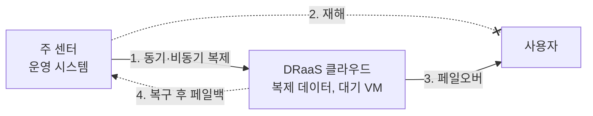

# DRaaS (Disaster Recovery as a Service)

---

## I. 재해복구 센터를 서비스로 쓰는, DRaaS의 개요

### 가. 정의

- 시스템·데이터를 **클라우드 사업자([[CSP]]) 인프라로 복제해 두고, 재해 시 클라우드에서 서비스를 재개**하는 서비스형 재해복구

### 나. 필요성 및 특징

| 구분 | 내용 |
| --- | --- |
| 비용 구조 | 원격지 DR 센터 구축(CapEx) 대신 사용량 기반 운영비(OpEx) |
| 대기 비용 절감 | 평시에는 스토리지·복제 비용 위주, 장애 시 컴퓨팅 자원 기동 |
| 자동화 | 복구 절차(런북)를 오케스트레이션으로 자동 실행 |
| 훈련 용이 | 운영에 영향 없는 격리 환경에서 반복 훈련 |

---

## II. DRaaS의 구조 및 구성요소

### 가. 동작 구조

- 평시 데이터를 클라우드로 복제하고, 재해 시 오케스트레이터가 VM을 기동·네트워크를 전환하며, 주 센터 복구 후 변경분을 되돌려 복귀

### 나. 구성요소

| 구분 | 요소 | 설명 |
| --- | --- | --- |
| 목표 | RTO / RPO | [[BIA (Business Impact Analysis)\|BIA]] 기반 업무별 복구 시간·시점 |
| 복제 | 데이터 복제 | 스토리지·하이퍼바이저·에이전트 수준 동기·비동기 복제 |
| | CDP (Continuous Data Protection) | 연속 저널링으로 임의 시점 복구 |
| 전환 | 페일오버 / 페일백 | 클라우드로 전환 / 주 센터로 복귀 |
| 자동화 | DR 오케스트레이션 | 런북 기반 VM 기동 순서·네트워크·DNS 전환 |
| 검증 | 무중단 테스트 | 격리 네트워크에서 복구 훈련 |
| 보안 | 테넌트 격리·암호화 | 고객별 논리 격리, 전송·저장 암호화 |

---

## III. 전통적 DR 비교 및 동향

### 가. 전통적 DR vs DRaaS

| 구분 | 전통적 DR | DRaaS |
| --- | --- | --- |
| 인프라 | 자체·임대 원격 데이터센터 | 퍼블릭·프라이빗 클라우드 |
| 비용 | 높은 초기 구축·유지 비용 | 구독·종량제 |
| 확장성 | 장비 도입 필요 | 필요 시 즉시 확장 |
| 운영 주체 | 자체 IT 조직 | CSP·MSP 위탁 가능 |
| 훈련 | 운영 영향으로 드묾 | 격리 환경에서 자주 가능 |

### 나. 동향

- **랜섬웨어 대응**: 불변 스토리지·격리 보관 백업과 깨끗한 복구 시점 탐지 기능을 DRaaS에 결합
- **클라우드 간 DR**: 단일 리전·단일 CSP 장애에 대비한 멀티 리전·멀티 클라우드 복제 ([[다중지역 A-A DRS]])
- **공공 도입 조건**: 공공기관은 [[CSAP]] 인증 클라우드 이용 등 보안 요건 충족 필요

---

### 🔗 연관 토픽

- **소속 도메인**: [[00_경영전략_MOC|📈 경영전략]]
- **세부 분류**: `3. 비즈니스 프로세스 혁신 & 디지털 전환 (DX)`
- **핵심 연관 토픽**:
  - [[DRS (Disaster Recovery System)]]
  - [[DRP(RTO, RPO 등)]]
  - [[BCP|BCP (Business Continuity Planning)]]
  - [[다중지역 A-A DRS]]
  - [[CSP|CSP (Cloud Service Provider)]]
