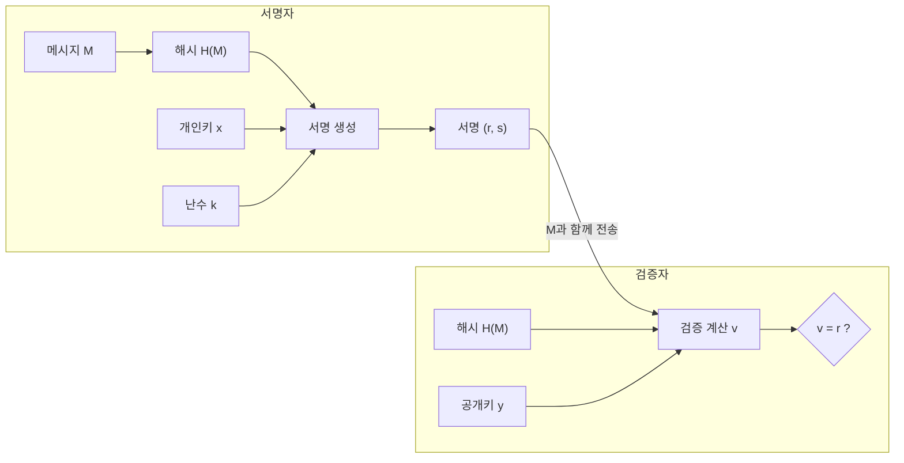

# DSA (Digital Signature Algorithm)

---

## I. 이산대수 기반 서명 전용 표준, DSA의 개요

### 가. 정의

- **이산대수 문제의 어려움에 기반하여 전자서명 생성·검증만 수행**하도록 NIST가 표준화한 서명 알고리즘 (FIPS 186, 1994)

### 나. 특징

| 구분 | 내용 |
| --- | --- |
| 서명 전용 | [[RSA (Rivest Shamir Adleman)\|RSA]]와 달리 암호화·키 전송에는 사용하지 않음 |
| ElGamal 변형 | ElGamal 서명을 부분군(q) 위에서 수행해 서명 길이 단축 |
| 난수 의존 | 서명마다 비밀 난수 k 필요, k 재사용·노출 시 개인키 유출 |
| 속도 | 서명 생성은 비교적 빠르고 검증은 상대적으로 느림 |
| 현황 | FIPS 186-5(2023)에서 서명 생성 용도 제외, 기존 서명 검증만 허용 |

---

## II. 동작 구조 및 구성요소

### 가. 서명·검증 절차

- 서명자는 $r = (g^k \bmod p) \bmod q$, $s = k^{-1}(H(M) + xr) \bmod q$를 계산하고, 검증자는 공개키로 구한 v가 r과 같은지 확인

### 나. 구성요소

| 구분 | 요소 | 설명 |
| --- | --- | --- |
| 수학적 기반 | 이산대수 문제 | $y = g^x \bmod p$에서 x를 구하기 어려움 |
| 도메인 파라미터 | p, q, g | 큰 소수 p, p−1의 소인수 q, 위수 q인 생성원 g |
| 키 | 개인키 x, 공개키 y | $y = g^x \bmod p$ |
| 해시 | SHA-2 | 메시지 다이제스트 계산 |
| 난수 | k | 서명마다 새로 생성, RFC 6979 결정적 k 생성으로 위험 완화 |
| 서명값 | (r, s) | 각각 q 크기 |

---

## III. 비교 및 동향

### 가. DSA vs RSA 서명 vs ECDSA

| 비교 항목 | DSA | RSA 서명 | ECDSA |
| --- | --- | --- | --- |
| 안전성 근거 | 이산대수 | 소인수분해 | 타원곡선 이산대수 |
| 기능 | 서명 전용 | 서명·암호화 | 서명 전용 |
| 속도 | 서명 빠름, 검증 느림 | 서명 느림, 검증 빠름 | 둘 다 효율적 |
| 128비트 강도 키 | p 3072비트 | 3072비트 | 256비트 |
| 난수 | 필수 (k 노출 치명적) | 불필요 (PSS는 솔트 사용) | 필수 |

### 나. 동향

- **DSA 퇴출**: FIPS 186-5는 신규 서명에 DSA를 승인하지 않고 ECDSA·EdDSA·RSA를 승인
- **EdDSA 확산**: 결정적 서명으로 난수 실수 위험을 없앤 Ed25519 채택 증가
- **PQC 서명**: [[양자내성암호|양자내성]] 서명 ML-DSA(FIPS 204)·SLH-DSA(FIPS 205)로 전환 준비

---

### 🔗 연관 토픽

- **소속 도메인**: [[00_보안_MOC|🛡️ 보안]]
- **세부 분류**: `1. 정보보안 원칙 & 거버넌스 · 인증`
- **핵심 연관 토픽**:
  - [[비대칭키 암호화]]
  - [[Elgamel]]
  - [[ECC|ECC(Elliptic Curve Cryptography)]]
  - [[RSA (Rivest Shamir Adleman)]]
  - [[FIPS (Federal Information Processing Standards)]]
