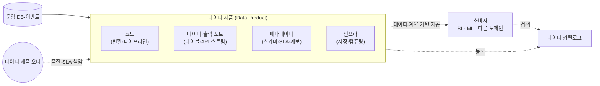

# DaaP (Data as a Product)

---

## I. 데이터를 제품처럼, DaaP의 개요

### 가. 정의

- 데이터를 시스템의 부산물이 아닌 **소비자를 위한 제품으로 보고, 생성 도메인 팀이 품질·문서·접근성·SLA까지 책임지고 제공하는 원칙** (데이터 메시 4대 원칙 중 하나, Zhamak Dehghani 제안)

### 나. 특징

| 구분 | 내용 |
| --- | --- |
| 등장 배경 | 중앙 데이터 팀·레이크의 병목, 품질 책임 불명확, 데이터 사일로 |
| 도메인 소유 | 데이터를 만드는 도메인 팀이 제품 수명주기 책임 |
| 소비자 중심 | 분석가·ML 엔지니어가 쉽게 찾고 이해하고 쓰도록 설계 |
| 제품 특성 | 발견 가능, 주소 지정 가능, 신뢰 가능, 자기 기술, 상호 운용, 보안 (DATSIS) |

---

## II. 구조 및 구성요소

### 가. 데이터 제품 구조

- 데이터 제품은 데이터뿐 아니라 이를 만드는 코드, 설명 메타데이터, 실행 인프라를 하나의 배포 단위로 묶은 것

### 나. 구성요소

| 구분 | 요소 | 설명 |
| --- | --- | --- |
| 제품 특성 | Discoverable | 카탈로그에서 검색 가능 |
| | Addressable | 고유 주소·표준 인터페이스로 접근 |
| | Trustworthy | 품질·신선도 SLA 명시 |
| | Self-describing | [[스키마]]·의미·샘플 제공 |
| | Interoperable | 공통 포맷·식별자로 다른 제품과 결합 |
| | Secure | 접근 정책·감사 적용 |
| 구현 | 데이터 계약 | 스키마·품질·SLA를 생산자–소비자 간 합의로 명시하고 자동 검증 |
| | DataOps | 테스트·CI/CD로 데이터 제품 배포 |
| 조직 | 데이터 제품 오너 | 소비자 요구 수집, 로드맵·품질 책임 |
| 거버넌스 | 연합형 계산 거버넌스 | 전사 표준을 정책 코드로 자동 적용 ([[데이터 거버넌스]]) |

---

## III. 비교 및 동향

### 가. 부산물로서의 데이터 vs 제품으로서의 데이터

| 비교 항목 | 기존 (Data as a By-product) | DaaP |
| --- | --- | --- |
| 관점 | 애플리케이션 운영의 부산물 | 소비자가 있는 제품 |
| 소유 | 중앙 데이터·IT 팀 | 도메인 교차 기능 팀 |
| 성공 지표 | 파이프라인 가동·처리 건수 | 소비자 활용도·만족도·SLA 준수 |
| 품질 대응 | 사후 수정 | 계약 위반 시 사전 차단 |
| 구조 | 중앙집중 DW·레이크 | 데이터 메시 기반 분산 |

### 나. 동향

- **데이터 계약 표준화**: Open Data Contract Standard(ODCS) 등 YAML 기반 계약 명세와 검증 도구 확산
- **데이터 마켓플레이스**: 사내 카탈로그에서 데이터 제품을 구독·요청하는 형태로 운영
- **AI 데이터 공급**: RAG·ML용 고품질 도메인 데이터를 제품으로 제공해 [[할루시네이션]] 위험 완화

---

### 🔗 연관 토픽

- **소속 도메인**: [[00_데이터베이스_MOC|🗄️ 데이터베이스]]
- **세부 분류**: `5. 분산 데이터베이스 & NoSQL & 대용량`
- **핵심 연관 토픽**:
  - [[데이터 거버넌스]]
  - [[데이터 거버넌스 데이터 품질]]
  - [[데이터 레이크하우스]]
  - [[스키마]]
  - [[EDW]]
