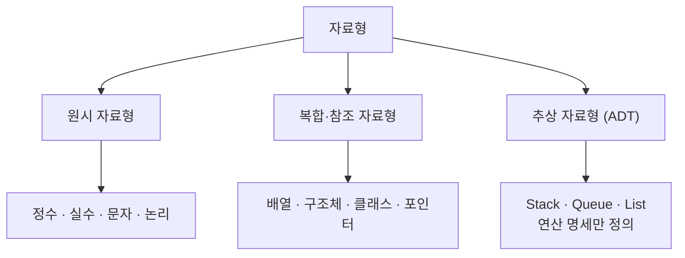

# Data Type (자료형)

---

## I. 비트를 해석하는 규칙, 자료형의 개요

### 가. 정의

- 변수·상수가 가질 수 있는 **값의 집합, 메모리 표현·크기, 적용 가능한 연산을 함께 정의**한 분류 체계

### 나. 필요성 및 특징

| 구분 | 내용 |
| --- | --- |
| 해석 기준 | 같은 비트열을 정수·실수·문자 중 무엇으로 볼지 결정 |
| 메모리 할당 | 타입에 맞는 크기 확보 (예: int 4바이트) |
| 타입 검사 | 잘못된 연산을 컴파일·실행 시 검출 |
| 가독성 | 코드 의도를 명확히 해 유지보수성 향상 |

---

## II. 분류 및 구성요소

### 가. 자료형 분류

- 원시 자료형은 하드웨어가 직접 다루는 값, 복합 자료형은 이들을 묶은 것, ADT는 구현을 숨긴 연산의 명세

### 나. 구성요소

| 구분 | 요소 | 설명 |
| --- | --- | --- |
| 원시 | 정수형 | 2의 보수 표현, 크기로 범위 결정 ([[Int Type]]) |
| | 실수형 | IEEE 754 부동소수점 ([[Float Type]]) |
| | 문자형 | 문자 코드값 저장 ([[Char Type]]) |
| | 논리형 | 참·거짓 ([[Boolean Type]]) |
| 복합 | [[배열]] | 같은 타입을 연속 메모리에 저장, 인덱스 접근 |
| | 구조체·[[클래스]] | 여러 필드(와 메서드)를 묶은 사용자 정의 타입 |
| | 포인터·참조 | 값이 아닌 메모리 주소를 저장 |
| 추상 | ADT | 연산의 명세(인터페이스)만 정의, 구현 은닉 ([[Stack]], [[Queue]]) |
| 타입 변환 | 묵시적·명시적 | 작은 타입→큰 타입 자동 변환(승격), 데이터 손실 가능한 변환은 캐스팅 |
| 타입 추론 | auto, var | C++ auto, Java 10+ var 등 초기값으로 타입 결정 |

---

## III. 비교 및 동향

### 가. 정적 타이핑 vs 동적 타이핑

| 비교 항목 | 정적 타이핑 | 동적 타이핑 |
| --- | --- | --- |
| 검사 시점 | 컴파일 시 | 실행 시 |
| 타입 결정 | 변수에 타입 고정 (명시 또는 추론) | 값에 타입, 변수는 어떤 값이든 참조 |
| 장점 | 오류 조기 발견, 최적화 유리 | 유연, 작성 속도 빠름 |
| 단점 | 코드 장황, 유연성 낮음 | 실행 중 타입 오류 위험 |
| 언어 | C, C++, Java, Go, Rust | Python, JavaScript, Ruby, PHP |

### 나. 동향

- **점진적 타이핑**: TypeScript, Python 타입 힌트(실행 시 강제는 없고 mypy 등 정적 검사 도구로 검증)로 동적 언어에 정적 검사 결합
- **메모리 안전 언어**: Rust는 소유권·빌림 검사로 댕글링 포인터·데이터 경쟁을 컴파일 시 차단 (메모리 누수 방지는 보장하지 않음), 미국 CISA 등이 메모리 안전 언어 전환 권고

---

### 🔗 연관 토픽

- **소속 도메인**: [[00_컴퓨터구조_MOC|💻 컴퓨터구조]]
- **세부 분류**: `2. 캐시 & 메모리 계층 구조 · 스토리지`
- **핵심 연관 토픽**:
  - [[변수]]
  - [[Int Type]]
  - [[Float Type]]
  - [[Boolean Type]]
  - [[String Type]]
