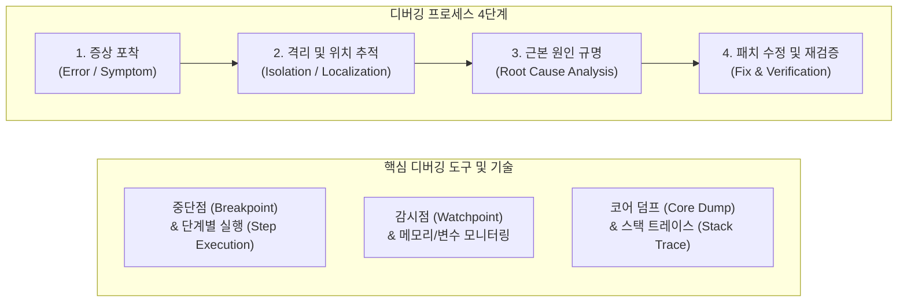

# Debugging (디버깅)

---

## I. 오류의 원인 추적 및 결함 제거 메커니즘, 디버깅의 개요

소프트웨어 또는 하드웨어 시스템에서 발생하는 예기치 않은 오작동, 결함(Bug), 또는 실패의 원인을 식별하고, 결함의 위치를 역추적하여 코드를 수정하고 무결성을 재검증하는 체계적인 문제 해결 프로세스이다.

| 구분 | 주요 내용 |
| --- | --- |
| **개념** | 프로그램 실행 중 관측된 이상 증상(Symptom)으로부터 근본 결함(Fault/Root Cause)의 위치를 규명하고 이를 격리·수정하는 일련의 엔지니어링 활동 |
| **등장 배경** | 소프트웨어 품질 및 신뢰성 확보, 장애 복구 시간(MTTR) 단축, 운영 유지보수 비용 최소화 필요 |
| **핵심 특징** | 결함 발견(Detection)에 집중하는 테스팅과 구별되는 결함 수정(Correction) 중심 활동, 비선형적 가설 검증 탐색 |

---

## II. 디버깅의 프로세스 및 핵심 기술 요소

### 가. 디버깅 프로세스 및 도구 연계 흐름

오작동 증상을 포착한 후, 중단점 및 실행 제어 도구를 활용하여 실행 범위를 좁혀나가며 근본 원인을 식별하고, 코드 수정 후 회귀 테스트를 거쳐 검증한다.

### 나. 디버깅의 핵심 기술 및 구성 요소

| 분류 | 요소기술 (키워드) | 세부 설명 |
| --- | --- | --- |
| **실행 제어** | 중단점 (Breakpoint) | 특정 소스코드 라인이나 주소에 도달했을 때 프로그램 실행을 일시 중지시키고 내부 상태를 점검하는 기능 |
| **실행 제어** | 단계별 실행 (Step Over/Into) | 중지 상태에서 코드를 한 줄씩 실행(Step Over)하거나 호출된 함수 내부로 진입(Step Into)하여 흐름 추적 |
| **변수 감시** | 감시점 (Watchpoint) | 특정 메모리 주소나 변수의 값이 읽히거나 변경될 때 즉각 실행을 중지시켜 데이터 오염 경로 추적 |
| **스택 분석** | [[Stack]] Trace (호출 스택) | 런타임 예외 발생 시 함수가 호출된 역순의 경로를 역추적하여 최초 오류 발생 지점을 직관적으로 식별 |
| **사후 진단** | Core Dump (코어 덤프) | 프로세스가 비정상 종료(Crash)된 순간의 메모리 상태와 CPU 레지스터를 파일로 기록하여 사후 정밀 분석 지원 |
| **고급 기법** | TTD (Time-Travel Debugging) | 프로그램의 실행 과정을 레코딩하여 역방향으로 실행(Replay)하며 과거 특정 시점의 버그 발생 순간으로 회귀 |
| **분산 환경** | 원격 디버깅 (Remote Debugging) | 로컬 IDE에서 네트워크 소켓을 통해 원격 서버나 클라우드 [[컨테이너]] 내부 프로세스에 접속하여 진단 |

---

## III. 전통적 디버깅과 최신 디버깅 트렌드 비교

### 가. 전통적 디버깅 vs 최신 지능형 디버깅 비교

| 비교 항목 | 전통적 디버깅 (Print / Local) | 최신 지능형 디버깅 (AI / Time-Travel) |
| --- | --- | --- |
| **진단 방식** | `print()` 문 삽입 후 재빌드, 로컬 IDE 중단점 의존 | **실행 레코드 역방향 재생(TTD), AI 자동 원인 분석** |
| **간헐적 버그** | 디버거 부착 시 사라지는 Heisenbug 추적 곤란 | **실행 기록(Trace)을 보존하여 언제든 동일 시점 재현 가능** |
| **분석 소요 시간** | 개발자의 직관과 수동 로그 대조로 긴 시간 소요 | **AI 모델이 로그와 코드를 대조하여 수정 패치 즉각 제안** |
| **대상 아키텍처** | 단일 모놀리식 프로세스 응용 프로그램 | **대규모 분산 [[MSA (Micro Service Architecture)|MSA]] 및 [[클라우드 네이티브]] 환경** |

### 나. 최신 기술 동향 및 발전 방향

* **생성형 AI 기반 자율 프로그램 수리(Automated Program Repair)**: 에러 로그와 스택 트레이스를 분석하여 결함 위치를 특정하고 자동으로 패치 코드(PR)를 작성하는 AI 코딩 에이전트 도입이 활성화됨.
* **OpenTelemetry 기반 통합 관측성(Observability) 연계**: 마이크로서비스 환경에서 수십 개의 컨테이너를 통과하는 트랜잭션의 지연과 오류를 분산 추적(Distributed Tracing)과 메트릭, 로그의 3대 축으로 일체화하여 진단함.

---

### 🔗 연관 토픽

- **소속 도메인**: [[00_소프트웨어공학_MOC|🏗️ 소프트웨어공학]]
- **세부 분류**: `6. 소프트웨어 테스팅 & 품질 보증 (QA/QC)`
- **핵심 연관 토픽**:
  - [[클라우드 네이티브]]
  - [[MSA (Micro Service Architecture)]]
  - [[컨테이너]]
  - [[신뢰성]]
  - [[프로세스]]
