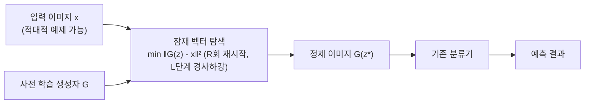

# Defense-GAN (적대적 공격 방어 프레임워크)

---

## I. 생성 모델로 입력을 정제하는, Defense-GAN의 개요

### 가. 정의

- 정상 데이터로 학습한 [[GAN (Generative Adversarial Network)|GAN]] 생성자의 출력 공간에 **입력을 투영해 적대적 교란을 제거(정제)한 뒤 분류기에 전달**하는 전처리 기반 방어 기법 (Samangouei et al., ICLR 2018)

### 나. 필요성 및 특징

| 구분 | 내용 |
| --- | --- |
| 필요성 | 적대적 학습은 학습한 공격 유형에 치우치고 분류기를 재학습해야 함 |
| 분류기 독립 | 기존 분류기 구조·가중치를 바꾸지 않고 앞단에 부착 |
| 매니폴드 투영 | 교란된 입력을 정상 데이터 분포 위의 가장 가까운 이미지로 대체 |
| 공격 비의존 | 특정 공격 알고리즘을 가정하지 않음 |
| 한계 | 추론 시 반복 최적화로 지연 발생, 적응형 공격(BPDA 등)에 우회됨이 보고됨 |

---

## II. 동작 구조 및 구성요소

### 가. 정제·분류 흐름

- 생성자가 만들 수 있는 이미지 중 입력과 가장 가까운 것을 찾아 분류기에 입력, 정상 분포 밖의 교란 성분은 재현되지 않아 제거됨

### 나. 구성요소

| 구분 | 요소 | 설명 |
| --- | --- | --- |
| 사전 학습 | 생성자 학습 | 정상(비교란) 학습 데이터 전체로 GAN 학습 (WGAN 사용) |
| 정제 | 잠재 벡터 최적화 | 재구성 오차 $\lVert G(z) - x \rVert^2$를 최소화하는 $z^*$를 경사하강법으로 탐색 |
| | 무작위 재시작 (R) | 여러 초기 $z$에서 탐색해 지역 최솟값 회피 |
| | 반복 횟수 (L) | 클수록 복원 정확·지연 증가 |
| 원리 | 매니폴드 투영 | 적대적 교란은 정상 데이터 매니폴드 밖 성분이 많아 투영 시 제거 |
| 부가 기능 | 공격 탐지 | 재구성 오차가 임계값보다 크면 적대적 입력으로 판단 |
| 방어 대상 | 화이트·블랙박스 공격 | FGSM, CW 등 평가에서 효과 보고 |

---

## III. 비교 및 동향

### 가. 적대적 학습 vs Defense-GAN

| 비교 항목 | 적대적 학습 | Defense-GAN |
| --- | --- | --- |
| 방어 시점 | 학습 단계 (적대적 예제 포함 학습) | 추론 단계 (입력 정제) |
| 분류기 수정 | 재학습 필요 | 불필요 |
| 미지 공격 | 학습에 쓴 공격에 편향 | 공격 유형 비의존 |
| 비용 | 학습 비용 큼 | 추론 지연 큼 |
| 약점 | 강한 공격엔 성능 저하 | GAN 표현력 한계, 적응형 공격에 우회 |

### 나. 동향

- **경사 은닉 문제 제기**: 정제 과정이 기울기를 가려 안전해 보이는 현상(Obfuscated Gradients)이 지적되어, 적응형 공격으로 평가하는 것이 표준 ([[머신러닝 학습과정에서의 적대적 공격]])
- **확산 모델 기반 정제**: 입력에 노이즈를 더한 뒤 [[Diffusion 모델]]로 복원하는 DiffPure 등으로 정제 품질 향상
- **인코더 결합**: 최적화 대신 인코더로 $z$를 한 번에 추정해 추론 지연 감소

---

### 🔗 연관 토픽

- **소속 도메인**: [[00_인공지능_MOC|🤖 인공지능]]
- **세부 분류**: `1. 수학 · 통계학 & 데이터 전처리`
- **핵심 연관 토픽**:
  - [[GAN (Generative Adversarial Network)]]
  - [[머신러닝 학습과정에서의 적대적 공격]]
  - [[Diffusion 모델]]
  - [[AI 레드팀(Red team) 테스트]]
  - [[딥페이크|딥페이크(Deepfake)]]
