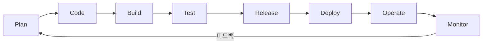

# 데브옵스 (DevOps)

---

## I. 개발과 운영의 벽 허물기, DevOps의 개요

### 가. 정의

- 개발(Dev)과 운영(Ops)의 협업 문화와 **CI/CD·IaC·모니터링 자동화로 소프트웨어를 빠르고 안정적으로 지속 제공**하는 문화·프랙티스·도구의 통합 체계

### 나. 특징

| 구분 | 내용 |
| --- | --- |
| 리드 타임 단축 | 요구가 운영 환경에 반영되기까지의 시간 최소화 |
| 릴리스 안정성 | 작은 단위의 잦은 배포로 장애 범위 축소, 복구 시간 단축 |
| CALMS | Culture·Automation·[[린 방법론\|Lean]]·Measurement·Sharing |
| 피드백 루프 | 운영 지표가 기획·개발로 환류 |

---

## II. DevOps 루프 및 구성요소

### 가. DevOps 무한 루프

- 개발(Plan~Test)과 운영(Release~Monitor)이 하나의 루프로 순환하고, 모니터링 지표가 다음 계획에 반영

### 나. 구성요소

| 구분 | 요소 | 설명 |
| --- | --- | --- |
| 문화 | CALMS | 협업 문화, 자동화, 낭비 제거, 측정, 공유 |
| 성과 지표 | DORA 4대 지표 | 배포 빈도, 변경 리드 타임, 변경 실패율, 장애 복구 시간 |
| 자동화 | CI | [[형상 관리]], 자동 빌드, 정적 분석, [[통합 테스트\|테스트]] 자동화 (Jenkins, GitHub Actions) |
| | CD | Blue-Green·Canary·Rolling [[무중단 배포]] 자동화 |
| | IaC | 인프라를 코드로 정의·버전 관리, 멱등성·재현성 확보 (Terraform, Ansible) |
| | GitOps | Git을 기준 상태로 클러스터 자동 동기화 (Argo CD, Flux) |
| 보안 | [[DevSecOps]] | [[SAST]]·[[DAST]]·SCA·[[컨테이너]] 이미지 스캔 내재화 |
| 운영 | 관측성 (Observability) | 로그·메트릭·트레이스를 OpenTelemetry로 수집·상관 분석 |

---

## III. 비교 및 동향

### 가. DevOps vs SRE

| 비교 항목 | DevOps | [[SRE (Site Reliability Engineering)\|SRE]] |
| --- | --- | --- |
| 성격 | 협업 문화·원칙·프랙티스 | DevOps 원칙을 SW 엔지니어링으로 구현한 운영 방식 (Google) |
| 관계 | 인터페이스 (무엇을) | 구현 클래스 (어떻게): "class SRE implements DevOps" |
| 초점 | 배포 속도와 흐름 | 가용성·신뢰성 |
| 지표 | DORA 지표 | SLI·SLO·Error Budget, [[SLA]] |
| 장애 대응 | 빠른 롤백, 피드백 개선 | 오류 예산 소진 시 배포 동결, 비난 없는 포스트모템 |
| 반복 업무 | 파이프라인 자동화 | 토일(Toil)을 업무 시간 50% 이하로 제한 |

### 나. 동향

- 개발자 인지 부하를 줄이는 내부 개발자 플랫폼(IDP)·골든 패스 중심의 플랫폼 엔지니어링 확산
- AIOps로 이상 탐지·자동 롤백, LLM 에이전트가 파이프라인 오류 분석과 수정 제안 수행

---

### 🔗 연관 토픽

- **소속 도메인**: [[00_소프트웨어공학_MOC|🏗️ 소프트웨어공학]]
- **세부 분류**: `2. 애자일(Agile) & 지속적 통합/배포(CI/CD)`
- **핵심 연관 토픽**:
  - [[CI, CD (Continuous Integration, Continuous Delivery)]]
  - [[DevSecOps]]
  - [[SRE (Site Reliability Engineering)]]
  - [[무중단 배포]]
  - [[린 방법론|린 (Lean) 방법론]]
