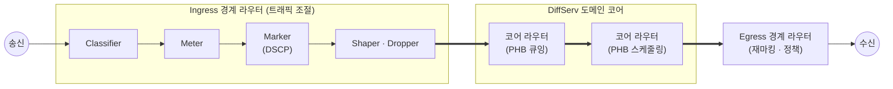

# DiffServ (Differentiated Services)

---

## I. 흐름이 아닌 등급으로 다루는, DiffServ의 개요

### 가. 정의

- 경계 라우터가 트래픽을 분류해 **IP 헤더의 DSCP 값으로 등급을 표시하고, 코어 라우터는 그 값에 정해진 홉별 동작(PHB)만 적용**해 차등 품질을 제공하는 [[QoS]] 구조 (RFC 2474, 2475)

### 나. 등장 배경 및 특징

| 구분 | 내용 |
| --- | --- |
| 등장 배경 | [[IntServ (Integrated Services)\|IntServ]]는 플로우마다 상태를 유지해 대규모 망에서 확장성 부족 |
| 역할 분담 | 경계에서 분류·측정·마킹, 코어는 DSCP에 따른 전달만 |
| 무상태 코어 | 코어 라우터가 플로우 상태를 저장하지 않음 |
| 집합 단위 | 플로우가 아닌 등급(Behavior Aggregate) 단위 처리 |
| 상대적 보장 | 등급 간 상대적 우선순위, 종단 간 절대 보장은 아님 |

---

## II. 구조 및 구성요소

### 가. DiffServ 도메인 구조

- 도메인 입구에서 한 번 분류·마킹하면 내부 라우터는 DSCP만 보고 큐와 폐기 우선순위를 결정

### 나. 구성요소

| 구분 | 요소 | 설명 |
| --- | --- | --- |
| 표시 | DSCP | [[IPv4]] ToS·[[IPv6]] Traffic Class 바이트의 상위 6비트, 64개 코드 (하위 2비트는 ECN) |
| 동작 | PHB (Per-Hop Behavior) | DSCP별 큐잉·[[스케줄링]]·폐기 방식 |
| PHB 종류 | EF (Expedited Forwarding) | 저지연·저지터·저손실, 음성 (DSCP 46) |
| | AF (Assured Forwarding) | 4개 클래스 × 3단계 폐기 우선순위 = 12개 (AFxy) |
| | CS (Class Selector) | 기존 IP Precedence 3비트와 호환 |
| | Default (BE) | 별도 보장 없는 기본 전달 (DSCP 0) |
| 트래픽 조절 | Classifier | 주소·포트·프로토콜로 등급 분류 |
| | Meter · Marker | 계약 프로파일 대비 측정 후 DSCP 표시·강등 |
| | Shaper · Dropper | 초과분 지연([[Traffic Shaping (트래픽 쉐이핑)\|Shaping]]) 또는 폐기([[Traffic Policing (트래픽 정책처리)\|Policing]]) |

---

## III. 비교 및 동향

### 가. DiffServ vs IntServ

| 비교 항목 | DiffServ | [[IntServ (Integrated Services)\|IntServ]] |
| --- | --- | --- |
| 처리 단위 | 등급 (Class) | 개별 플로우 |
| 자원 확보 | DSCP 마킹 후 홉별 차등 처리 | RSVP로 경로 상 자원 사전 예약 |
| 라우터 상태 | 코어 무상태 | 경로 상 모든 라우터가 플로우 상태 유지 |
| 확장성 | 높음 | 낮음 |
| 보장 수준 | 상대적 (Soft QoS) | 절대적 (Hard QoS) |
| 활용 | 기업 WAN, 통신사 [[백본망]], MPLS VPN | 소규모 망, RSVP-TE 형태로 MPLS 경로 예약 |

### 나. 동향

- **MPLS·SR 연계**: DSCP를 MPLS EXP(TC) 비트에 매핑해 백본에서 등급 유지
- **5G QoS 연계**: 5G QoS 플로우(5QI)를 전송망의 DSCP로 매핑
- **결정적 네트워크 보완**: 절대 지연 보장이 필요한 구간은 [[네트워크 슬라이싱]]·TSN/DetNet과 결합

---

### 🔗 연관 토픽

- **소속 도메인**: [[00_네트워크_MOC|🌐 네트워크]]
- **세부 분류**: `1. OSI 7계층 & 데이터링크 계층 (L1/L2)`
- **핵심 연관 토픽**:
  - [[IntServ (Integrated Services)]]
  - [[QoS|QoS (Quality of Service)]]
  - [[WFQ|WFQ (Weighted Fair Queuing)]]
  - [[Traffic Shaping (트래픽 쉐이핑)]]
  - [[Traffic Policing (트래픽 정책처리)]]
