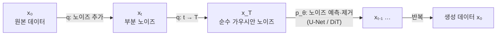

# Diffusion 모델 (Diffusion Model)

---

## I. 노이즈를 걷어내며 생성하는, Diffusion 모델의 개요

### 가. 정의

- 데이터에 **가우시안 노이즈를 단계적으로 더하는 정방향 과정과, 노이즈를 예측해 제거하는 역방향 과정을 학습**해 순수 노이즈에서 새 데이터를 생성하는 생성 모델

### 나. 등장 배경 및 특징

| 구분 | 내용 |
| --- | --- |
| 배경 | [[GAN (Generative Adversarial Network)\|GAN]]의 학습 불안정·모드 붕괴 한계 |
| 안정적 학습 | 단계별 노이즈 예측(회귀) 손실로 학습, 적대적 학습 불필요 |
| 다양성 | 데이터 분포 전체를 덮어 모드 붕괴가 적음 |
| 조건부 생성 | 텍스트 등 조건으로 이미지·영상·오디오·3D 생성 |
| 단점 | 수십~수백 단계의 반복 추론으로 생성이 느림 |

---

## II. 동작 원리 및 핵심 기술

### 가. 개념도

- **정방향**: 고정된 노이즈 스케줄로 원본을 점점 노이즈로 바꾸는 마르코프 과정 (학습 불필요)
- **역방향**: 신경망이 각 단계의 노이즈를 예측해 제거, 순수 노이즈에서 출발해 데이터 생성

### 나. 핵심 기술

| 구분 | 요소 | 설명 |
| --- | --- | --- |
| 이론 | DDPM | 노이즈 예측 손실 $\lVert \epsilon - \epsilon_\theta(x_t, t) \rVert^2$로 학습하는 확산 확률 모델 (2020) |
| | Score 기반 모델 | 데이터 분포의 로그 밀도 기울기(Score)를 추정, SDE로 DDPM과 통합 |
| 신경망 | U-Net·DiT | 노이즈 예측 네트워크, 확장성 좋은 Diffusion Transformer로 이동 |
| 효율화 | 잠재 확산 (LDM) | 오토인코더 잠재 공간에서 확산해 연산 절감 (Stable Diffusion) |
| 조건 제어 | 텍스트 인코더 | CLIP·T5 등으로 프롬프트를 임베딩해 교차 어텐션으로 주입 |
| | CFG | 조건부·무조건부 예측을 섞어 프롬프트 반영 강도 조절 |
| 고속 샘플링 | DDIM | 비마르코프 샘플링으로 단계 수 축소 |
| | 증류·일관성 모델 | LCM, SDXL Turbo 등 1~4단계 생성 |
| 평가 | FID·IS·CLIP Score | 실제 분포와의 거리, 품질·다양성, 텍스트-이미지 일치도 |

---

## III. 비교 및 동향

### 가. Diffusion vs GAN

| 비교 항목 | Diffusion | GAN |
| --- | --- | --- |
| 학습 | 단계별 노이즈 예측 | 생성자-판별자 적대 학습 |
| 안정성 | 높음 | 낮음 (균형 붕괴, 모드 붕괴) |
| 다양성 | 높음 | 상대적으로 낮음 |
| 생성 속도 | 느림 (반복 추론) | 빠름 (1회 순전파) |
| 대표 | Stable Diffusion, DALL·E 3, Imagen, Sora | StyleGAN, CycleGAN |

### 나. 동향

- **DiT 확산**: Stable Diffusion 3, Sora 등 Transformer 기반 확산 모델로 대규모 스케일링
- **영상 생성**: 프레임 간 일관성을 갖춘 텍스트-영상 모델(Sora, Veo 등) 상용화
- **실시간 생성**: 증류·플로우 매칭(Flow Matching)·일관성 모델로 생성 단계 단축
- **악용 대응**: 생성물 [[딥페이크]] 대응을 위한 워터마크·출처 표시 ([[인공지능 생성물 워터마크 적용 기술]])

---

### 🔗 연관 토픽

- **소속 도메인**: [[00_인공지능_MOC|🤖 인공지능]]
- **세부 분류**: `1. 수학 · 통계학 & 데이터 전처리`
- **핵심 연관 토픽**:
  - [[GAN (Generative Adversarial Network)]]
  - [[VAE|VAE(Variational Autoencoder)]]
  - [[Defense GAN]]
  - [[멀티모달 AI|멀티모달(Multimodal) AI]]
  - [[인공지능 생성물 워터마크 적용 기술]]
