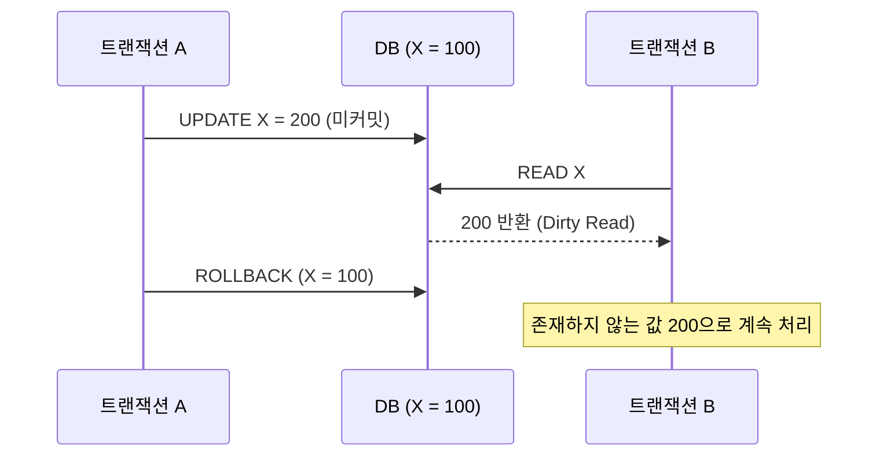

# Dirty Read

---

## I. 커밋 전 데이터 읽기, Dirty Read의 개요

### 가. 정의

- 한 [[트랜잭션]]이 **다른 트랜잭션이 변경했지만 아직 커밋하지 않은 데이터를 읽는 이상 현상**으로, 변경이 롤백되면 존재하지 않았던 값을 사용하게 됨

### 나. 특징

| 구분 | 내용 |
| --- | --- |
| 발생 조건 | 격리 수준 READ UNCOMMITTED |
| 위험 | 롤백된 값으로 후속 연산 수행 → 정합성 훼손 |
| 연쇄 복귀 | 오손 데이터를 읽은 트랜잭션도 함께 철회해야 하는 Cascading Rollback |
| 방지 | READ COMMITTED 이상, 또는 MVCC |

---

## II. 발생 원리 및 방지 기법

### 가. 발생 시나리오

- A의 롤백으로 X는 100으로 돌아갔지만 B는 200을 근거로 처리를 이어감

### 나. 관련 요소

| 구분 | 요소 | 설명 |
| --- | --- | --- |
| 원인 | READ UNCOMMITTED | 공유 잠금 없이, 미커밋 값을 읽도록 허용하는 최저 격리 수준 |
| 결과 | 연쇄 복귀 | 오손 데이터를 읽은 트랜잭션의 연쇄 철회 |
| 방지 (잠금) | 배타 잠금 + 공유 잠금 | 갱신 중 X-Lock을 커밋까지 유지, 읽기는 S-Lock 대기 (Strict [[2PL]]) |
| 방지 (격리) | READ COMMITTED | 커밋된 데이터만 읽음 (Oracle, PostgreSQL, SQL Server 기본값) |
| 방지 (버전) | [[MVCC(다중 버전 동시성 제어) 2가지 유형\|MVCC]] | 미커밋 변경 대신 Undo의 이전 버전을 읽어 대기 없이 방지 |
| 고려 | 동시성 vs 일관성 | 격리 수준을 높일수록 일관성은 높지만 동시성 저하 |

---

## III. 비교 및 동향

### 가. 읽기 이상 현상 비교

| 비교 항목 | Dirty Read | Non-Repeatable Read | [[Phantom Read]] |
| --- | --- | --- | --- |
| 현상 | 미커밋 값 읽기 | 같은 행 재조회 시 값 변경 | 같은 범위 재조회 시 행 수 변경 |
| 원인 연산 | 진행 중인 UPDATE | 커밋된 UPDATE·DELETE | 커밋된 INSERT·DELETE |
| 방지 최소 수준 | READ COMMITTED | REPEATABLE READ | SERIALIZABLE |
| 잠금 대상 | 변경 중 데이터 | 읽은 행 | 조회 범위 (Range·Gap Lock) |

### 나. 동향

- **MVCC 기본화**: 주요 DBMS는 MVCC 기반 READ COMMITTED(Oracle·PostgreSQL) 또는 REPEATABLE READ(MySQL InnoDB)를 기본값으로 사용해 잠금 없이 Dirty Read 차단
- **NOLOCK 주의**: SQL Server의 `WITH (NOLOCK)` 힌트는 Dirty Read를 허용하므로 집계·정산 쿼리에 사용 금지

---

### 🔗 연관 토픽

- **소속 도메인**: [[00_데이터베이스_MOC|🗄️ 데이터베이스]]
- **세부 분류**: `2. 트랜잭션 & 동시성 제어 (Concurrency)`
- **핵심 연관 토픽**:
  - [[Isolation Level (격리 레벨고립성 수준)]]
  - [[Phantom Read]]
  - [[병행 제어]]
  - [[MVCC(다중 버전 동시성 제어) 2가지 유형]]
  - [[트랜잭션]]
